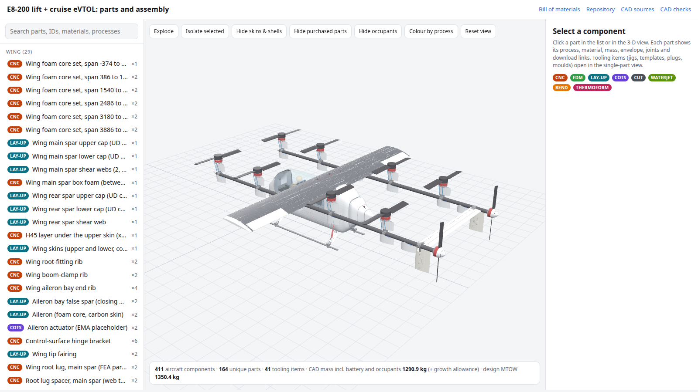

# E8-200 – crewed lift + cruise eVTOL

E8-200 is a full-scale electric VTOL aircraft that carries **200 kg of payload (crew plus cargo) for 20 km**. It is designed for
**the lowest cost and complexity**, and to be built in a small shop with a 3-axis CNC mill and non-metal FDM printers. Every major
part is either bought (COTS), machined, printed or laid up in printed moulds.

**3-D viewer and bill of materials:** <https://rpirayesh.github.io/E8-200-eVTOL/>
([analysis summary](https://rpirayesh.github.io/E8-200-eVTOL/analysis.html),
[BOM](https://rpirayesh.github.io/E8-200-eVTOL/bom.html))

## Frozen design (iteration 3.3)

| Item | Value |
|---|---|
| MTOW / empty / battery | 1,347.8 kg / 823.1 kg / 324.7 kg (5 % growth allowance included) |
| Payload, range | 200 kg, 20 km design (24.1 km capability with a 20 % reserve at 80 % end-of-life battery) |
| Configuration | lift + cruise: 8 lift rotors on two booms, 2 pusher propellers on the boom tails, high wing, H-tail |
| Battery | Molicel P50B 21700 cells, 175s5p x 4 packs (3,500 cells), 63 kWh, 630 V nominal |
| Lift rotors | 8 x 1.85 m E-PROPS 2-blade fixed pitch, EMRAX 268 MV liquid-cooled motors, MGM HBCi 400800 inverters |
| Pushers | 2 x REB 90 motors with 1.75 m E-PROPS, 2,074 rpm, ground-adjustable pitch |
| Wing | 8.0 m span x 1.15 m chord (9.2 m²), LS(1)-0417, ailerons only (no flaps) |
| Cruise | 167 km/h (1.163 x stall speed) |
| Safety | ballistic parachute (Galaxy GRS 6 1200-1390); continued hover with one motor out; one-pack-out operation |
| Cost | USD 381k prototype cash plus about 3,050 shop hours; USD 498k per aircraft at a batch of 10; BOM USD 389k |

The full numbers are in [design/selected_design.json](design/selected_design.json) and
[design/geometry.json](design/geometry.json); CFD, FEA and CAD all build from the latter.

## Repository map

| Folder | Contents |
|---|---|
| [requirements/](requirements/requirements.yaml) | requirements, including the recorded relaxations |
| [resources/](resources/README.md) | every source used, with its link and what it was used for |
| [methods/](methods/README.md) | equations, benchmark aircraft data, initial estimate |
| [sizing/](sizing/README.md), [design/](design/) | sizing and cost optimisation, trade studies, frozen design files |
| [cfd/](cfd/README.md) | OpenFOAM cruise polar, CLmax, pusher-airframe interaction, hover download, grid study |
| [fea/](fea/README.md) | CalculiX/beam structural analysis of members and every machined fitting, flutter, modes |
| [cad/](cad/) | parametric CAD (build123d) of every part, STEP/STL per part, compressed assembly STEP |
| [bom/](bom/), [manufacturing/](manufacturing/) | priced BOM, COTS catalog, process for every part, quotes to request |
| [validation/](validation/README.md) | all verification and validation: per-discipline checks plus an independent re-derivation |
| [docs/](docs/) | the website (viewer, BOM, analysis) |

## How the design got here

| Iteration | MTOW kg | Range km | Cost at N = 10 kUSD | Key change |
|---|---|---|---|---|
| 1 | 1,002 | 50 | 387 | first closure |
| 2 | 1,090 | 20 | – | range set to 20 km; CAD/FEA mass calibration |
| 3 | 1,043 | 20 | 392 | cost-down |
| 3.1 | 1,078 | 20 | 431 | one-pack-out battery sag, 10 % pusher power margin |
| 3.2 | 1,170 | 20 | 442 | CFD aerodynamics; relaxed rules (below); twin REB 60 pushers |
| **3.3** | **1,348** | **20 (24.1)** | **498** | CAD mass calibration, exact battery sag; EMRAX 268 lift motors (published ratings) and REB 90 pushers; CFD-calibrated cruise at 167 km/h |

Iteration 3.2 was the cheapest closure on paper, but it depended on an unpublished REB 60 motor rating and failed once the CAD
masses and the exact battery-sag model were applied. Iteration 3.3 replaces it with motors whose ratings are published, which
is why the aircraft is heavier.

### Requirements relaxed (owner direction: "cheapest, yet reliable")

| Rule | Was | Now |
|---|---|---|
| One-motor-out landing flare | 1.2 g | 1.1 g |
| Cruise speed margin over stall | ≥ 1.3 Vs | ≥ 1.15 Vs |
| Ground footprint | 9.0 m | 10.5 m |
| Minimum cruise speed | 135 km/h | 120 km/h |

**Kept (the reliability core):**
- ultimate factor 1.5 on all loads;
- continued hover with one motor out, with a 10 % control margin;
- cell current ≤ 60 A and bus ≥ 400 V at end of life, including with one pack out;
- 10 % continuous margin on the pushers and ≥ 1 m/s climb;
- 1,000 m ISA+15 hover ceiling;
- 20 % energy reserve at 80 % end of life;
- ballistic parachute;
- flight-controller rotor rpm cap.

## Verification and validation status

- **Sizing:** `validation/sizing/verify_sizing.py`, 105 PASS, 0 FAIL.
- **CFD:**
  - cruise drag within 2 % of sizing at CD0;
  - lift-dependent drag 15 % higher, which is adopted in the sizing;
  - CLmax ≥ 1.71;
  - static margin 0.195; the Cm level does not converge on the mesh, so the design keeps the sizing value 0.098 (independent check 0.101);
  - grid study: GCI 2.8 % on drag.
- **FEA:** every strength margin is positive at ultimate load. Lowest: booms +0.094; fittings from W-FIT-RS +0.14 upward.
- **CAD:** 36 clearance checks pass, 1 warning, 0 fail; the known interferences are fixed; CAD mass is within 1.5 % of sizing.
- **Independent V&V** ([validation/README.md](validation/README.md)), a separate re-derivation of the design from first principles:
  - 71 hand checks pass, 19 are flagged, none fail;
  - in the 33-row V&V matrix, 21 pass, 10 are flagged, 2 are open on vendor ratings, none fail;
  - wherever it disagrees with the design by more than 5 %, the design value is the more conservative one: range 25.3 against 24.1 km, pusher margin +4.4 % against +2.7 %, climb 1.66 against 1.55 m/s.

## Open risks and items before building

1. **Motor quotes:**
   - EMRAX 268 winding for the 525-756 V bus. The MV winding needs an inverter speed limit, and the series is being superseded.
   - EMRAX axial-load limit.
   - EMRAX time limit above the 205 N·m continuous rating: one-motor-out hover needs about 290 N·m, and the datasheet peak is rated for 30 s.
   - REB 90 continuous torque at about 2,000 rpm.

   See [manufacturing/QUOTES_TO_REQUEST.md](manufacturing/QUOTES_TO_REQUEST.md).
2. **Thin margins:**

   | Item | Margin |
   |---|---|
   | Lift-motor hover torque at the 1,000 m ceiling | 1.6 % |
   | Cruise over 1.15 Vs | 1.1 % |
   | Pusher continuous power | 2.7 % |
   | Parachute weight rating | 2.9 % |
3. **Vibration:** the pusher 1P (34.6 Hz) is near the boom modes (35.5–37.6 Hz). A ground vibration test and notch filtering of
   the pusher speed command are required.
4. **Range at the unfavourable end of the CFD uncertainty bands:** 19.0 km in the CFD's own check at 172 km/h. The independent check gets 20.9 km at 167 km/h with the thrust-deduction and wake credit.
5. **Manufacturing:**
   - CH-CRADLE and PB-PLUG need two set-ups on the 150 mm mill;
   - HT-SPAR needs a bonded splice sleeve;
   - 106 part pairs in the assembly could not be interference-checked, because their meshes are not watertight.
6. **Prices:** about two-thirds of the BOM value is estimates or quotes not yet received.

## Tools

OpenFOAM v2412, CalculiX 2.23, gmsh, build123d, NeuralFoil/AeroSandbox, Python 3. How to re-run each step is described in the
README of its folder.
