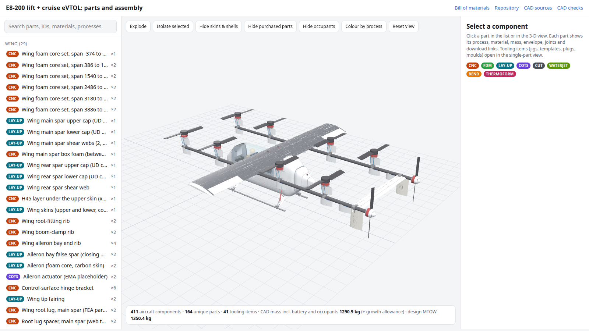

# E8-200 3-D model (work package G)

Parametric build123d model of every part of the E8-200 lift + cruise eVTOL and of the main jigs, templates, plugs and
moulds, generated from the frozen design and the structural sizing. One command rebuilds all files.



## Rebuild

```bash
~/tools/cadenv/bin/python cad/build.py            # ~4 min: parts, exports, assembly, mass/CG and clearance audit
~/tools/cadenv/bin/python cad/audit.py            # interference scan from the exported GLBs (run separately, memory-capped)
~/tools/cadenv/bin/python cad/build.py --no-step-assembly --no-audit   # quick iteration
~/tools/cadenv/bin/python cad/build.py --only W-SKIN,PY-C              # selected parts (no assembly/audit totals)
```

Viewer: `cd docs && python -m http.server` and open `http://localhost:8000/` (three.js, local vendor copy; explode, isolate,
hide skins/shells, hide purchased parts, colour by process, searchable part list, single-part view, download links).

## Inputs (nothing aircraft-specific is typed into the code)

| file | used for |
|---|---|
| `design/geometry.json` | every station, position and envelope: wing planform/airfoil/incidence/spar stations/root-fitting span/ailerons, fuselage super-ellipse stations, booms and attach stations, rotor hubs/diameter/blade data, pusher, H-tail and ventral fins, skid gear OML, battery boxes, seats/SRP/occupants, cargo bay, parachute canister/fire direction/attach points, design mass items |
| `design/selected_design.json` | mass breakdown, rotor/pusher data, battery series/parallel, loading cases (audit reference) |
| `fea/results/sizing_update.json` (WP F) | spar caps/webs by span station, wing skin, boom over-wrap segments (UD + +/-45), pylon tube 100 x 1.6 mm, tail spar, gear legs. Used when present; otherwise the geometry.json sections |
| `fea/parts.py` (WP F parts P1-P6) | fitting dimensions copied into `e8cad/config.py: FEA_FIT` so the FEA can be re-run on the CAD STEP files: wing-root lug P1, boom saddle P2, motor plate P3, gear saddle P4, parachute hard point P5, seat fitting P6 |
| `bom/catalog.json` | COTS masses and dimensions (REB 60 / REB 90 diameters and masses, HBCi inverter mass, P50B cell mass, tube stock ID/length, PC sheet thickness, Veronte mass, GRS 6 mass) |
| `fea/materials.json` | densities of every structural material key; `e8cad/config.py: EXTRA_DENSITY` adds non-structural/tooling materials (XPS core foam 32, EPS tooling foam 30, MDF 750, plywood 680, PC 1200, CONFOR 93, G10 1850, UHMW 940 kg/m3) |
| `validation/cfd/reference/ls417_coordinates_TND7428.dat` | wing section (same file CFD and sizing use) |

Detail features (wall thicknesses of fairings, gaps, bolt sizes not set by WP F, motor axial lengths, inverter envelope)
are listed in `e8cad/config.py: DETAIL`; shop limits in `SHOP`.

**Shop limits assumed** (not given in the requirements; change `SHOP` and rebuild to re-split): 3-axis router bed
2440 x 1220 mm with 250 mm usable cutting depth, aluminium envelope 1000 x 600 x 150 mm (or job shop), FDM 250 mm cube,
hot-wire bow 1300 mm, carbon tube stock 2438 mm (96 in). Every part records the machine envelope check in
`parts.json -> machine_fit`; parts that exceed a machine are split automatically (plugs, moulds, canopy plug, seat plug,
cap jigs) or carry a stated joint (`joints`).

## Outputs

| path | content |
|---|---|
| `cad/parts/<ID>/<ID>.step`, `.stl` | every made part and tooling item (mm, bounding box at the origin). COTS placeholders have no files. STL tolerance per part in `parts.json -> files.stl_tolerance_mm` (coarser for foam cores and plugs, 0.2-1.0 mm) |
| `cad/assembly/E8-200_assembly.step.xz` | aircraft assembly, xz-compressed for the repository (the raw `.step`, about 90 MB, is rebuilt locally and git-ignored; unpack with `xz -dk`). Assembly in the aircraft frame (x aft of the nose, y right, z up from the skid bottom, mm). Cell modules appear as envelopes (the cells are in `BAT-MOD*.step`); tooling is not in the assembly |
| `cad/parts.json` = `docs/data/parts.json` | per part: ID, name, group, process, material + material keys, qty, mass each and its source, mass group (selected_design breakdown key), envelope, notes, joints, machine check, settings, files, viewer colour, instance matrices (a mirror placement has a negative determinant) |
| `cad/mass_properties.json` | CAD mass and CG by group |
| `docs/models/<ID>.glb`, `docs/models/E8-200_assembly.glb` | viewer meshes (the assembly instances the part meshes) |
| `validation/cad/` | mass/CG audit, clearance checks, interference scan (see its README) |

## Code

| module | parts |
|---|---|
| `e8cad/config.py` | inputs, shop limits, materials, Part record, wing frame (LE origin, rotated by the incidence about the LE as in `cfd/tools/oml.py`), fuselage OML functions |
| `e8cad/geom.py` | profile/prism/loft/tube helpers (from the subscale library) and the P5 hard-point generator |
| `e8cad/wing.py` | foam cores (split at ribs and to the hot-wire bow), spar caps/webs/box foam, skins, ribs, false spar, ailerons, hinges, actuators, tip fairings, P1 root lugs + spacers, fuselage clevises, pins, parachute front hard points |
| `e8cad/booms.py` | boom tube pieces (splice stations chosen automatically clear of all clamps), sleeves, WP F over-wrap segments and clamp bands, end caps, P2 saddles (rear slotted), 8 identical rotor stations (saddle with pylon socket, pylon tube, pylon head with the P3 stub, elastomeric isolators, P3 motor plate, motor, inverter, nacelle, rotors CW/CCW), cooling pack/fairing/lines, boom HV runs |
| `e8cad/tail.py` | H-stabiliser, elevator, HT spar, tail clamps, ventral fins, rudders, fin spars, hinges, actuators |
| `e8cad/fuselage.py` | OML shell panels, hatches, canopy, door glazing, window, canopy frame/hinges/latches, pusher cowl, cabin sandwich structure (floor, side panels, 8 bulkheads, aft keel) with tab/slot and half-lap joints, wing-root fairing |
| `e8cad/gear.py` | skids, pivoting legs with end fittings, pins and keel pivot saddles, oleo dampers with collars and upper fittings, skid clamps, wear shoes, leg fairings |
| `e8cad/systems.py` | battery boxes/lids/cold plates/cell tiers/BMS/contactors/mounts/vents, twin boom-tail pusher units (boom-end fitting PB-PLUG, motor, CW/CCW props, spinners, inverters and pods), parachute, seats (P6 fittings), occupants, instrument panel, avionics, LV electrical, inceptors, HV runs |
| `e8cad/tooling.py` | cap jigs, hot-wire templates, wing cradles, fuselage/canopy/seat/tip plugs, nacelle moulds, drill templates, V-blocks, gear-leg bend template |
| `build.py`, `audit.py` | exports and checks |

## Design state built

The model is built from the iteration-3.2 frozen design T8 (`design/geometry.json`, `design/selected_design.json`:
MTOW 1,169.5 kg; 9.0 x 1.40 m wing at z 1.985 m and 4.0 deg incidence with split plain flaps, spars at 0.20/0.70 c, root
fittings at y = 0.38 m inside the shoulder fairing of the OML; 9.31 m booms at y = +/-1.56 m, z 1.775 m; 8 x REB 60
with 1.90 m rotors on 0.56 m faired pylons; **twin boom-tail pushers** (REB 60 + HBCi on a bonded boom-end fitting,
2.05 m counter-rotating 2-blade props behind the tail, inverters in under-boom pods); closed tail cone; five 175s3p
packs under the cabin floor; NACA 0014 H-tail of 0.58 m chord; GRS 6 990-1190 parachute) with the weight reductions of
`design/mass_calibration.json` and the WP F (FEA) sections and fitting dimensions. Rebuilding after a new design
freeze is one command; nothing aircraft-specific is typed into the code.

## Changes adopted from WP F (FEA) and design/mass_calibration.json

1. Sections from `fea/results/sizing_update.json`: spar caps and webs by span station, 0.5 mm wing skin, boom
   over-wrap segments (UD + +/-45; the high-moment segment is extended over the L2/L3 clamps and all clamps share one
   bore through clamp bands), pylon tube 100 x 1.6 mm, tail spar, gear legs 76 x 2.0 mm (minimum gauge).
2. Fittings P1-P6 at the dimensions of `fea/parts.py`. Adapters keep the FEA geometry unchanged: the P1 root lug sits on
   a 6061 spacer (W-FIT-MP/RP) so the lug clears the lower spar cap; the P5 hard points sit on 6061 angles with the plate
   in the riser plane. **WP F phase 3/3.1:** 14 mm eye boss on both root lugs (W-FIT-MS, W-FIT-RS; clevises and pins follow); main clevis
   F-CLV-MS in 7075-T6; damper upper fitting LG-DUP with 12 mm cheeks; parachute cradle CH-CRADLE as one body (posts run
   into the clamp ring, no lightening holes within 70 mm of the posts, 24 x 24 mm posts with Z = 2,304 mm3 >= 1,310);
   H-tail NACA 0014 (design 3.1) with a 50 x 2.48 mm spar (FEA phase 3.1, `e8cad/config.py: FEA_31`).
3. **Damped, pivoting skid gear (WP F phase 3).** Four separate legs (LG-LEG, one bend) pivot on 20 mm pins (LG-PIN) in
   keel pivot saddles (LG-SADDLE, P4 pad and bolt pattern) through leg end fittings (LG-LEGEND); four oleo dampers
   (LG-DAMP, 80 mm stroke, end points from `geometry.json`) between a leg collar (LG-DCL) and a side-panel hard point
   (LG-DUP) carry the vertical load. There is no continuous clamped cross tube any more.
4. Rear boom saddles (BC-WR) have 16 mm fore-aft slotted holes.
5. Eight 0.55 m rotor pylons (PY-TUBE in the PY-C saddle socket, PY-HEAD with the P3 stub), faired per the design mast
   thickness/chord (NAC). The HBCi inverter does not fit the 116 mm fairing: it hangs in an under-boom pod (INV-POD).
6. Elastomeric isolators (MP-ISO, 6 per station) between the pylon head and the P3 motor plate.
7. Weight reductions: wing cores with hot-wire spanwise voids (30 mm of foam under each skin, solid around the spars and
   aft of the rear spar; the ribs close the bays), main-spar box foam H45, a 15 mm H45 layer under the upper skin over
   x/c 0.08-0.73 for |y| <= 2.94 m (W-H45-U, WP F phase 3.1; pieces between the ribs, cut back in the flap/aileron bays), pocketed motor plate (-48 %), pylon head (-26 %), skid clamps
   (-31 %), tail clamps (-36 %), lighter parachute cradle (-47 %, posts kept at Z >= 1,310 mm3). The pylon saddle PY-C
   stays at -11 % (WP F phase 3). The achieved fractions are tabulated in `validation/cad/mass_cg_audit.md`.

## What was simplified

- COTS items (motors, rotors, inverters, BMS, contactors, avionics, dampers, harness, parachute) are envelopes with
  catalog or budget masses; motor axial lengths and inverter envelopes are assumed (catalog gives diameters only).
- HV harness, coolant lines and LV wiring are single conduits; the HV budget is shared over the runs by volume.
- Laminates are solids of the laminate thickness; flat sandwich panels use the effective density of 2 x 0.5 mm carbon on
  10 mm H80; foam cores carry no ply drop-offs; bolts other than the wing pins are holes only.
- A separate wing-root fairing (F-WRF) is generated only if the root fittings fall outside the OML (not the case in iteration 3: the OML shoulder fairing covers them).
- Cell modules contain every cylinder in the part STEP; the assembly STEP and the interference fallback use module envelopes.
- Rotors are shown stopped at 0 deg azimuth with constant-chord, constant-pitch blades.
- Fuselage plug sections are the shell inner surface split to the router; no draft, flanges or index pins are modelled.
- Large foam/plug STL files are tessellated at up to 1 mm chordal tolerance to keep the repository small.

<!-- PART TREE START -->

## Part tree (generated by build.py)

### Wing (29 unique, 54 pieces)

| ID | name | process | material | qty | kg each | envelope mm | machine |
|---|---|---|---|---|---|---|---|
| W-CORE-1 | Wing foam core set, span -374 to 374 mm | CNC | xps_foam (hot-wire cut) | 1 | 1.564 | 1149 x 749 x 180 | hot-wire bow: fits |
| W-CORE-2 | Wing foam core set, span 386 to 1530 mm | CNC | xps_foam (hot-wire cut) | 2 | 2.461 | 1149 x 1144 x 180 | hot-wire bow: fits |
| W-CORE-3 | Wing foam core set, span 1540 to 2474 mm | CNC | xps_foam (hot-wire cut) | 2 | 2.045 | 1149 x 934 x 180 | hot-wire bow: fits |
| W-CORE-4 | Wing foam core set, span 2486 to 3180 mm (aileron bay) | CNC | xps_foam (hot-wire cut) | 2 | 1.239 | 830 x 694 x 195 | hot-wire bow: fits |
| W-CORE-5 | Wing foam core set, span 3180 to 3874 mm (aileron bay) | CNC | xps_foam (hot-wire cut) | 2 | 1.379 | 830 x 694 x 195 | hot-wire bow: fits |
| W-CORE-6 | Wing foam core set, span 3886 to 3920 mm | CNC | xps_foam (hot-wire cut) | 2 | 0.088 | 1149 x 34 x 195 | hot-wire bow: fits |
| W-SPM-CU | Wing main spar upper cap (UD carbon, continuous tip to tip) | composite-layup | cf_ud_wet | 1 | 2.750 | 80 x 7840 x 17 | none (lay-up / bought) (joints) |
| W-SPM-CL | Wing main spar lower cap (UD carbon, continuous tip to tip) | composite-layup | cf_ud_wet | 1 | 2.750 | 80 x 7840 x 13 | none (lay-up / bought) (joints) |
| W-SPM-W | Wing main spar shear webs (2, box spar) | composite-layup | cf_fabric_wet | 1 | 2.858 | 50 x 7840 x 176 | none (lay-up / bought) (joints) |
| W-SPM-F | Wing main spar box foam (between the webs) | CNC | pvc_h45 | 1 | 2.981 | 48 x 7840 x 176 | none (lay-up / bought) (joints) |
| W-SPR-CU | Wing rear spar upper cap (UD carbon, continuous tip to tip) | composite-layup | cf_ud_wet | 1 | 0.905 | 50 x 7840 x 14 | none (lay-up / bought) (joints) |
| W-SPR-CL | Wing rear spar lower cap (UD carbon, continuous tip to tip) | composite-layup | cf_ud_wet | 1 | 0.905 | 50 x 7840 x 12 | none (lay-up / bought) (joints) |
| W-SPR-W | Wing rear spar shear web | composite-layup | cf_fabric_wet | 1 | 3.117 | 5 x 7840 x 124 | none (lay-up / bought) (joints) |
| W-H45-U | H45 layer under the upper skin (x/c 0.085-0.735, |y| <= 2.90 m) | CNC | pvc_h45 | 1 | 2.963 | 748 x 5796 x 57 | none (lay-up / bought) (joints) |
| W-SKIN | Wing skins (upper and lower, continuous tip to tip) | composite-layup | cf_fabric_wet | 1 | 12.236 | 1150 x 7840 x 196 | none (lay-up / bought) (joints) |
| W-RIB-R | Wing root-fitting rib | CNC | sandwich cf_fabric_wet 2 x 0.5 mm on pvc_h80 10.0 mm | 2 | 0.300 | 1149 x 11 x 195 | cnc: fits |
| W-RIB-B | Wing boom-clamp rib | CNC | sandwich cf_fabric_wet 2 x 0.5 mm on pvc_h80 10.0 mm | 2 | 0.320 | 1149 x 11 x 195 | cnc: fits |
| W-RIB-A | Wing aileron bay end rib | CNC | sandwich cf_fabric_wet 2 x 0.5 mm on pvc_h80 10.0 mm | 4 | 0.322 | 1149 x 11 x 195 | cnc: fits |
| W-FS-AIL | Aileron bay false spar (closing web) | composite-layup | cf_fabric_wet | 2 | 0.232 | 1 x 1389 x 115 | none (lay-up / bought) |
| W-AIL | Aileron (foam core, carbon skin) | composite-layup | cf_fabric_wet skin on xps_foam core | 2 | 1.675 | 316 x 1383 x 115 | none (lay-up / bought) |
| W-AIL-ACT | Aileron actuator (EMA placeholder) | COTS | purchased | 2 | 1.000 | 80 x 200 x 50 | none (lay-up / bought) |
| W-HINGE | Control-surface hinge bracket | CNC | al6061_t6_sheet | 6 | 0.072 | 112 x 6 x 40 | cnc_metal: fits |
| W-TIP | Wing tip fairing | composite-layup | eglass_fabric_wet | 2 | 0.599 | 1150 x 80 x 196 | none (lay-up / bought) |
| W-FIT-MS | Wing root lug, main spar (FEA part P1) | CNC | al7075_t6_sheet | 2 | 1.198 | 18 x 170 x 189 | cnc_metal: fits |
| W-FIT-MP | Root lug spacer, main spar (web to cap edge) | CNC | al6061_t6_extr | 2 | 0.787 | 16 x 170 x 113 | cnc_metal: fits |
| W-PIN-M | Wing attach pin, main spar (3/4 in close-tolerance bolt) | COTS | steel_an_bolt | 2 | 0.134 | 60 x 19 x 19 | none (lay-up / bought) |
| W-FIT-RS | Wing root lug, rear spar (FEA part P1) | CNC | al7075_t6_sheet | 2 | 0.795 | 14 x 170 x 185 | cnc_metal: fits |
| W-FIT-RP | Root lug spacer, rear spar (web to cap edge) | CNC | al6061_t6_extr | 2 | 1.225 | 23 x 170 x 118 | cnc_metal: fits |
| W-PIN-R | Wing attach pin, rear spar (3/4 in close-tolerance bolt) | COTS | steel_an_bolt | 2 | 0.125 | 56 x 19 x 19 | none (lay-up / bought) |

### Fuselage (20 unique, 26 pieces)

| ID | name | process | material | qty | kg each | envelope mm | machine |
|---|---|---|---|---|---|---|---|
| F-CLV-MS | Fuselage wing-attach clevis, main spar | CNC | al7075_t6_sheet | 2 | 2.805 | 124 x 74 x 258 | cnc_metal: fits |
| F-CLV-RS | Fuselage wing-attach clevis, rear spar | CNC | al7075_t6_sheet | 2 | 2.596 | 120 x 70 x 256 | cnc_metal: fits |
| SH-NOSE | Fuselage nose shell | composite-layup | eglass_fabric_wet | 1 | 3.127 | 600 x 898 x 1389 | none (lay-up / bought) (joints) |
| SH-CAB | Cabin lower shell | composite-layup | eglass_fabric_wet | 1 | 7.944 | 2408 x 928 x 777 | none (lay-up / bought) (joints) |
| SH-MID | Cabin upper shell / window frames under the wing | composite-layup | eglass_fabric_wet | 1 | 0.578 | 704 x 928 x 706 | none (lay-up / bought) (joints) |
| SH-AFT | Aft fuselage shell | composite-layup | eglass_fabric_wet | 1 | 6.496 | 1292 x 931 x 1532 | none (lay-up / bought) (joints) |
| SH-TAIL | Tail cone shell | composite-layup | eglass_fabric_wet | 1 | 0.609 | 400 x 317 x 396 | none (lay-up / bought) (joints) |
| HATCH-AV | Avionics bay hatch (nose top) | composite-layup | eglass_fabric_wet | 1 | 0.240 | 400 x 340 x 442 | none (lay-up / bought) |
| HATCH-CH | Parachute frangible hatch | composite-layup | eglass_fabric_wet | 1 | 0.331 | 430 x 420 x 260 | none (lay-up / bought) |
| HATCH-SVC | Aft fuselage service door (left) | composite-layup | eglass_fabric_wet | 1 | 0.393 | 485 x 97 x 450 | none (lay-up / bought) |
| HATCH-BATA | Battery access panel A (belly) | composite-layup | eglass_fabric_wet | 1 | 0.461 | 441 x 560 x 29 | none (lay-up / bought) |
| HATCH-BATB | Battery access panel B (belly) | composite-layup | eglass_fabric_wet | 1 | 0.462 | 441 x 560 x 29 | none (lay-up / bought) |
| HATCH-BATC | Battery access panel C (belly) | composite-layup | eglass_fabric_wet | 1 | 0.462 | 441 x 560 x 30 | none (lay-up / bought) |
| HATCH-BATD | Battery access panel D (belly) | composite-layup | eglass_fabric_wet | 1 | 0.462 | 441 x 560 x 30 | none (lay-up / bought) |
| CAN-F | Front canopy (pilot), hinged right | outsourced-thermoform | polycarbonate | 1 | 14.974 | 1705 x 920 x 751 | none (lay-up / bought) |
| CAN-R | Passenger door glazing (right), hinged right | outsourced-thermoform | polycarbonate | 1 | 1.395 | 488 x 116 x 689 | none (lay-up / bought) |
| WIN-L | Passenger window (left, fixed) | outsourced-waterjet | polycarbonate | 1 | 1.395 | 488 x 116 x 689 | none (lay-up / bought) |
| CAN-FRM | Front canopy frame | composite-layup | cf_fabric_wet | 1 | 3.242 | 1745 x 916 x 755 | none (lay-up / bought) |
| CAN-HINGE | Canopy / door hinge | CNC | al6061_t6_sheet | 4 | 0.205 | 80 x 20 x 50 | cnc_metal: fits |
| CAN-LATCH | Canopy / door latch (COTS) | COTS | purchased | 2 | 0.250 | 60 x 24 x 40 | none (lay-up / bought) |

### Systems (13 unique, 20 pieces)

| ID | name | process | material | qty | kg each | envelope mm | machine |
|---|---|---|---|---|---|---|---|
| W-CHUTE-FIT | Parachute front riser hard point (FEA part P5) | CNC | steel_4130_n | 2 | 1.409 | 120 x 15 x 142 | cnc_metal: fits |
| W-CHUTE-ANG | Parachute front hard-point angle (to the main spar aft web) | CNC | al6061_t6_extr | 2 | 0.200 | 137 x 54 x 70 | cnc_metal: fits |
| HV-BOOM | HV harness run inside the boom (simplified conduit) | COTS | purchased | 2 | 5.454 | 8300 x 28 x 28 | none (lay-up / bought) |
| COOL-LINE | Coolant line inside the boom (simplified) | COTS | purchased | 2 | 1.501 | 7020 x 16 x 16 | none (lay-up / bought) |
| COOL-PK | Cooling pack: radiator, pump, reservoir (placeholder) | COTS | purchased | 2 | 4.877 | 446 x 140 x 160 | none (lay-up / bought) |
| COOL-FAIR | Cooling pack fairing with inlet | composite-layup | eglass_fabric_wet | 2 | 0.596 | 454 x 156 x 239 | none (lay-up / bought) |
| CHUTE | Ballistic parachute CHUTE-GRS1390 canister (placeholder) | COTS | purchased (CHUTE-GRS1390) | 1 | 28.900 | 456 x 320 x 573 | none (lay-up / bought) |
| CH-CRADLE | Parachute canister cradle | CNC | al6061_t6_extr | 1 | 5.258 | 634 x 336 x 238 | cnc_metal: split (joints) |
| CH-ATT-R | Parachute rear riser hard point (FEA part P5) | CNC | steel_4130_n | 1 | 1.409 | 120 x 15 x 142 | cnc_metal: fits |
| CH-ANG-R | Parachute rear hard-point angle (to BH-6) | CNC | al6061_t6_extr | 1 | 0.187 | 126 x 54 x 70 | cnc_metal: fits |
| CH-RISER | Parachute risers (3, simplified) | COTS | nylon_strap | 1 | 0.000 | 1690 x 612 x 616 | none (lay-up / bought) |
| HV-WING | HV harness run in the wing (behind the rear spar) | COTS | purchased | 1 | 2.383 | 28 x 3070 x 28 | none (lay-up / bought) |
| HV-RISER | HV riser, battery bay to wing root (one per pack bus) | COTS | purchased | 2 | 0.993 | 48 x 24 x 1230 | none (lay-up / bought) |

### Booms (13 unique, 32 pieces)

| ID | name | process | material | qty | kg each | envelope mm | machine |
|---|---|---|---|---|---|---|---|
| BM-T1 | Boom tube piece 1 (2400 mm) | COTS-cut | cf_tube_rollwrapped_twill (MAT-TUBE-DP-4x96) | 2 | 1.930 | 2400 x 105 x 105 | none (lay-up / bought) (joints) |
| BM-T2 | Boom tube piece 2 (1950 mm) | COTS-cut | cf_tube_rollwrapped_twill (MAT-TUBE-DP-4x96) | 2 | 1.568 | 1950 x 105 x 105 | none (lay-up / bought) (joints) |
| BM-T3 | Boom tube piece 3 (2000 mm) | COTS-cut | cf_tube_rollwrapped_twill (MAT-TUBE-DP-4x96) | 2 | 1.608 | 2000 x 105 x 105 | none (lay-up / bought) (joints) |
| BM-T4 | Boom tube piece 4 (2400 mm) | COTS-cut | cf_tube_rollwrapped_twill (MAT-TUBE-DP-4x96) | 2 | 1.929 | 2400 x 105 x 105 | none (lay-up / bought) (joints) |
| BM-SLV | Boom internal splice sleeve | composite-layup | cf_fabric_wet | 6 | 0.338 | 300 x 101 x 101 | none (lay-up / bought) |
| BM-WRAP1 | Boom over-wrap segment 1 (x -1100 to 905 mm) | composite-layup | cf_ud_wet + cf_fabric_wet (+/-45) | 2 | 2.290 | 2005 x 109 x 109 | none (lay-up / bought) |
| BM-WRAP2 | Boom over-wrap segment 2 (x 905 to 4215 mm) | composite-layup | cf_ud_wet + cf_fabric_wet (+/-45) | 2 | 15.467 | 3310 x 122 x 122 | none (lay-up / bought) |
| BM-WRAP3 | Boom over-wrap segment 3 (x 4215 to 7650 mm) | composite-layup | cf_ud_wet + cf_fabric_wet (+/-45) | 2 | 9.993 | 3434 x 116 x 116 | none (lay-up / bought) |
| BM-BAND1 | Boom clamp band to the 122.3 mm clamp OD (on 109.4 mm) | composite-layup | cf_ud_wet | 2 | 0.530 | 150 x 122 x 122 | none (lay-up / bought) |
| BM-BAND2 | Boom clamp band to the 122.3 mm clamp OD (on 116.0 mm) | composite-layup | cf_ud_wet | 4 | 0.265 | 150 x 122 x 122 | none (lay-up / bought) |
| BM-CAP-F | Boom front cap (with nav-light pocket) | FDM | asa | 2 | 0.266 | 180 x 105 x 105 | fdm: fits |
| BC-W | Boom-to-wing saddle clamp, front (main spar) | CNC | al6061_t6_extr | 2 | 2.518 | 110 x 150 x 162 | cnc_metal: fits |
| BC-WR | Boom-to-wing saddle clamp, rear (rear spar), slotted holes | CNC | al6061_t6_extr | 2 | 2.472 | 110 x 150 x 162 | cnc_metal: fits |

### Rotor stations (13 unique, 96 pieces)

| ID | name | process | material | qty | kg each | envelope mm | machine |
|---|---|---|---|---|---|---|---|
| PY-C | Pylon boom saddle with pylon socket | CNC | al6061_t6_extr | 8 | 2.742 | 116 x 150 x 222 | cnc_metal: fits |
| PY-TUBE | Rotor pylon tube 100 x 1.6 mm | COTS-cut | al6061_t6_extr | 8 | 0.387 | 100 x 100 x 290 | none (lay-up / bought) |
| PY-HEAD | Pylon head (P3 stub + isolator flange) | CNC | al6061_t6_extr | 8 | 0.682 | 240 x 236 x 38 | cnc_metal: fits |
| MP-ISO | Motor-plate elastomeric isolators (6 per station) | COTS | purchased (elastomer sandwich mount) | 8 | 0.360 | 220 x 248 x 25 | none (lay-up / bought) |
| MP | Motor plate (FEA part P3) | CNC | al6061_t6_extr | 8 | 0.830 | 269 x 280 x 10 | cnc_metal: fits |
| MP-EMX | EMRAX face-mount adapter ring | CNC | al6061_t6_extr | 8 | 0.584 | 220 x 220 x 12 | cnc_metal: fits |
| COOL-MOT | Motor coolant hoses (supply/return, per station) | COTS | purchased | 8 | 0.281 | 136 x 101 x 388 | none (lay-up / bought) |
| MOT-L | Lift motor EMRAX 268 MV (axial flux) (placeholder) | COTS | purchased (MOT-EMRAX268) | 8 | 21.900 | 305 x 268 x 91 | none (lay-up / bought) |
| INV-L | Lift inverter MGM HBCi 400800 (placeholder) | COTS | purchased (INV-HBCI400800) | 8 | 4.000 | 230 x 90 x 180 | none (lay-up / bought) |
| INV-POD | Inverter pod fairing (under the boom) | composite-layup | eglass_fabric_wet | 8 | 0.693 | 460 x 147 x 265 | none (lay-up / bought) |
| NAC | Pylon fairing (116 x 400 mm) | composite-layup | eglass_fabric_wet | 8 | 0.610 | 400 x 116 x 262 | none (lay-up / bought) (joints) |
| ROT-CCW | Lift rotor CCW (E-PROPS ground-adjustable, placeholder) | COTS | purchased (PROP-EPROPS-UAV-ADJ) | 4 | 3.951 | 301 x 1850 x 140 | none (lay-up / bought) |
| ROT-CW | Lift rotor CW (E-PROPS ground-adjustable, placeholder) | COTS | purchased (PROP-EPROPS-UAV-ADJ) | 4 | 3.951 | 301 x 1850 x 140 | none (lay-up / bought) |

### Tail (9 unique, 22 pieces)

| ID | name | process | material | qty | kg each | envelope mm | machine |
|---|---|---|---|---|---|---|---|
| HT | Horizontal stabiliser (foam core, carbon skin) | composite-layup | cf_fabric_wet skin on xps_foam core | 1 | 2.118 | 242 x 2942 x 53 | none (lay-up / bought) (joints) |
| ELEV | Elevator (one piece) | composite-layup | cf_fabric_wet skin on xps_foam core | 1 | 0.983 | 129 x 2942 x 36 | none (lay-up / bought) |
| HT-SPAR | Horizontal-tail spar tube | COTS-cut | cf_tube_rollwrapped_twill | 1 | 3.133 | 50 x 2944 x 50 | none (lay-up / bought) (joints) |
| TL-CLAMP | Tail clamp (boom, HT-spar socket, fin-spar socket) | CNC | al6061_t6_extr | 2 | 2.250 | 110 x 243 x 245 | cnc_metal: fits |
| VF | Ventral fin (fixed part) | composite-layup | cf_fabric_wet skin on xps_foam core | 2 | 0.609 | 292 x 54 x 673 | none (lay-up / bought) |
| RUD | Rudder | composite-layup | cf_fabric_wet skin on xps_foam core | 2 | 0.275 | 156 x 37 x 670 | none (lay-up / bought) |
| VF-SPAR | Fin spar tube | COTS-cut | cf_tube_rollwrapped_twill | 2 | 0.242 | 40 x 40 x 654 | none (lay-up / bought) |
| TL-HINGE | Tail hinge bracket | CNC | al6061_t6_sheet | 8 | 0.029 | 50 x 6 x 36 | cnc_metal: fits |
| TL-ACT | Tail surface actuator (EMA placeholder) | COTS | purchased | 3 | 0.800 | 220 x 44 x 36 | none (lay-up / bought) |

### Cabin structure (19 unique, 22 pieces)

| ID | name | process | material | qty | kg each | envelope mm | machine |
|---|---|---|---|---|---|---|---|
| FLOOR-F | Cabin floor, front piece | CNC | sandwich cf_fabric_wet 2 x 0.5 mm on pvc_h80 10.0 mm | 1 | 2.223 | 1496 x 682 x 11 | cnc: fits (joints) |
| FLOOR-A | Cabin floor, aft piece | CNC | sandwich cf_fabric_wet 2 x 0.5 mm on pvc_h80 10.0 mm | 1 | 1.622 | 1091 x 682 x 11 | cnc: fits (joints) |
| FLOOR-DBL | Cabin floor splice doubler | composite-layup | cf_fabric_wet | 1 | 0.104 | 120 x 660 x 1 | none (lay-up / bought) |
| SIDE-F | Cabin side panel (wing-post panel), front piece | CNC | sandwich cf_fabric_wet 2 x 0.5 mm on pvc_h80 10.0 mm | 2 | 2.645 | 1945 x 11 x 1220 | cnc: fits (joints) |
| SIDE-A | Cabin side panel (wing-post panel), aft piece | CNC | sandwich cf_fabric_wet 2 x 0.5 mm on pvc_h80 10.0 mm | 2 | 1.486 | 825 x 11 x 1220 | cnc: fits (joints) |
| SIDE-DBL | Cabin side panel (wing-post panel) splice doubler | composite-layup | cf_fabric_wet | 2 | 0.187 | 120 x 1 x 1220 | none (lay-up / bought) |
| BH-0 | Nose bulkhead (avionics bay front, crush-zone back-up) at x = 160 mm | CNC | sandwich cf_fabric_wet 2 x 0.5 mm on pvc_h80 10.0 mm | 1 | 0.846 | 11 x 620 x 670 | cnc: fits |
| BH-1 | Forward cabin bulkhead (rudder-pedal / footwell bulkhead) at x = 430 mm | CNC | sandwich cf_fabric_wet 2 x 0.5 mm on pvc_h80 10.0 mm | 1 | 0.656 | 11 x 825 x 523 | cnc: fits |
| BH-2 | Under-floor bulkhead between the battery packs at x = 1431 mm | CNC | sandwich cf_fabric_wet 2 x 0.5 mm on pvc_h80 10.0 mm | 1 | 0.403 | 11 x 865 x 246 | cnc: fits |
| BH-2B | Under-floor bulkhead between the battery packs at x = 1932 mm | CNC | sandwich cf_fabric_wet 2 x 0.5 mm on pvc_h80 10.0 mm | 1 | 0.403 | 11 x 865 x 245 | cnc: fits |
| BH-2C | Under-floor bulkhead between the battery packs at x = 2432 mm | CNC | sandwich cf_fabric_wet 2 x 0.5 mm on pvc_h80 10.0 mm | 1 | 0.401 | 11 x 863 x 245 | cnc: fits |
| BH-7 | Tail-cone frame at x = 4300 mm | CNC | sandwich cf_fabric_wet 2 x 0.5 mm on pvc_h80 10.0 mm | 1 | 0.234 | 11 x 317 x 393 | cnc: fits |
| BH-3 | Aft cabin bulkhead (behind the passenger seat; harness and cargo tie-down back-up) at x = 3028 mm | CNC | sandwich cf_fabric_wet 2 x 0.5 mm on pvc_h80 10.0 mm | 1 | 2.298 | 11 x 917 x 1469 | cnc: fits |
| BH-4 | Gear / parachute forward frame at x = 3173 mm | CNC | sandwich cf_fabric_wet 2 x 0.5 mm on pvc_h80 10.0 mm | 1 | 0.523 | 11 x 917 x 1535 | cnc: fits |
| BH-5 | Parachute aft frame at x = 3818 mm | CNC | sandwich cf_fabric_wet 2 x 0.5 mm on pvc_h80 10.0 mm | 1 | 0.391 | 11 x 681 x 1004 | cnc: fits |
| BH-6 | Parachute rear riser frame at x = 4100 mm | CNC | sandwich cf_fabric_wet 2 x 0.5 mm on pvc_h80 10.0 mm | 1 | 0.238 | 11 x 475 x 597 | cnc: fits |
| AF-KEEL | Aft fuselage keel panel | CNC | sandwich cf_fabric_wet 2 x 0.75 mm on pvc_h80 10.0 mm | 1 | 1.145 | 1124 x 11 x 536 | cnc: fits |
| AF-KEEL-CAP | Aft keel caps (UD carbon, top and bottom edges) | composite-layup | cf_ud_wet | 1 | 0.637 | 1132 x 40 x 544 | none (lay-up / bought) |
| NOSE-EA | Nose crush block (energy absorber) | CNC | pvc_h80 | 1 | 0.460 | 230 x 300 x 154 | cnc: fits (joints) |

### Landing gear (11 unique, 42 pieces)

| ID | name | process | material | qty | kg each | envelope mm | machine |
|---|---|---|---|---|---|---|---|
| LG-SKID | Skid tube | COTS-cut | al6061_t6_extr | 2 | 4.666 | 3210 x 57 x 57 | none (lay-up / bought) (joints) |
| LG-LEG | Gear leg (bent tube, pivoting on the keel) | outsourced-bend | al6061_t6_extr | 4 | 0.998 | 76 x 541 x 446 | none (lay-up / bought) |
| LG-LEGEND | Leg pivot end fitting | CNC | al6061_t6_extr | 4 | 0.583 | 71 x 88 x 71 | cnc_metal: fits |
| LG-SADDLE | Keel pivot saddle (P4 pad, clevis for the leg pivot) | CNC | al6061_t6_extr | 4 | 0.877 | 160 x 90 x 90 | cnc_metal: fits |
| LG-PIN | Leg pivot pin (20 mm, 4130) | COTS | steel_4130_n | 4 | 0.197 | 80 x 20 x 20 | none (lay-up / bought) |
| LG-DAMP | Skid oleo damper (80 mm stroke) | COTS | purchased (oleo-pneumatic damper) | 4 | 1.200 | 50 x 164 x 532 | none (lay-up / bought) |
| LG-DCL | Damper lower collar on the gear leg | CNC | al6061_t6_extr | 4 | 0.560 | 96 x 117 x 118 | cnc_metal: fits |
| LG-DUP | Damper upper fitting (fuselage side hard point) | CNC | al7075_t6_sheet | 4 | 0.547 | 80 x 97 x 120 | cnc_metal: fits |
| LG-SKCL | Skid-to-leg clamp | CNC | al6061_t6_extr | 4 | 1.231 | 110 x 90 x 135 | cnc_metal: fits |
| LG-SHOE | Skid wear shoe | CNC | uhmw_pe | 4 | 0.080 | 250 x 61 x 19 | cnc: fits |
| LG-FAIR | Cross-tube leg fairing | composite-layup | eglass_fabric_wet | 4 | 0.657 | 200 x 306 x 298 | none (lay-up / bought) |

### Battery (9 unique, 40 pieces)

| ID | name | process | material | qty | kg each | envelope mm | machine |
|---|---|---|---|---|---|---|---|
| BAT-TIER1 | Battery cell tier 1 (442 x P50B in G10 holders) | COTS | CELL-P50B cells in g10 holders | 4 | 33.422 | 450 x 609 x 80 | none (lay-up / bought) |
| BAT-TIER2 | Battery cell tier 2 (433 x P50B in G10 holders) | COTS | CELL-P50B cells in g10 holders | 4 | 32.844 | 450 x 609 x 80 | none (lay-up / bought) |
| BAT-BOX | Battery box (folded aluminium) | outsourced-waterjet | al6061_t6_sheet | 4 | 2.960 | 461 x 620 x 187 | none (lay-up / bought) |
| BAT-LID | Battery box lid (bolts to the floor) | outsourced-waterjet | al6061_t6_sheet | 4 | 1.540 | 461 x 620 x 2 | none (lay-up / bought) |
| BAT-CP | Battery cold plate (one per tier) | CNC | al6061_t6_extr | 8 | 3.201 | 458 x 617 x 6 | cnc: fits |
| BMS | Orion BMS 2 (placeholder) | COTS | purchased (BMS-ORION2) | 4 | 0.600 | 222 x 60 x 96 | none (lay-up / bought) |
| HV-SW | Pack contactors (2 x EV200) and fuse (placeholder) | COTS | purchased (HV-EV200, HV-FUSE) | 4 | 1.110 | 222 x 60 x 96 | none (lay-up / bought) |
| BAT-MNT | Battery end bracket (fore/aft restraint to the floor) | CNC | al6061_t6_extr | 4 | 0.138 | 64 x 80 x 100 | cnc_metal: fits |
| BAT-VENT | Battery vent duct (to the belly) | COTS-cut | al6061_t6_extr | 4 | 0.148 | 82 x 44 x 172 | none (lay-up / bought) |

### Pusher (6 unique, 12 pieces)

| ID | name | process | material | qty | kg each | envelope mm | machine |
|---|---|---|---|---|---|---|---|
| PB-PLUG | Pusher boom-end fitting (plug + motor plate) | CNC | al6061_t6_extr | 2 | 3.966 | 210 x 280 x 280 | cnc_metal: fits (joints) |
| MOT-PB | Pusher motor REB90 (placeholder) | COTS | purchased (MOT-REB90) | 2 | 23.800 | 90 x 270 x 270 | none (lay-up / bought) |
| PROP-PCW | Pusher propeller CW, 2 blades, D 1750 mm (placeholder) | COTS | purchased (PROP-EPROPS-UAV-ADJ) | 2 | 3.416 | 115 x 200 x 1750 | none (lay-up / bought) |
| SPIN-P | Pusher spinner | composite-layup | eglass_fabric_wet | 2 | 0.520 | 200 x 280 x 280 | none (lay-up / bought) |
| INV-PB | Pusher inverter MGM HBCi 400800 (placeholder) | COTS | purchased (INV-HBCI400800) | 2 | 4.000 | 230 x 90 x 180 | none (lay-up / bought) |
| INV-POD-P | Pusher inverter pod fairing | composite-layup | eglass_fabric_wet | 2 | 0.693 | 460 x 147 x 265 | none (lay-up / bought) |

### Cabin (12 unique, 35 pieces)

| ID | name | process | material | qty | kg each | envelope mm | machine |
|---|---|---|---|---|---|---|---|
| SEAT-SHELL | Seat shell (pan, back, side bolsters) | composite-layup | cf_fabric_wet | 2 | 4.025 | 659 x 464 x 775 | none (lay-up / bought) |
| SEAT-CUSH | Seat cushions (CONFOR CF-45) | COTS-cut | confor_cf45 | 2 | 0.932 | 645 x 400 x 776 | none (lay-up / bought) |
| SEAT-EA | Seat energy-absorbing stroke block | CNC | pvc_h100 | 2 | 1.997 | 390 x 320 x 160 | cnc: fits |
| SEAT-FIT | Seat leg fitting (FEA part P6) | CNC | al7075_t6_sheet | 8 | 0.200 | 90 x 50 x 65 | cnc_metal: fits |
| SR | Seat rail (aluminium seat track) | COTS-cut | al6061_t6_extr | 4 | 0.817 | 600 x 24 x 25 | none (lay-up / bought) |
| HA-FIT | Harness anchor fitting | CNC | al6061_t6_extr | 8 | 0.049 | 40 x 12 x 40 | cnc_metal: fits |
| HARN | 4-point harness (Hooker, COTS) | COTS | purchased (CAB-HARNESS) | 2 | 1.000 | 274 x 400 x 654 | none (lay-up / bought) |
| OCC | Occupant (95th percentile seated male envelope, 100 kg) | COTS | payload | 2 | 100.000 | 986 x 400 x 1153 | none (lay-up / bought) |
| IP | Instrument panel | outsourced-waterjet | al6061_t6_sheet | 1 | 1.068 | 3 x 600 x 300 | none (lay-up / bought) |
| FC-STICK | Pilot inceptors: side-stick (right) and lift/thrust lever (left) | COTS | purchased | 2 | 1.500 | 80 x 56 x 330 | none (lay-up / bought) |
| FC-MISC | Flight-control wiring, trim and mode panel (lumped) | COTS | purchased | 1 | 1.600 | 105 x 300 x 38 | none (lay-up / bought) |
| FURN | Cabin trim, floor mat, placards (lumped) | COTS | purchased | 1 | 4.000 | 400 x 300 x 6 | none (lay-up / bought) |

### Avionics (10 unique, 10 pieces)

| ID | name | process | material | qty | kg each | envelope mm | machine |
|---|---|---|---|---|---|---|---|
| AV-EFIS | EFIS Dynon SkyView HDX 7 (placeholder) | COTS | purchased | 1 | 2.000 | 90 x 200 x 140 | none (lay-up / bought) |
| AV-G5 | Standby instrument Garmin G5 (placeholder) | COTS | purchased | 1 | 0.600 | 100 x 90 x 90 | none (lay-up / bought) |
| AV-RADIO | COM radio + transponder (Trig TY91 / TT21) (placeholder) | COTS | purchased | 1 | 1.200 | 160 x 60 x 200 | none (lay-up / bought) |
| AV-FCC | Flight control computer Veronte 4x (placeholder) | COTS | purchased | 1 | 0.750 | 120 x 200 x 60 | none (lay-up / bought) |
| AV-GNSS | GNSS receivers Here4 x 2 (placeholder) | COTS | purchased | 1 | 0.400 | 80 x 320 x 25 | none (lay-up / bought) |
| AV-MISC | Avionics bay: ADAHRS, air-data, intercom, LV harness (lumped) | COTS | purchased | 1 | 12.141 | 105 x 300 x 120 | none (lay-up / bought) |
| AV-TRAY | Avionics bay shelf | CNC | sandwich cf_fabric_wet 2 x 0.5 mm on pvc_h80 10.0 mm | 1 | 0.451 | 259 x 731 x 12 | cnc: fits |
| LV-BATT | 24 V LiFePO4 backup battery (placeholder) | COTS | purchased | 1 | 4.000 | 180 x 190 x 120 | none (lay-up / bought) |
| LV-DCDC | HV-to-28 V DC-DC converters x 2 (placeholder) | COTS | purchased | 1 | 3.000 | 180 x 190 x 120 | none (lay-up / bought) |
| LV-PANEL | LV fuse / relay panel and harness (lumped) | COTS | purchased | 1 | 3.000 | 57 x 100 x 250 | none (lay-up / bought) |

### Tooling (41 unique, 111 pieces)

| ID | name | process | material | qty | kg each | envelope mm | machine |
|---|---|---|---|---|---|---|---|
| T-CAPJIG-MU1 | Spar-cap jig, main spar upper cap, segment 1 (span 0-1960 mm) | CNC | mdf | 2 | 12.890 | 160 x 1960 x 57 | cnc: fits (joints) |
| T-CAPJIG-MU2 | Spar-cap jig, main spar upper cap, segment 2 (span 1960-3920 mm) | CNC | mdf | 2 | 13.331 | 160 x 1960 x 57 | cnc: fits (joints) |
| T-CAPJIG-ML1 | Spar-cap jig, main spar lower cap, segment 1 (span 0-1960 mm) | CNC | mdf | 2 | 11.941 | 160 x 1960 x 53 | cnc: fits (joints) |
| T-CAPJIG-ML2 | Spar-cap jig, main spar lower cap, segment 2 (span 1960-3920 mm) | CNC | mdf | 2 | 12.383 | 160 x 1960 x 53 | cnc: fits (joints) |
| T-CAPJIG-RU1 | Spar-cap jig, rear spar upper cap, segment 1 (span 0-1960 mm) | CNC | mdf | 2 | 10.133 | 130 x 1960 x 54 | cnc: fits (joints) |
| T-CAPJIG-RU2 | Spar-cap jig, rear spar upper cap, segment 2 (span 1960-3920 mm) | CNC | mdf | 2 | 10.252 | 130 x 1960 x 54 | cnc: fits (joints) |
| T-CAPJIG-RL1 | Spar-cap jig, rear spar lower cap, segment 1 (span 0-1960 mm) | CNC | mdf | 2 | 9.857 | 130 x 1960 x 52 | cnc: fits (joints) |
| T-CAPJIG-RL2 | Spar-cap jig, rear spar lower cap, segment 2 (span 1960-3920 mm) | CNC | mdf | 2 | 9.976 | 130 x 1960 x 52 | cnc: fits (joints) |
| T-HW-LE | Hot-wire template: wing LE core | CNC | mdf | 2 | 0.275 | 206 x 12 x 209 | cnc: fits |
| T-HW-MID | Hot-wire template: wing core between the spars | CNC | mdf | 2 | 0.975 | 551 x 12 x 236 | cnc: fits |
| T-HW-AFT | Hot-wire template: wing aft core | CNC | mdf | 2 | 0.287 | 345 x 12 x 167 | cnc: fits |
| T-HW-AFTA | Hot-wire template: wing aft core in the flap and aileron bays | CNC | mdf | 2 | 0.033 | 27 x 12 x 167 | cnc: fits |
| T-HW-AIL | Hot-wire template: aileron core | CNC | mdf | 2 | 0.244 | 316 x 12 x 156 | cnc: fits |
| T-HW-HT | Hot-wire template: horizontal-tail core | CNC | mdf | 2 | 0.133 | 242 x 12 x 93 | cnc: fits |
| T-HW-ELV | Hot-wire template: elevator core | CNC | mdf | 2 | 0.045 | 129 x 12 x 76 | cnc: fits |
| T-HW-VF | Hot-wire template: fin core | CNC | mdf | 2 | 0.165 | 293 x 12 x 95 | cnc: fits |
| T-HW-RUD | Hot-wire template: rudder core | CNC | mdf | 2 | 0.056 | 156 x 12 x 77 | cnc: fits |
| T-CRADLE-L | Wing lower cradle board | CNC | mdf | 15 | 3.951 | 1350 x 18 x 260 | cnc: fits |
| T-CRADLE-U | Wing upper cradle board | CNC | mdf | 15 | 3.362 | 1350 x 18 x 260 | cnc: fits |
| T-PLUG-F111 | Fuselage plug section x1 z1 layer 1 | CNC | eps_tooling_foam | 2 | 11.737 | 2344 x 232 x 774 | cnc_plug: fits (joints) |
| T-PLUG-F121 | Fuselage plug section x1 z2 layer 1 | CNC | eps_tooling_foam | 2 | 10.075 | 2292 x 232 x 767 | cnc_plug: fits (joints) |
| T-PLUG-F112 | Fuselage plug section x1 z1 layer 2 | CNC | eps_tooling_foam | 2 | 9.142 | 2274 x 227 x 761 | cnc_plug: fits (joints) |
| T-PLUG-F122 | Fuselage plug section x1 z2 layer 2 | CNC | eps_tooling_foam | 2 | 8.048 | 2256 x 227 x 754 | cnc_plug: fits (joints) |
| T-PLUG-F211 | Fuselage plug section x2 z1 layer 1 | CNC | eps_tooling_foam | 2 | 12.631 | 2344 x 232 x 774 | cnc_plug: fits (joints) |
| T-PLUG-F212 | Fuselage plug section x2 z1 layer 2 | CNC | eps_tooling_foam | 2 | 6.154 | 1760 x 232 x 760 | cnc_plug: fits (joints) |
| T-PLUG-F222 | Fuselage plug section x2 z2 layer 2 | CNC | eps_tooling_foam | 2 | 6.039 | 1761 x 232 x 761 | cnc_plug: fits (joints) |
| T-CAN-PLUG1 | Canopy plug, lift 1 | CNC | mdf | 1 | 226.418 | 1705 x 914 x 194 | cnc: fits (joints) |
| T-CAN-PLUG2 | Canopy plug, lift 2 | CNC | mdf | 1 | 224.922 | 1705 x 911 x 194 | cnc: fits (joints) |
| T-CAN-PLUG3 | Canopy plug, lift 3 | CNC | mdf | 1 | 214.659 | 1705 x 900 x 194 | cnc: fits (joints) |
| T-CAN-PLUG4 | Canopy plug, lift 4 | CNC | mdf | 1 | 143.645 | 1705 x 839 x 194 | cnc: fits (joints) |
| T-SEAT-PLUG1 | Seat shell plug, layer 1 | CNC | eps_tooling_foam | 1 | 2.881 | 657 x 230 x 773 | cnc_plug: fits (joints) |
| T-SEAT-PLUG2 | Seat shell plug, layer 2 | CNC | eps_tooling_foam | 1 | 2.882 | 657 x 230 x 773 | cnc_plug: fits (joints) |
| T-PLUG-TIP | Wing tip fairing plug | CNC | eps_tooling_foam | 1 | 0.235 | 1149 x 79 x 195 | cnc_plug: fits |
| T-NAC-M1 | Nacelle half-mould segment 1 | FDM | asa | 2 | 0.908 | 215 x 105 x 218 | fdm: fits (joints) |
| T-NAC-M2 | Nacelle half-mould segment 2 | FDM | asa | 2 | 1.081 | 215 x 105 x 218 | fdm: fits (joints) |
| T-NAC-M3 | Nacelle half-mould segment 3 | FDM | asa | 2 | 1.139 | 215 x 105 x 218 | fdm: fits (joints) |
| T-NAC-M4 | Nacelle half-mould segment 4 | FDM | asa | 2 | 1.403 | 215 x 105 x 218 | fdm: fits (joints) |
| T-DRILL-RF | Root-fitting drill template | CNC | al6061_t6_sheet | 4 | 0.256 | 160 x 100 x 6 | cnc_metal: fits |
| T-DRILL-BC | Boom clamp crown drill template | FDM | pa_cf | 1 | 0.143 | 180 x 134 x 67 | fdm: fits |
| T-VBLOCK | Boom alignment cradle (strongback) | FDM | petg | 12 | 0.843 | 160 x 180 x 110 | fdm: fits |
| T-XT-TEMPL | Gear leg bend template (both legs of a station) | CNC | birch_plywood | 1 | 10.657 | 1560 x 558 x 18 | cnc: fits |

<!-- PART TREE END -->
