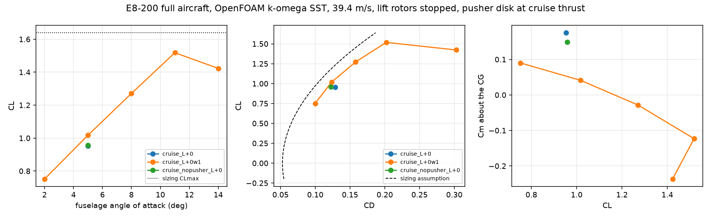
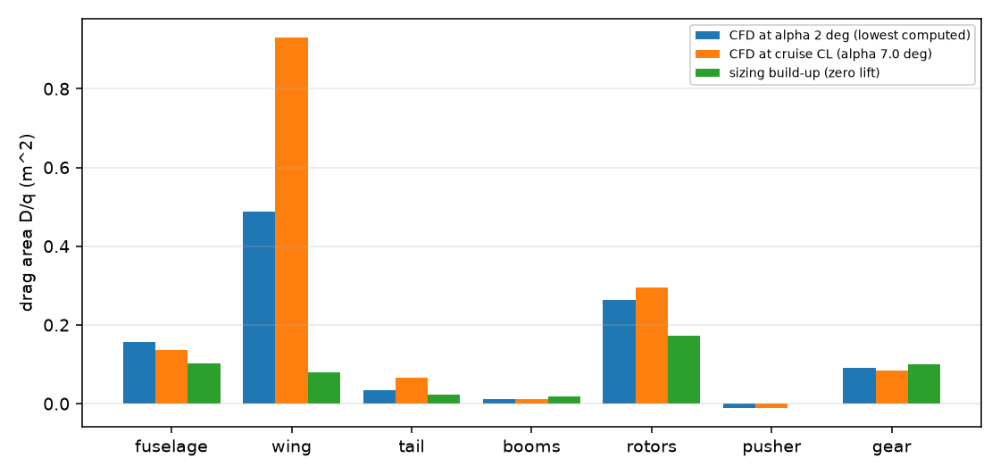

# E8-200 design CFD results (work package C, phase 2) - design iteration 3.1

Frozen design `design/geometry_cfd.json` (iteration 3.1): MTOW 1,078 kg, wing 9.0 x 1.15 m LS(1)-0417 (S 10.35 m2,
incidence 4.0 deg, plain flaps y 0.51-2.70 m), 8 x 1.85 m stopped lift rotors on faired pylons (0.116 x 0.40 m),
H-tail NACA 0014 + twin ventral fins, tail-cone pusher 1.65 m, faired skid gear. Cruise 142 km/h (39.4 m/s).
Validated tool chain and uncertainty bands: [validation/cfd/README.md](../../validation/cfd/README.md) (section 7).

**Set-up (as validated).** OpenFOAM v2412, steady k-omega SST, half model (symmetry y = 0), snappyHexMesh 1.89 M cells.
Wing and tail surfaces at c/128 (`--lift-extra 1`; prism layers 7.8 of 9 on the wing, 6.0 of 7 on the tail, first
layer 0.55 mm, y+ 25-40). Fuselage, booms, rotors and gear at c/64 (fuselage 4.1 of 7 layers, booms 4.0 of 5; no layers
on blades, hubs, pylons and gear). Coefficients use sea-level density; the cruise point is taken at the sizing cruise
lift coefficient (CL 1.184, 500 m ISA+15). Lift rotors are stopped with blades along the flow; the pusher is a
radius-weighted actuator disk at the cruise thrust (1,096 N). Angles are fuselage angles of attack (wing incidence
+4 deg). Inverter pods are not in the CFD geometry; they are added as the sizing build-up increment (8 x 0.030 m2 x
C_D 0.12 = 0.029 m2).

Files: `cruise.json` (polar, per-component forces), `summary.json` (comparison, bands), `mission_check.json`,
`hover_linear_L+0.json`, `transition_L+0_a+05.0.json`, `flap_section_gaw1.json`, plots `cruise_polar.png`,
`drag_breakdown.png`, `oml_cfd.png`. The two iteration-3 points (superseded geometry, same settings) are in
`iteration3/`; the iteration-1 pipeline test is in `pipeline_test_old_geometry/`.

## 1. Cruise polar (production mesh)

| Fuselage alpha (deg) | CL | CD | Cm (about the CG) | CL oscillation | Iterations |
|---|---|---|---|---|---|
| 2 | 0.752 | 0.0998 | +0.090 | 0.003 | 559 |
| 5 | 1.018 | 0.1234 | +0.041 | 0.002 | 637 |
| 8 | 1.271 | 0.1578 | -0.028 | 0.001 | 632 |
| 11 | 1.518 | 0.2020 | -0.123 | 0.001 | 663 |
| 14 | 1.423 | 0.3027 | -0.237 | 0.022 (unsteady, post-stall) | 652 |

## 2. Comparison with the sizing assumptions

Values are CFD (production mesh, inverter pods added where marked) with the validated band, rounded.

| Quantity | Sizing (design/selected_design.json) | CFD | Band (validation sec. 7) | Assessment |
|---|---|---|---|---|
| CL_alpha (/rad) | 4.69 | 4.96 | +-5 % (4.71-5.21) | sizing within the band (5 % low) |
| CD0 (parabolic fit 2-8 deg) | 0.0528 | 0.0676; **0.0704 with pods** | -20 % / +17 % (0.056-0.082) | **CFD 33 % above sizing**; sizing value below the band |
| Oswald factor e (parabolic fit) | 0.816 | 0.734 | +-8 % (0.68-0.79) | CFD 10 % below sizing |
| Cruise L/D at CL 1.184 | 9.65 | 8.15; **8.00 with pods** | 7.1-9.25 | sizing 21 % above CFD, just above the band |
| Cruise drag (W CD/CL) | 1,096 N | 1,297 N; **1,322 N with pods** | 1,140-1,490 N | +21 % |
| Fuselage angle in cruise | 5.6 deg | 7.0 deg | +-0.4 deg | 1.4 deg more nose-up |
| Neutral point / static margin | 2.211 m / 10.0 % MAC | 2.358 m / **22.8 % MAC** | +-5 % MAC | more stable than assumed |
| Cm at cruise CL (elevator neutral) | - | -0.005 | +-0.1 (mesh sensitivity of the Cm level) | trimmed with about zero elevator |
| CLmax clean (untrimmed, elevator neutral; Cm -0.12 at the maximum) | 1.64 | **1.52** at fuselage alpha 11 deg (wing 15 deg); 1.42 and unsteady at 14 deg | -5 % / +12 % (1.44-1.70) | sizing 8 % above CFD, inside the band; stall speed 33.1 m/s clean at MTOW, sea level |
| CLmax flaps down | 2.00 | **1.61** (flap 20 deg), **1.70** (35 deg) | -5 % / +12 % on the clean part; increment conservative | sizing 15-20 % above CFD |
| Hover download / thrust | 4.71 % | 8.0 % raw, **5.5 % corrected** (raw / 1.46) | 3.9-7.2 % | 0.8 point above sizing, within the band |

Drag areas D/q in m2 by component (CFD at alpha 2 deg, the lowest computed point, CL 0.75; the wing value includes
its induced drag there; sizing build-up at zero lift):

| Component | CFD alpha 2 deg | CFD at cruise CL | Sizing build-up | Notes |
|---|---|---|---|---|
| Wing | 0.488 | 0.931 | 0.080 | CD0 share of the wing incl. interference about 0.155 (CD0 x S minus the other components) |
| Fuselage + spinner (pusher on) | 0.147 | 0.124 | 0.102 (incl. inlets) | without the pusher disk the fuselage is 0.084 + 0.005 spinner (sec. 4) |
| H-tail + fins | 0.034 | 0.065 | 0.023 | tail lift rises with alpha (stability) |
| Booms | 0.011 | 0.012 | 0.018 | |
| Stopped rotors (blades, motor hubs, pylons) | 0.263 | 0.295 | 0.144 (0.173 minus pods) | **+83 %**; largest single difference |
| Landing gear (faired legs, skids) | 0.090 | 0.085 | 0.101 | |
| Inverter pods (build-up, not meshed) | 0.029 | 0.029 | 0.029 (inside the sizing "stopped rotors") | added to the CFD totals |
| **Total zero-lift drag area (CD0 x S)** | **0.700 + 0.029 = 0.729** | | **0.546** | +33 % |

## 3. Mesh sensitivity

Fuselage alpha 5 deg on the c/64 mesh (L0, 1.13 M cells, all surfaces c/64) vs the production mesh:

| Mesh | CL | CD | Cm |
|---|---|---|---|
| L0 (c/64) | 0.953 | 0.1288 | +0.175 |
| production (lifting surfaces c/128) | 1.018 | 0.1234 | +0.041 |
| change | -6.4 % | +4.4 % | 0.13 |

The direction and size of the lift and drag changes match the finite-wing validation (L0: lift slope -6.5 %, drag
high), which supports using the validation bands for the production mesh. The pitching-moment level changes by 0.13
between the meshes, so Cm levels are uncertain to about +-0.1; the slope (static margin) is taken from the production
mesh only and carries the +-5 % MAC band. A further refinement of the non-lifting parts (c/128 everywhere, about 5 M
cells) was not run within the available compute time.

## 4. Pusher / fuselage interaction

Fuselage alpha 5 deg, L0 mesh, pusher disk at 1,096 N vs pusher off: the airframe drag rises from CD 0.1227 to 0.1288
(+0.0061, drag area +0.063 on the fuselage, -0.017 on the spinner): about 45 N at the cruise condition, a thrust
deduction of about 4.5 % of the pusher thrust (to be added to the propeller efficiency loss in the sizing model if not
already there). The wake fraction at the disk was not evaluated.

## 5. Flaps-down CLmax estimate

Method: 2-D CFD of the GA(W)-1 section with the E8-200 flap (sealed plain flap, 30 % chord, hinge faired over
+-6 % chord) at the stall Reynolds number 2.4e6, deflections 20 and 35 deg, alpha sweeps through clmax (512 x 256
O-grids, 500 c far field, same SST settings as the validated section runs; the flapped cases needed limited gradients
and lower relaxation to start). The section increment is applied to the 3-D clean CFD CLmax with the DATCOM method for
partial-span flaps on an unswept wing: dCLmax = dclmax x Swf/S, Swf/S = 0.487 (flaps y 0.51-2.70 m).

| Flap | section clmax | at alpha (deg) | dclmax | 3-D dCLmax | CLmax flaps down | Vs at MTOW, sea level | Vs, 500 m ISA+15 (TAS) |
|---|---|---|---|---|---|---|---|
| 0 (clean) | 1.74 | 18 | - | - | 1.52 (3-D CFD) | 33.2 m/s | 34.6 m/s |
| 20 deg | 1.92 | 10 | +0.19 | +0.09 | 1.61 | 32.2 m/s | 33.6 m/s |
| 35 deg | 2.12 | 10 | +0.38 | +0.19 | **1.70** | 31.3 m/s | 32.7 m/s |
| sizing assumption | - | - | 0.9 x 0.9 | +0.38 | 2.00 | 28.9 m/s | 30.2 m/s |

The 35 deg flap is separated on its upper surface over the whole alpha range (section cd 0.13-0.17, lift oscillation
0.01), which is why the increment is about half the handbook value used by the sizing (0.9 x 0.9 x 0.47 = 0.38). The
clean section clmax at this Reynolds number (1.74) is consistent with the validation (CFD clmax 3-11 % below
experiment), so the flaps-down CLmax is a conservative estimate; with the +12 % band it reaches 1.90 (Vs 29.7 m/s
sea level). **Consequence:** at the nominal CFD value the cruise speed is 1.26 x Vs at sea level and 1.21 x Vs (TAS) at
500 m ISA+15, below the 1.30 x Vs rule used by the sizing; only the favourable end of the band (1.90) restores 1.30-1.33.
A slotted or larger-chord flap, or a slightly larger wing, would be needed to keep the margin with the CFD values.
Files: `flap_section_gaw1.json` (all 2-D points), `summary.json` (`flaps`). Clean runs with the limited schemes at
14-18 deg did not leave the stalled start-up state within 6000 iterations and are not used.

## 6. Hover download

All 8 lift rotors as radius-weighted actuator disks at the hover thrust (1,384 N each, 11,072 N total), 1.27 M cells,
disks at R/30. Vertical force by component (whole aircraft): wing -425 N, booms -378 N, gear -119 N, fuselage -34 N,
tail +14 N, rotor hubs/pylons +53 N; total download 890 N = **8.0 % of thrust raw**, **5.5 %** after the validated
actuator-disk correction (CFD / measured = 1.46 for a wing under a rotor, validation sec. 5), band 3.9-7.2 %. The
sizing assumes 4.7 %. The booms (directly under the disk centres) carry as much download as the wing.

## 7. Transition (qualitative)

35 m/s, fuselage alpha 5 deg, lift rotors at 25 % of hover thrust (2,768 N total) as actuator disks in edgewise flow,
pusher 1,100 N, L0 mesh. The airframe lift coefficient falls from 0.953 (clean, same mesh and angle) to 0.892
(-6 %; wing -0.046, tail -0.011) and the drag coefficient rises by 0.003. The lift lost on the airframe is about 470 N,
i.e. about 17 % of the lift-rotor thrust at this point. This is outside the validated envelope (actuator disks in
edgewise flow, no swirl) and is a trend only: the transition energy should allow for a rotor-wing interaction loss of
order 10-20 % of the rotor thrust at low rotor loading.

## 8. Mission check with the CFD aerodynamics

`tools/mission_check.py` re-flies the frozen design's mission with the sizing model's energy terms: cruise power
scaled with the CFD drag (CD0 incl. pods, e), hover energy with (1 + download)^1.5, transitions with the mean of hover
and cruise power. The current sizing model gives 23.9 km for the published inputs (the design files state 26.7 km; the
model has been recalibrated since the freeze), so the CFD cases are reported both as model ranges and scaled to the
published 26.7 km by the model's range ratio:

| Case | CD0 | e | Download | Cruise L/D | Range, model | Range, scaled to published |
|---|---|---|---|---|---|---|
| Sizing inputs | 0.0528 | 0.816 | 4.7 % | 9.59 | 23.9 km | 26.7 km |
| **CFD nominal** | 0.0704 | 0.734 | 5.5 % | 7.98 | 19.1 km | **21.4 km** |
| CFD, unfavourable end of the bands | 0.082 | 0.675 | 7.2 % | 7.01 | 16.0 km | 17.9 km |
| CFD, favourable end of the bands | 0.056 | 0.793 | 3.9 % | 9.18 | 23.0 km | 25.7 km |

**Verdict:** with the CFD drag the 20 km design range still closes nominally (21.4 km against the published
capability, about 7 % margin), but the margin is consumed by the unfavourable end of the CFD uncertainty band
(17.9 km), and on the current sizing model it does not close (19.1 km). The capability claimed by the sizing
(26.7 km) is not supported: the CFD gives 21-22 km. The largest single item is the stopped-rotor group (+0.12 m2 over
the build-up), followed by the wing incl. interference (+0.075 m2) and the pusher-induced fuselage drag (+0.06 m2).

## 9. What this means for the design

* Drag: the zero-lift drag area is about 0.73 m2 (33 % above the build-up). The most effective reductions are at the
  stopped rotors (blades, hubs and pylons: 0.26-0.30 m2) and the fuselage tail cone in the pusher inflow.
* Stability: the CFD static margin (23 % MAC) is larger than the 10 % assumed; the CG range can move aft or the H-tail
  can shrink. The Cm level is mesh-sensitive (+-0.1); trim is close to zero elevator at cruise.
* CLmax / stall: clean CLmax 1.52 (band 1.44-1.70) vs 1.64 assumed. Past the maximum the lift drops gently (-6 % at
  +3 deg) with a strong nose-down moment (Cm -0.24 at 14 deg), i.e. a benign stall. The flaps-down value (sec. 5)
  decides whether the stall-speed requirement is met: the CFD estimate 1.70 with the 35 deg flap (sizing 2.00) gives
  cruise = 1.26 Vs at sea level, short of the 1.30 rule.
* Hover: download 5.5 % (band 3.9-7.2 %) vs 4.7 % assumed; the booms under the disk centres contribute as much as the
  wing.
