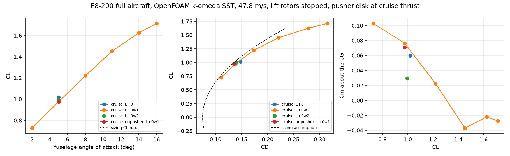
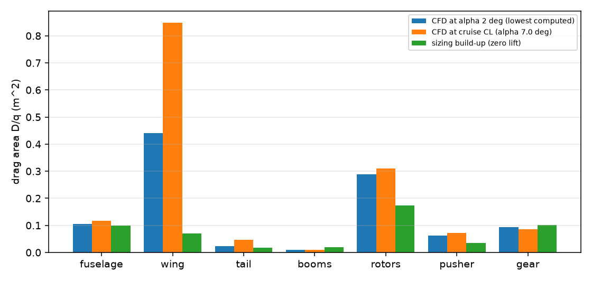

# E8-200 design CFD results - design iteration 3.3

> **Note:** after this CFD run, the sizing adopted these results and moved cruise to 167 km/h at an MTOW of 1,347.8 kg (see `sizing/README.md`, "Iteration 3.3 CFD calibration"). The 167 km/h point lies inside the polar below, so no re-run was needed. The independent V&V finds that the Cm level does not converge on the mesh, so only the Cm slope (static margin) is indicative.

Frozen design `design/geometry_cfd.json`: MTOW 1,350.4 kg, wing 8.0 x 1.15 m (S 9.20 m2), cruise 172 km/h (47.8 m/s), cruise CL 1.137 (sizing density 1.109 kg/m3). Tool chain and uncertainty bands: [validation/cfd/README.md](../../../validation/cfd/README.md) (section 7). Set-up as validated: steady k-omega SST, half model, wing and tail surfaces at c/128 (`--lift-extra 1`), first prism layer for y+ 25-40, stopped lift rotors, pushers as radius-weighted actuator disks at the cruise thrust (thrust only, no swirl). Inverter pods are a build-up increment (0.0360 m2). Coefficients use sea-level density; the cruise point is taken at the sizing cruise CL. Angles are fuselage angles of attack.

## 1. Cruise polar (production mesh)

| alpha (deg) | CL | CD | Cm (CG) | CL oscillation | iterations |
|---|---|---|---|---|---|
| 2 | 0.727 | 0.1108 | +0.103 | 0.005 | 517 |
| 5 | 0.975 | 0.1381 | +0.076 | 0.002 | 581 |
| 8 | 1.220 | 0.1731 | +0.023 | 0.002 | 575 |
| 11 | 1.453 | 0.2212 | -0.037 | 0.005 | 550 |
| 14 | 1.624 | 0.2781 | -0.022 | 0.009 | 800 |
| 16 | 1.714 | 0.3147 | -0.027 | 0.008 | 800 |

## 2. Comparison with the sizing assumptions

| Quantity | Sizing | CFD | Band |
|---|---|---|---|
| CL_alpha (/rad) | 4.56 | 4.63 | +-5 % |
| CD0 (incl. pods) | 0.0751 | 0.0725 (0.0764) | 0.0556-0.0882 |
| Oswald e | 0.756 | 0.658 | +-8 % |
| Cruise L/D (incl. pods) | 7.42 | 7.00 (6.84) | see text |
| Cruise drag (incl. pods), N | 1,786 | 1,892 (1,937) | |
| Fuselage angle in cruise (deg) | 5.49 | 7.04 | +-0.4 |
| Static margin (MAC) | 0.098 | 0.195 (x_np 2.786 m) | +-0.05 |
| CLmax clean | 1.639 | 1.714 at 16 deg | -5 % / +12 % |
| Hover download | 0.0332 | raw 0.0292, corrected 0.0200 | +-30 % |

Stall speed with the CFD CLmax: 37.0 m/s (sea level), 38.9 m/s TAS at the cruise density; cruise / Vs = 1.227 (cruise density). With the -5 % / +12 % CLmax band: 1.196 - 1.299.

Drag areas D/q (m2) by component: CFD at the lowest computed angle (2.0 deg) and at the cruise CL, sizing build-up (zero lift).

| Component | CFD lowest alpha | CFD cruise | Sizing |
|---|---|---|---|
| fuselage | 0.104 | 0.118 | 0.100 |
| wing | 0.440 | 0.849 | 0.070 |
| tail | 0.023 | 0.046 | 0.018 |
| booms | 0.009 | 0.010 | 0.019 |
| rotors | 0.288 | 0.310 | 0.174 |
| pusher | 0.062 | 0.072 | 0.034 |
| gear | 0.094 | 0.085 | 0.101 |

## 3. Pushers in the tail wake

Fuselage alpha 5.0 deg, pushers on vs off (same mesh): airframe drag change +35 N at 1786 N total thrust, thrust deduction **1.9 %** (sizing 4.5 %). Change of drag area by component (m2): fuselage +0.0030, wing +0.0051, tail +0.0033, booms +0.0001, rotors +0.0039, pusher +0.0053, gear +0.0041.
Tail surfaces: lift 77 N without, 62 N with the pushers; drag area 0.0292 / 0.0325 m2; Cm +0.0709 / +0.0764.
Inflow 0.1 m ahead of the disk (no_pusher): mean axial 0.951 V, min 0.210, max 1.051, non-uniformity (std/mean) 9.8 %.
Inflow 0.1 m ahead of the disk (pusher_on): mean axial 1.002 V, min 0.231, max 1.075, non-uniformity (std/mean) 10.7 %.
Wake fraction (pushers off) w = 0.045.

| Case | thrust per pusher (N) | inflow (m/s) | eta | shaft power per pusher (kW) | power / sizing | margin on the sizing basis (2.8 % sized) | torque (N m) |
|---|---|---|---|---|---|---|---|
| sizing (T as sized, free-stream inflow) | 893 | 47.8 | 0.842 | 50.7 | 1.000 | +2.8 % | 233 |
| CFD drag, free-stream inflow | 969 | 47.8 | 0.838 | 55.2 | 1.090 | -6.0 % | 254 |
| CFD drag, CFD wake inflow | 969 | 45.6 | 0.833 | 53.1 | 1.047 | -1.8 % | 244 |

Actuator disks carry thrust only (no swirl); with both pushers turning the same way the reaction torques add (net rolling moment = 2 Q), which the disks do not model; the props are aft of the tail surfaces, so their swirl does not reach the H-tail or fins.

## 4. Hover download

Raw download 2.9 % of thrust; corrected (raw / 1.46, validation sec. 5) **2.0 %**, band 1.4-2.6 %. Vertical force by component (N): fuselage -8, wing +8, tail +7, booms -402, rotors +47, pusher +0, gear -52.

## 5. Grid convergence at the cruise point

Fuselage alpha 5.0 deg, wing and tail surface cells c/64, c/128, c/256 (refinement of the wing and tail surface mesh only (ratio 2); fuselage, booms, rotors and gear at c/64 on all three meshes).

| Quantity | c/64 | c/128 | c/256 | p (observed) | extrapolated | GCI fine | GCI medium |
|---|---|---|---|---|---|---|---|
| CL | 1.0189 | 0.9753 | 0.9959 | 1.08 | 1.0144 | 2.315% | 5.002% |
| CD | 0.1476 | 0.1381 | 0.1400 | 2.33 | 0.1406 | 0.560% | 2.844% |
| Cm | 0.0597 | 0.0764 | 0.0296 | - | - | 474.815% | - |

## 6. Mission check

| Case | CD0 | e | download | L/D | range (model) | range scaled to published |
|---|---|---|---|---|---|---|
| check_same_inputs | 0.0751 | 0.756 | 0.0332 | 7.42 | 24.4 km | 24.2 km |
| cfd_nominal | 0.0764 | 0.658 | 0.0200 | 6.84 | 22.7 km | 22.5 km |
| cfd_worst_band | 0.0942 | 0.605 | 0.0260 | 5.92 | 19.1 km | 19.0 km |
| cfd_best_band | 0.0586 | 0.711 | 0.0140 | 8.01 | 27.3 km | 27.0 km |

Required range 20.0 km; published capability 24.192 km.

## 7. Assessment against the design constraints (iteration 3.3)

| Item | Sizing / requirement | CFD (band) | Status |
|---|---|---|---|
| Cruise L/D at CL 1.137 (incl. pods) | 7.42 | 6.84 (CD0 band -27/+15 %, e +-8 %) | 8 % below sizing |
| Cruise drag (incl. pods) | 1,786 N | 1,937 N | +8.5 % |
| CD0 / e | 0.0751 / 0.756 | 0.0764 incl. pods / 0.658 | CD0 matches; lift-dependent drag 15 % higher |
| Clean CLmax | 1.64 | >= 1.71 at fuselage 16 deg (lift still rising, oscillation 0.008; maximum not bracketed) | not limiting |
| Cruise >= 1.15 Vs (cruise density) | 1.156 | 1.227 with CLmax 1.71 (1.196 at the -5 % end) | met |
| Pusher thrust deduction | 4.5 % | 1.9 % | favourable |
| Pusher shaft power per unit (CFD drag) | 50.7 kW, 2.8 % continuous margin | 53.1 kW with the wake inflow (55.2 kW free-stream inflow) | **margin -1.8 % (-6.0 %): continuous rating exceeded** |
| Pusher torque per motor at 2,074 rpm | max 300 N m | 244 N m | met |
| Static margin | 0.098 (CAD 0.086) | 0.195 (+-0.05) | more stable than assumed |
| Trim at the cruise CL (elevator neutral) | - | Cm +0.033 about the CG (+-0.1) | small elevator deflection |
| Hover download | 3.3 % | 2.0 % corrected (1.4-2.6 %); raw 400 N, almost all on the booms (the wing lies between the disks) | favourable |
| Mission range | 20 km | 22.5 km nominal, 19.0 km at the unfavourable end of the bands | met nominally; not met at the band edge |

Pusher inflow: the disks run in the boom and tail wakes; the axial inflow 0.1 m ahead of the disk averages 0.95 V
without the pushers (wake fraction 0.045) and is strongly non-uniform near the hub (minimum 0.21 V behind the motor
can, std/mean 10 %). With both pushers turning the same way the reaction torques add (2 x 244 N m rolling moment),
which the thrust-only disks do not model; the props are aft of the tail surfaces, so their swirl does not reach the
H-tail or fins. The pushers reduce the H-tail lift by 15 N and raise the tail drag area by 0.003 m2 (suction ahead of
the disks).
