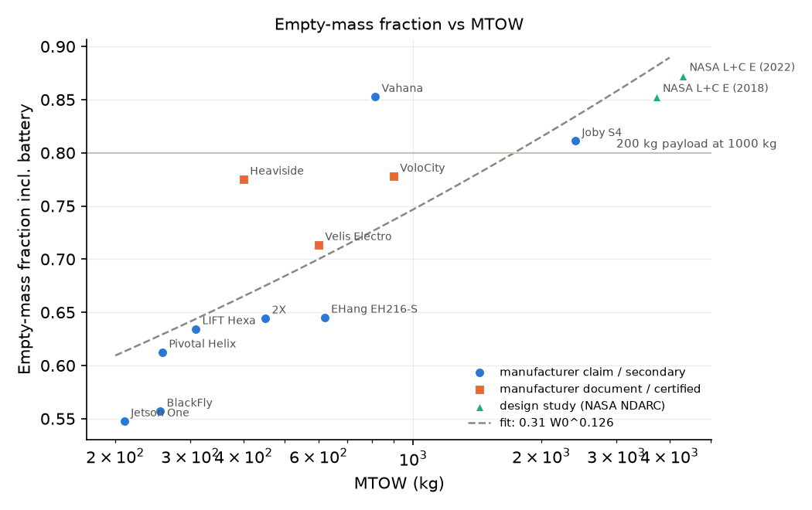
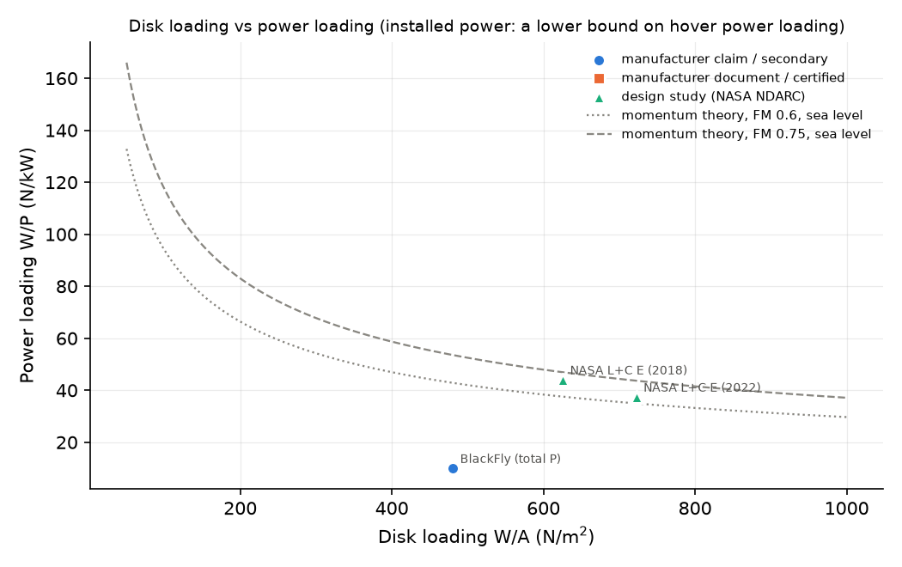
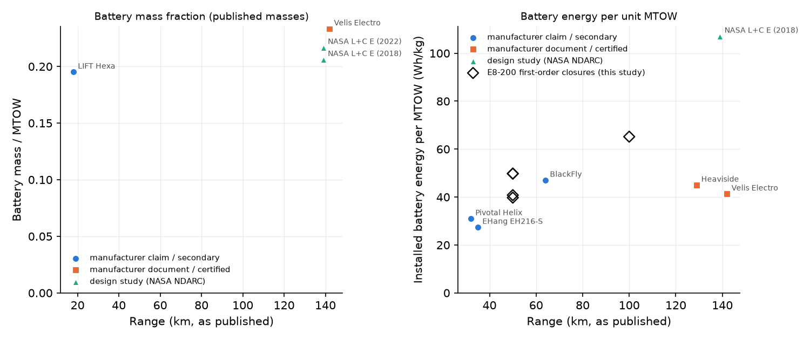
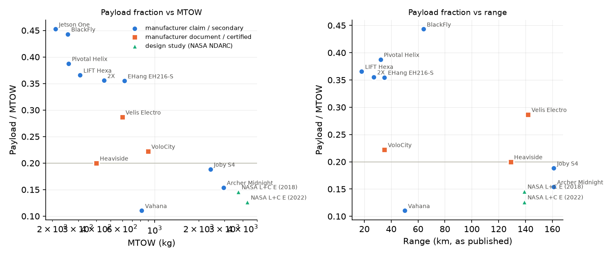

# Benchmark aircraft data (WP M)

Generated by `build_benchmarks.py` (edit the script, not the outputs):

- `benchmarks.csv` - long format, **one row per value with its own source URL** and a quality code.
- `benchmarks_wide.csv` - one row per aircraft with derived ratios (empty, payload and battery fractions, installed Wh per
  kg MTOW, disk loading, power loading) and the set of quality codes behind each row.
- `trend_fits.json` - empty-mass-fraction regression used in `methods/EQUATIONS.md` [W3].
- `plots/` - trend plots (below).

Sources were checked on 2026-11-12/13. `resources/benchmarks_raw.json` did not exist at that time; when WP R publishes
it, rerun the script and reconcile any differences.

## Quality codes

| Code | Meaning |
|---|---|
| claim | manufacturer specification, press release or web page; not independently measured |
| document | manufacturer technical document (flight manual, design specification sheet), calculated or flight-test based |
| certified | value fixed by a type certificate (Velis Electro MTOW) |
| study | published engineering design study (NASA NDARC concept vehicles) |
| secondary | encyclopaedia / trade-press database repeating manufacturer figures |
| derived | computed here from other listed values (formula in the `note` column) |

No value is estimated: where nothing was published (e.g. Wisk Cora MTOW, VX4 MTOW, rotor diameters of most aircraft),
the field is empty. Where sources conflict, the note says so (e.g. EHang range 30 vs 35 km, Archer MTOW 6,500 vs 7,000 lb,
LIFT Hexa payload 220 vs 250 lb).

## Aircraft covered (18 entries, 150 values)

Jetson One; Opener/Pivotal BlackFly; Pivotal Helix; Volocopter 2X; Volocopter VoloCity (2019 design specification);
EHang EH216-S; Wisk Cora (Gen 5); Kitty Hawk Heaviside 2 Block 2 (flight manual); CityAirbus NextGen; Beta Alia A250;
Joby S4; Archer Midnight; Vertical VX4; LIFT Hexa; Airbus Vahana Alpha; Pipistrel Velis Electro; NASA Lift+Cruise
electric (2018, AIAA 2018-3847) and its 2022 re-sizing (Johnson & Silva).

Summary of derived ratios (from `benchmarks_wide.csv`):

| Aircraft | MTOW kg | Empty incl. batt. / MTOW | Payload / MTOW | Battery / MTOW | Wh per kg MTOW | quality |
|---|---|---|---|---|---|---|
| Jetson One | 210 (derived) | 0.55 | 0.45 | - | - | claim |
| BlackFly | 255 | 0.56 | 0.44 | - | 47 | secondary |
| Pivotal Helix | 258 | 0.61 | 0.39 | - | 31 | claim |
| LIFT Hexa | 309 (derived) | 0.63 | 0.37 | 0.20 | - | claim |
| Heaviside 2 Block 2 | 400 | 0.78 | 0.20 | - | 45 | document |
| Volocopter 2X | 450 | 0.64 | 0.36 | - | - | secondary |
| Velis Electro | 600 | 0.71 | 0.29 | 0.23 | 41 | certified/secondary |
| EHang EH216-S | 620 | 0.65 | 0.35 | - | 27 | claim |
| Vahana Alpha | 815 | 0.85 | 0.11 | - | - | secondary |
| VoloCity | 900 | 0.78 | 0.22 | - | - | document |
| Joby S4 | 2,404 | 0.81 | 0.19 | - | - | claim |
| Archer Midnight | 2,948 | - | 0.15 | - | - | claim |
| NASA L+C E 2018 | 3,724 | 0.85 | 0.15 | 0.21 | 107 | study |
| NASA L+C E 2022 | 4,301 | 0.87 | 0.13 | 0.22 | - | study |

Reading for E8-200: 200 kg payload is a payload fraction of 0.20 at 1,000 kg and 0.15 at 1,350 kg. Aircraft with a
payload fraction above 0.3 are ultralight single-seaters with 15-30 min endurance; the long-range winged aircraft
(Heaviside, Joby, NASA) sit at 0.13-0.20.

## Plots

Power loading uses the installed (rated) power, a lower bound on the hover power loading; only three aircraft publish
both rotor diameter and power, so the momentum-theory lines (FM 0.6 and 0.75, sea level) carry most of the information.

The right panel overlays the E8-200 first-order closures from `methods/initial_estimate.py` (hollow diamonds): E8-200 needs
50-65 Wh of nameplate energy per kg MTOW for 50-100 km because only 61 % of it may be used (EOL + 20 % reserve); the
Heaviside and Velis fly 130-140 km on 41-45 Wh/kg with no such derating published.

