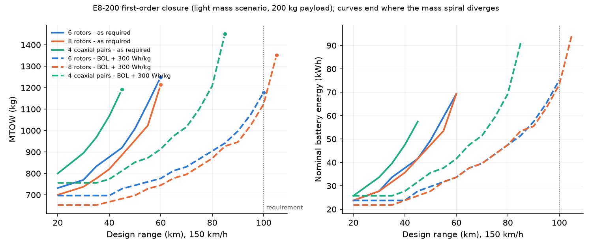

# E8-200 first-order design-space estimate (WP M, independent of WP D)

Script: `methods/initial_estimate.py` (uses the equations of `EQUATIONS.md` through `check_design.py`); results:
`methods/initial_estimate.json`; plot: `methods/initial_estimate_mtow_vs_range.png`.

## Method

For a trial MTOW the script builds a complete design (8, 6, 4 lift rotors or 4 coaxial pairs; disk loading 450 N/m²;
blade chord for C_T/σ = 0.11; wing loading 650 N/m², span ≤ 9 m; 1.6 m pusher; 4.6 m fuselage; P50B cells, 110 s),
computes hover/rotor-out/cruise power, the requirement mission energy (60 s hover take-off incl. 30 m climb, 2 × 30 s
transition, climb to 500 m, cruise at 150 km/h, 60 s hover landing, all at 500 m ISA + 15 °C) and the nominal battery
energy needed with **20 % remaining at landing on end-of-life (80 %) capacity** and η_b = 0.95, then the component
masses [M1]-[M16]. The closure `MTOW = payload + empty + battery` is solved for its smallest root between 400 and
3,000 kg. Battery energy is also checked against the hover C-rate limit (40 A continuous screening value at EOL minus
0.3 C); it was never the active constraint.

Two mass scenarios bracket the empty mass:

| Scenario | Structure (Raymer GA) | Motor accessories (inverters, cooling, harness) | LV electrical | Pack overhead | Growth |
|---|---|---|---|---|---|
| conservative | no composite credit | 0.63 × motor mass (NASA [S18]) | Raymer GA (~36 kg) | 30 % | 10 % |
| light | × 0.85 (composite) | 0.35 × motor mass (COTS inverter 0.23-0.33 + cooling) | 12 kg | 25 % | 5 % |

Benchmark sanity check (`benchmarks/`): the light scenario gives an empty mass excluding battery of 0.53 MTOW, the same
as Kitty Hawk Heaviside (0.50, flight manual) and Joby S4 (~0.53 with a 235 Wh/kg pack), and below NASA's Lift+Cruise
(0.65). The conservative scenario is ~10 % heavier.

## Main result: the 100 km requirement does not close as written

| Range | 4 rotors | 6 rotors | 8 rotors | 4 coaxial pairs |
|---|---|---|---|---|
| 50 km, light | no closure (rotor-out cannot trim) | **1,009 kg**, 49.5 kWh | **954 kg**, 47.5 kWh | no closure (mass excess 2 kg at 1,450 kg) |
| 50 km, conservative | no | no (min. excess 135 kg) | no (min. excess 118 kg) | no |
| 100 km, light | no | no (min. excess 148 kg at 1,050 kg) | no (min. excess 146 kg at 1,000 kg) | no |
| 150 km, light | no | no (excess 282 kg) | no (excess 280 kg) | no |

"No closure" means that for every MTOW from 400 to 3,000 kg the payload + empty + battery mass exceeds the MTOW: the
mass spiral diverges. Largest range that closes (light scenario):

| Change to the requirement / technology | 6 rotors | 8 rotors | 4 coax pairs | MTOW at the limit |
|---|---|---|---|---|
| as required (EOL 80 %, 20 % reserve, 253 Wh/kg cells, span 9 m) | 61 km | 62 km | 50 km | ~1,350-1,450 kg |
| reserve on beginning-of-life capacity (new pack) | 84 km | 84 km | 69 km | ~1,350-1,450 kg |
| 300 Wh/kg cells (best 21700 class, not yet in the catalog) | 78 km | 79 km | 64 km | ~1,370-1,500 kg |
| BOL capacity **and** 300 Wh/kg cells | **104 km** | **106 km** | 87 km | ~1,350-1,370 kg |
| span 11 m instead of 9 m | 70 km | 70 km | 56 km | ~1,600-1,700 kg |

The curves (light scenario) end where the mass spiral diverges. The flat parts at short range are where the battery is
sized by hover power (C-rate) rather than energy. Below ~60 km the 8-rotor aircraft is 700-1,200 kg; the knee is at
60 km as required and ~105 km with beginning-of-life accounting and 300 Wh/kg cells.

The reason is the energy chain: only 0.8 × 0.8 × 0.95 = **61 % of nameplate energy** is usable for the mission, the
lift + cruise aircraft carries its parked rotors (L/D ≈ 10 at a 9 m span), and pack-level specific energy is
~177-190 Wh/kg. 100 km at 150 km/h then needs ~0.08 kWh of nameplate energy per kg of MTOW, i.e. a battery fraction of
0.42-0.45, which with an empty fraction (excl. battery) of ~0.5 leaves nothing for payload.

## Sanity targets for WP D

| Case | MTOW | Battery (nominal) | Battery mass | Hover elec. (500 m / 1000 m, ISA+15) | Rotor-out shaft, most loaded motor | Cruise elec. | Rotor D | L/D |
|---|---|---|---|---|---|---|---|---|
| 50 km, 8 rotors, light | 954 kg | 47.5 kWh | 250 kg | 219 / 222 kW | 40 kW | 55 kW | 1.82 m | 10.1 |
| 50 km, 6 rotors, light | 1,009 kg | 49.5 kWh | 260 kg | 231 / 234 kW | 67 kW | 56 kW | 2.16 m | 10.5 |
| 100 km, 8 rotors, BOL + 300 Wh/kg | 1,124 kg | 73.3 kWh | 326 kg | 257 / 261 kW | 47 kW | 67 kW | 1.97 m | 10.0 |
| 100 km, 6 rotors, BOL + 300 Wh/kg | 1,178 kg | 75.2 kWh | 334 kg | 269 / 274 kW | 78 kW | 68 kW | 2.33 m | 10.3 |
| 50 km, 8 rotors, BOL + 300 Wh/kg | 697 kg | 27.7 kWh | 123 kg | 160 / 163 kW | 29 kW | 41 kW | 1.56 m | 9.9 |

So a design that claims 100 km with 200 kg payload at **600-800 kg** under the written reserve rules should be expected
to fail the independent check; the hand-built 750 kg test case (`examples/`) does exactly that (55 km range).
Realistic sanity band for the 100 km mission: **MTOW 1,100-1,450 kg and 70-100 kWh nominal**, and only with relaxed
energy accounting or better cells; with the requirement as written and today's 21700 cells, about 60 km is the limit.

Hover C-rates at end of life are 3.8-6.2 C (below the 40 A screening value = 10 C at EOL); with one of two packs out
they double to 7.5-12.5 C, within the P50B 60 A rating (15 C at EOL) but with no margin at the 50 km point -
consistent with WP P's finding (`validation/parts/README.md`).

## Effect of the number of lift rotors

- **4 rotors**: cannot meet one-motor-out hover (a quad cannot trim with one rotor failed) - excluded unless coaxial.
- **6 rotors**: rotor-out thrust +50 % (+65 % with the 10 % control margin) gives 67-78 kW and ~370-470 N·m on the most
  loaded motor: above every screened COTS lift motor (REB 50: 50 kW peak, 200 N·m) - in agreement with WP P
  (6 rotors fail above ~600 kg). 6 rotors are ~5 % heavier in MTOW than 8.
- **8 rotors**: rotor-out +33 % -> 40-47 kW and ~200-260 N·m: REB 50 class at ~950 kg, REB 60 (250 N·m) at ~1,100 kg. Lightest closure
  in every case, at the price of 2 more motor/inverter/propeller sets and pylons.
- **4 coaxial pairs (8 motors)**: fewer booms/pylons, but with the disk loading defined per pair the discs are 3.6-3.7 m
  (or the disk loading doubles), stopped-rotor drag rises and the 50 km case only just fails to close; not attractive
  for cost unless a 2.5-3 m rotor is acceptable.

## Effect on cost (light scenario, per aircraft, N = 10)

| Case | Battery | Motors + controllers | Propellers | Parachute | Flight control + avionics | Misc | Airframe (Eastlake recurring) | **Total** |
|---|---|---|---|---|---|---|---|---|
| 50 km, 8 rotors | 31.7 k | 68.6 k | 13.1 k | 8.0 k | 25.0 k | 10.0 k | 140.3 k | **USD 297 k** |
| 50 km, 6 rotors | 33.0 k | 83.0 k | 10.2 k | 8.0 k | 25.0 k | 10.0 k | 137.2 k | **USD 306 k** |
| 100 km, 8 rotors, BOL + 300 Wh/kg | 48.8 k | 81.1 k | 13.1 k | 8.0 k | 25.0 k | 10.0 k | 155.7 k | **USD 342 k** |

Bases: cells USD 7.50 each × 1.6 pack factor; motors + controllers 180 USD per kW of rotor-out peak power (T-Motor
U15XXL + Thunder 300A listing; MGM quotes pending in `bom/catalog.json`, which estimates USD 10-18 k per REB 50 +
HBCi set, i.e. 80-145 k for 8 lift sets - higher than used here); propeller USD 1,450 each (E-PROPS reference);
parachute, flight control/avionics and misc are estimates. Airframe = Eastlake manufacturing hours (~2,100 h per
aircraft at N = 10) × USD 55/h + materials + QC; non-recurring engineering/tooling/flight test ~USD 1.8 M
(F_cert = 0.5). Eastlake is a GA model and the largest single uncertainty.

Range sensitivity of cost: 50 -> 100 km (with the relaxed energy accounting) adds ~15 % to the per-aircraft cost
(battery +54 %, motors +18 %, airframe +11 %). 6 vs 8 rotors: 8 rotors are ~3 % cheaper in this model because the
smaller rotor-out power per motor more than pays for two extra sets; with quoted MGM prices per set the difference may
reverse - the complexity metric (9 vs 7 motors/inverters/propellers, 8 vs 6 pylons, 2 vs 1 motor types) favours 6.

## Other sensitivities (light, 8 rotors; 50 km as required / 100 km with BOL + 300 Wh/kg)

| Parameter | Values | MTOW (50 km) | MTOW (100 km relaxed) |
|---|---|---|---|
| cruise speed | 150 / 165 / 180 / 200 km/h | 957 / 991 / 1,050 / 1,188 kg | 1,127 / 1,179 / 1,254 / 1,489 kg |
| disk loading | 300 / 450 / 600 / 800 N/m² | 1,063 / 957 / 951 / 930 kg | no closure / 1,127 / 1,052 / 991 kg |
| cell specific energy | 200 / 250 / 300 Wh/kg | no closure / 965 / 798 kg | no / no / 1,127 kg |
| wing loading | 500 / 650 / 800 N/m² | 997 / 957 / 923 kg | 1,448 / 1,127 / 1,074 kg |

Fly at the minimum cruise speed (150 km/h), use the highest wing loading the stall/transition allows and a moderate
disk loading (450-600 N/m²; higher saves mass but raises hover power, C-rate and noise).

## Recommendations to the project

1. Resolve the range/reserve requirement before D optimises: either accept ~50-60 km with the reserve as written, or
   define the reserve on beginning-of-life capacity and/or fixed minutes, or allow a higher-energy cell.
2. Baseline 8 lift rotors of 1.8-2.0 m with REB 50/60-class motors (agrees with WP P); 6 rotors only if a motor with
   ≥ 70 kW peak / ≥ 400 N·m at ≤ 20 kg is found.
3. Treat any D design below ~950 kg MTOW for 200 kg payload as suspect unless the component masses are catalog-backed.
