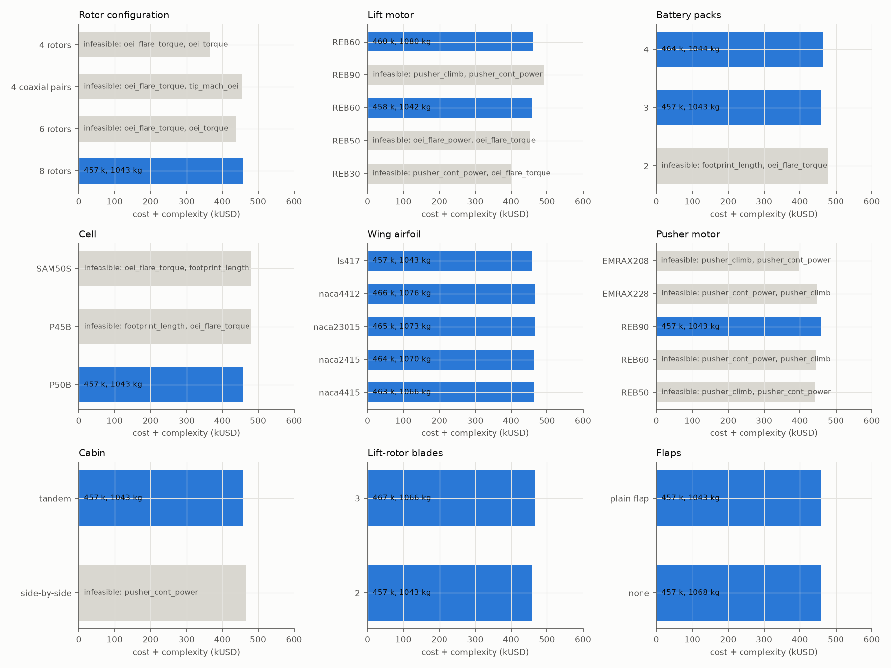
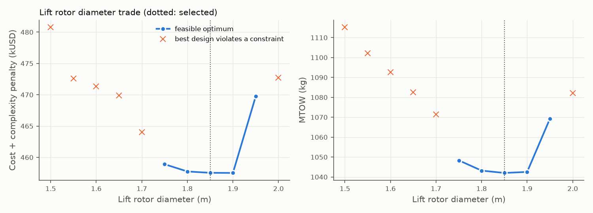
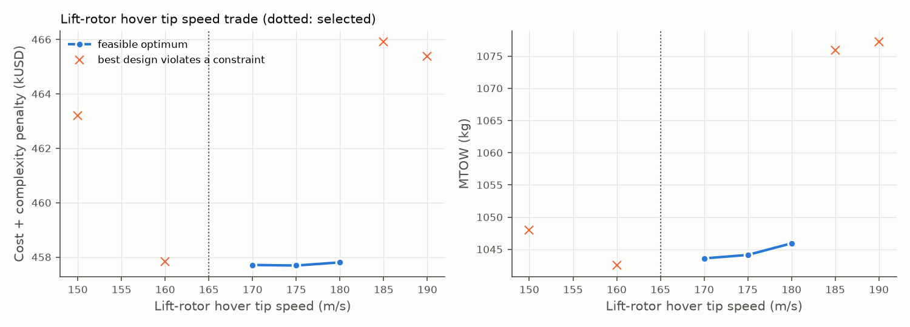
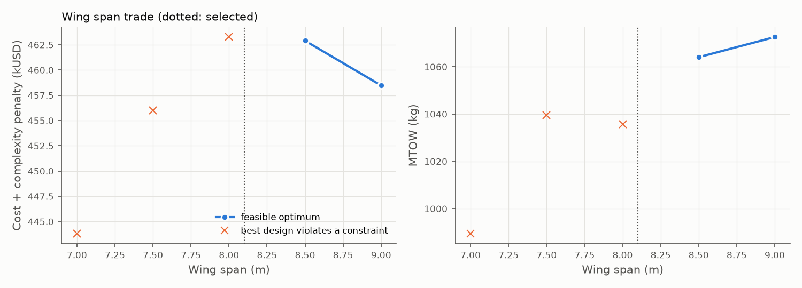
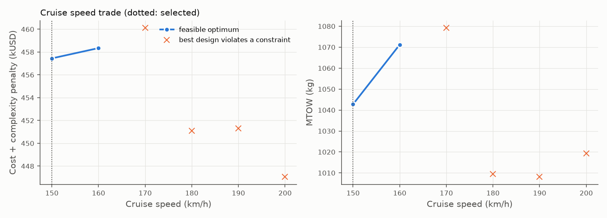
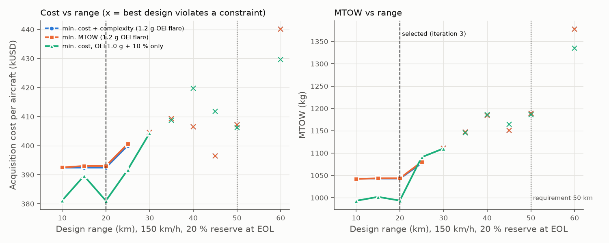

# WP D - E8-200 sizing and optimisation

Sizing, layout and cost/complexity optimisation of the E8-200 lift + cruise eVTOL (200 kg payload,
[requirements/requirements.yaml](../requirements/requirements.yaml)). Outputs: [design/selected_design.json](../design/selected_design.json),
[design/geometry.json](../design/geometry.json) (+ [geometry_cfd.json](../design/geometry_cfd.json)),
[design/mass_calibration.json](../design/mass_calibration.json), trade studies and plots in this folder, verification in
[validation/sizing/](../validation/sizing/README.md). Iteration-1 files are kept in `design/iteration1/` and `sizing/results/iteration1/`.

## Iteration 3.3 - current frozen design (final closure: EMRAX 268 lift, twin REB 90 pushers)

Frozen option: **ALL_rpmfree** from `sizing/results/final_33/`. Copies are in `design/iteration33/` and
`sizing/results/iteration33/`; 3.2 is kept in `design/iteration32/` and `sizing/results/iteration32/`.

**Owner decision ("cheapest, yet reliable"):**
- It keeps the 5 % growth allowance.
- It removes the REB 60 rating risk, which was decisive: the EMRAX 268 ratings are published (datasheet v1.7).
- Its cost is close to the REB 90 fallback cost that the programme would have faced anyway.

MIX_g0 was rejected. It had 0 % growth with margins under 2 %, and it still depends on the REB 60 rating.

| Item | Iteration 3.3 | Iteration 3.2 |
|---|---|---|
| MTOW / empty / battery | **1,350.4 / 825.7 / 324.7 kg** (growth 39.3 kg) | 1,169.5 / 697.2 / 272.4 kg |
| Battery | P50B 175s5p x 4 packs (3,500 cells), 63.0 kWh, 630 V | 175s3p x 5 packs, 47.3 kWh |
| Wing | 8.0 x 1.15 m, 9.2 m2, LS(1)-0417, no flaps (ailerons only), CLmax 1.52 | 9.0 x 1.40 m, 12.6 m2, plain flaps |
| Lift rotors | 8 x 1.85 m E-PROPS 2-blade, 183 m/s, **EMRAX 268 MV LC** + HBCi 400800 | 8 x 1.90 m, REB 60 |
| Pushers | **2 x REB 90** + 2 x HBCi 400800 on the boom tails, 2 x E-PROPS **1.75 m** 2-blade, same rotation, **2,074 rpm**, pitch about 21.5 deg at 0.75 R | 2 x REB 60, 2.05 m, 1,550 rpm |
| Parachute | **Galaxy GRS 6 1200-1390 SDS/FF** (1,390 kg variant, 28.9 kg, 57.4 kN opening shock) | GRS 6 990-1190 |
| Cruise | **167 km/h** (1.163 Vs on CLmax 1.628), CFD-calibrated (see "Iteration 3.3 CFD calibration"); was 172 km/h at the build-up L/D 7.42 | 129 km/h |
| Range capability (exact sag) | 24.1 km (20 km design; CFD band low 19.0 km is a documented risk) | 21.2 km (19.9 km with exact sag) |
| Cost | **USD 381.0k prototype cash; USD 497.5k per aircraft at N = 10** (MTOW 1,347.8 kg after the CFD download) | USD 335.2k; USD 442.3k |

Binding margins:

| Constraint | Value | Limit | Margin |
|---|---|---|---|
| Hover continuous torque at the 1,000 m ceiling | – | EMRAX 268 205 Nm LC | 0.1 % |
| Cruise speed vs 1.15 Vs | – | – | 0.5 % |
| One-pack-out cell current | 59.7 A | 60 A | – |
| One-pack-out bus voltage | 403 V | 400 V | – |
| Pusher continuous (with 10 % margin) | 116.7 kW | 120 kW | 2.8 % |
| OEI torque | 301 Nm | 500 Nm | – |
| Parachute rating | 1,350 kg | 1,390 kg | 2.9 % |
| Footprint | 9.87 m | 10.5 m | – |

- Static margin at MTOW is 0.098; the range over the loading cases is 0.063-0.098.
- `verify_sizing.py`: 105 PASS, 0 FAIL. The B4 benchmark band is widened by ±0.02, because the battery fraction (0.240) is
  set by hover power and the one-pack-out current rather than cruise.

**CG fix.**
- The CAD group CG shifts are applied in the layout, and the CG solution places the fuselage group (cabin, packs, payload)
  relative to the wing, boom and rotor group.
- The wing LE moves from x = 1.987 m to **2.145 m** from the nose: the fuselage moves 0.16 m forward relative to the wing.
- The MTOW CG sits on the rotor centroid at x = 2.562 m; it was 2.474 m in 3.2.
- This is recorded in `geometry.json` under `cg_fix_iteration33`.

**Inverter pods.** The twin-pusher pods are centred at **x = 6.795 m**, 0.30 m ahead of the tail LE, so they are clear of
TL-CLAMP, VF-SPAR and RUD (see `pushers[].inverter`).

**Geometry deltas versus 3.2 (for CAD, CFD and FEA):**
- **Booms:** x = -1.100 to 7.650 m (was -1.389 to 7.918), y = ±1.535 m, z = 1.771 m.
- **Lift hubs:** x = -0.95, 1.00, 4.12, 6.07 m; hub z = 2.400 m.
- **Wing:** span 8.0 m, chord 1.15 m, no flaps; LE at x = 2.145 m.
- **H-tail:** LE at x = 7.095 m, chord 0.376 m, 1.11 m2 exposed, span 3.07 m; fins 0.62 m2 in total.
- **Battery:** 4 packs of 0.461 m at x = 1.18, 1.68, 2.18 and 2.68 m.
- **Pusher props:** 1.75 m at x = 7.800 m; REB 90 motor face at the boom end, x = 7.650 m.
- **Pusher clearances:**
  - axial gap to the H-tail TE 0.33 m, to the fin TE 0.25 m;
  - tip-to-tip gap 1.32 m;
  - static ground clearance 0.90 m;
  - prop plane 0.80 m behind the rear lift disc.
- **Speeds and loads (FEA):**
  - V_C is 45.5 m/s EAS and **V_D is 63.6 m/s EAS** (66.9 m/s TAS); in 3.2 V_D was 47.7 m/s EAS. The dynamic pressure at V_D
    rises by 78 %, so FEA must re-run the gust and dive cases.
  - The parachute opening shock rises to 57.4 kN.
  - Lift-motor mass is 21.9 kg per station (was 15.3).
- **FEA dynamics item (`geometry.pusher_dynamics`):** the pusher runs at 2,074 rpm, so **1P = 34.6 Hz and 2P (blade pass) =
  69.1 Hz** (maximum 2,281 rpm). This is outside the 1,525-1,575 rpm window found on the 3.2 structure. Modes must be re-run
  on the 3.3 structure, followed by a GVT and notch filtering as needed.

### Iteration 3.3 CFD calibration (cfd/results/iteration33)

The CFD of the frozen 3.3 geometry is adopted as calibration factors on top of the 3.1 factors (`sizing/model.py`, `cfd33_*`):

| Item | Was | Now |
|---|---|---|
| CD0 incl. pods | 0.0751 | 0.0764 |
| Oswald e | 0.756 | 0.658 |
| Clean CLmax for the 1.15 Vs rule | 1.519 | 1.628 (CFD 1.714, not bracketed, minus 5 %; below the 1.64 alternative) |
| Thrust deduction | 4.5 % | 1.9 % |
| Wake fraction | not modelled | 0.045 (propeller at 0.955 V) |
| Hover download | 3.3 % | 2.0 % |

**Pusher margin reconciliation.** Shaft power is evaluated with the CFD's own thrust deduction (1.9 %) and wake fraction (0.045).
- At 172 km/h this gives 54.1 kW per pusher. 1.1 x 54.1 = 59.5 kW against the 60 kW REB 90 continuous rating, a +0.8 % margin.
- The CFD table's -1.8 % scaled the sizing figure, which carried the old 4.5 % deduction, by the drag ratio, so the deduction was counted twice.
- The CFD mission check (22.5 km) also scales cruise power with drag only and does not credit t or w.

**Fix: operating point only, no hardware change.**
- **Cruise speed is now 167 km/h (46.4 m/s)**; it was 172 km/h. Cruise CL is 1.20 against CL_md about 1.05, so slowing reduces drag power.
- Pusher shaft power is 53.1 kW each. The continuous margin is **+2.7 %** beyond the 10 % rule.
- Cruise speed is 1.163 x Vs on the conservative CLmax 1.628, a **+1.1 %** margin on 1.15 Vs; with the CFD nominal CLmax 1.714 it is 1.19 x Vs.
- The pusher stays at 2,074 rpm. The ground-adjustable pitch at 0.75 R goes from 21.5 to 21.0 deg.
- MTOW re-closes at 1,347.8 kg (download 2.0 %). Cost is USD 497.5k at N = 10 and USD 381.0k prototype cash.

**Range.**
- **24.1 km nominal** (model with the CFD t and w, exact sag, 20 % reserve at EOL).
- CFD mission-check method at 172 km/h: 22.5 km.
- **Documented risk:** 19.0 km at the unfavourable end of the CFD bands (CD0 +23 %, e -8 %, download +30 %). This is a risk, not a requirement.

**Static margin.** The CFD gives 0.195 (neutral point at x = 2.786 m), against the sizing 0.098, so the aircraft is more stable
than sized. The CG is unchanged; trim drag is inside the CFD polar.

**Geometry.** Coordinates are unchanged, so no CAD or FEA churn. What changed in `geometry.json` / `geometry_cfd.json`:
- `gear_strut_section` and the faired leg tubes are now 3 in x 0.095 in (76.2 x 2.41 mm), matching the CAD. FEA phase 3.3B gives LG-LEG MS +0.32 at this wall, so the 5.82 mm wall is not needed.
- The cruise operating values change: speed, thrust, CL, V_C 44.1 m/s EAS, V_D 61.8 m/s EAS (was 63.6), and the pusher pitch.
- The lift-rotor flight-controller cap thrust is now 2,860 N, with the cap still at 2,460 rpm.
- The torque-derived structural figure moves from 4,240 to 4,267 N (+0.6 %, from the lower download). It stays above every commanded thrust; FEA keeps its 4,240 N sizing.

`verify_sizing.py`: 105 PASS, 0 FAIL.

**3.3 open items (after FEA Phase A):**
1. **Pusher rpm stays at 2,074.**
   - FEA found that at this rpm 1P (34.6 Hz) sits just below the boom/tail modes at 35.5-37.6 Hz, which cross between 2,129
     and 2,258 rpm. 2P falls between the 67.4 and 72.6 Hz modes.
   - The only ±5 %-clear speed between 1,600 and 2,600 rpm is about 1,920 rpm, and cruise there does not close:
     - continuous power passes (about 264 Nm per REB 90 within 60 kW with the 10 % margin);
     - helical Mach passes (0.53-0.57);
     - climb fails, because the REB 90's 300 Nm peak torque limits it to 60 kW per motor. Climb is 0.88 m/s with the 1.75 m
       prop, and 0.91 / 0.93 / 0.95 m/s at 1.80 / 1.85 / 1.90 m, against the 1.0 m/s rule.
   - The REB 90 max-power rpm is 2,546 (80 kW at 300 Nm).
   - Route: **GVT plus notch filtering** of the pusher speed command.
2. **Quote watch item:** the REB 90 continuous torque at about 2,000 rpm is not published. The design needs 264-276 Nm
   against the 300 Nm peak; it is on the MGM quote list.
3. **Lift-rotor thrust limit.** `lift_rotors[].max_thrust_n` = 2,900 N, set by the flight-controller rpm cap `fc_rpm_cap` =
   2,460 rpm (tip Mach 0.70, sea level). The cap is a flight-controller requirement in `requirements.yaml` (safety).
   - The highest commanded thrust is 2,521 N per rotor (one motor out and 1.1 g flare, worst rotor).
   - `max_thrust_n_structural` = 4,240 N (EMRAX 268 peak torque through the fixed-pitch prop) is kept for the structure, so
     FEA's 4,240 N sizing stands.

Catalog and quotes:
- `bom/catalog.json`: CHUTE-GRS1390 is added; MOT-EMRAX268 becomes the lift motor, at a USD 12,000 estimate pending a quote.
- `manufacturing/QUOTES_TO_REQUEST.md`: EMRAX 268 winding and price for the 525-756 V bus, the GRS 6 1200-1390 quote, and
  the REB 90 continuous torque at 2,074 rpm.

### 3.3 closure runs (alternatives)

The 3.2 rules are unchanged. The 3.3 mass calibration is now `design/mass_calibration.json`; a copy is in
`sizing/results/final_33/mass_calibration_33.json`.

Model changes (now the defaults):
- **3.2 CAD recalibration:** wing x1.158, booms x1.273, tail x1.182, gear x1.162, fuselage x1.175, avionics x1.098,
  cooling x1.109.
- **Fixed-mass increments:** rotor stations +2.57 kg, pusher units +1.64 kg each, parachute +0.47 kg.
- **Pack model** refitted to the two CAD builds: 0.0159 kg per cell + 5.11 kg per pack.
- **CAD group CG shifts** are applied in the layout (`cg_dx_iteration33`).
- **Exact I-R battery sag** for hover, transition, climb and cruise efficiency, range and hover C-rate. Mid-SOC open-circuit
  voltage is 3.60 V; the landing hover uses the low-SOC 3.45 V.
- **Pusher pod and motor-step drag** now uses the independent V&V basis: C_D 0.15 on the 0.27 m motor area, twice per unit.
  This was understated in 3.2 (0.017 m2 against 0.034 m2). It explains the pusher-margin difference: V&V -1.4 % is right,
  and sizing +0.1 % was optimistic.
- **New parachute option:** Galaxy GRS 6 1200-1390 SDS/FF (245 m2, 28.9 kg, 1,390 kg variant, VNE 260 km/h, opening shock
  57.4 kN), at an estimated USD 17,000.
- **Twin-pusher inverter pods** move to 0.30 m ahead of the tail leading edge.

On the 3.2 freeze, the new hand checks A8a, A8c, A8d and A8e reproduced the V&V findings: range 19.9 km and hover C-rate
9.86 against 9.7.

| Run | Lift / pusher / pusher rpm | Growth | Feasible | MTOW kg | N = 10 kUSD | Prototype kUSD | Remaining violations |
|---|---|---|---|---|---|---|---|
| T33 | REB 60 / 2 x REB 60 / 1,550 | 5 % | no | 1,213 | 465.5 | 347.6 | pusher climb +28 %, 1.15 Vs +9.5 %, pusher cont. +7.7 %, OEI Q +1.7 %, tip M +2.8 % |
| T33F (+ fairings) | same | 5 % | no | 1,209 | 467.0 | 349.1 | 1.15 Vs +13 %, climb +2.6 %, cont. +2.1 %, OEI Q +1.5 % |
| ALL (all motors free) | REB 60 / 2 x REB 90 / 1,550 | 5 % | no | 1,237 | 473.0 | 354.2 | OEI Q +4.6 %, flare Q +3.1 %, tip M +2.8 % |
| FB33 (REB 90 fallback) | REB 90 / 2 x REB 90 / 1,550 | 5 % | no | 1,369 | 512.3 | 388.5 | climb +23 %, 1.15 Vs +14 % |
| FB33_rpmfree | REB 90 / 2 x REB 90 / 2,135 | 5 % | no | 1,373 | 499.3 | 380.4 | OEI Q +1.0 % |
| **ALL_rpmfree** | **EMRAX 268 / 2 x REB 90 / 2,074** | 5 % | **yes** | 1,350 | 498.3 | 381.3 | none; parachute margin 2.9 % on the 1,390 kg unit |
| T8_g0 | REB 60 / 2 x REB 60 / 1,550 | 0 % | no | 1,177 | 467.9 | 349.0 | pusher cont. +2.0 % |
| **MIX_g0** | **REB 60 / 2 x REB 90 / 1,550** | **0 %** | **yes** | 1,173 | 457.5 | 344.1 | none (OEI torque margin 0.4 %, flare torque margin 1.9 %) |

**Reading.**
- With the 3.2 CAD masses, the exact sag and the 5 % growth allowance, the T8 architecture does not close.
  - The REB 60 lift motor reaches its 250 Nm one-motor-out torque limit at about 1,195 kg.
  - At 1,550 rpm, the REB 60 pushers lack the continuous power and climb margin.
- Only two designs close:
  - **MIX_g0** stays closest to T8: twin REB 90 pushers, 1,550 rpm, 2.05 m props, and no growth allowance.
  - **ALL_rpmfree** changes the architecture: EMRAX 268 lift motors, and a 2,074 rpm pusher that is outside the FEA window, so it needs a GVT and notch filtering.
- The owner chose ALL_rpmfree (see the decision above).

## Iteration 3.2 (owner relaxation, twin boom-tail pushers) - superseded by 3.3

Iteration-3.1 files are kept in `design/iteration31/` and `sizing/results/iteration31/`. Copies of 3.2 are in
`design/iteration32/` and `sizing/results/iteration32/`. Search runs are in `sizing/results/final_32/`.

### Rule set (requirements.yaml `iteration_3_2_relaxation`)

| Rule | 3.1 | 3.2 | Reason |
|---|---|---|---|
| One-motor-out flare | 1.2 g | **1.1 g** | Keeps a reserve above the 1.0 g continued-hover rule. Closes at 1.1 g, so no lower value was needed. |
| Cruise over stall (hot day, flaps down) | 1.3 Vs | **1.15 Vs** | Stall is backed up by the lift rotors. |
| Footprint | 9.0 m | **10.5 m** | Trailer transport with the wing removed. 9.0 m does not close (see below). |
| Cruise speed minimum | 135 km/h | **120 km/h** | Only allowed when >= 1.15 Vs holds. |

Kept unchanged:
- ultimate factor 1.5 and all load cases;
- one-motor-out hover with a 10 % control margin, plus OEI torque and rpm;
- cell current <= 60 A and bus >= 400 V at EOL in every case, including one pack out;
- pusher 10 % continuous margin and climb >= 1 m/s;
- hover ceiling 1000 m ISA+15; 20 % reserve at 80 % EOL; 20 km and 200 kg;
- parachute rating, tip Mach, door, blade chord and all other constraints.

### Search (everything free over the R/S space; N = 10 cost objective)

| Run | Layout | Feasible | MTOW kg | Prototype kUSD | N=10 kUSD | Range km | Lift rotors | Span / chord m | V km/h | Length m | Violations |
|---|---|---|---|---|---|---|---|---|---|---|---|
| T8 | twin REB 60, 8 rotors | yes | 1170 | 335 | 442.3 | 21.2 | 8 x 1.90 REB 60 | 9.0 / 1.40 | 129 | 10.46 | none |
| T8F | twin REB 60, 8 rotors, fairings | yes | 1159 | 335 | 441.3 | 24.5 | 8 x 1.90 REB 60 | 9.0 / 1.20 | 147 | 9.99 | none |
| T8_9m | T8 within 9.0 m | no | 1153 | 334 | 436.9 | 21.7 | 8 x 1.90 REB 60 | 8.8 / 1.15 | 146 | 9.00 | pusher cont +9.1 %, 1-pack-out I +5.5 %, 1.15 Vs +3.2 %, tip M OEI +1.7 %, OEI P +1.6 %, OEI Q +1.5 %, flare P +0.1 % |
| T8F_9m | T8F within 9.0 m | no | 1165 | 343 | 449.3 | 23.8 | 8 x 1.95 REB 60 | 9.0 / 1.15 | 149 | 9.18 | 1-pack-out I +5.4 %, OEI Q +3.0 %, tip M OEI +2.8 %, footprint +2.0 %, pusher cont +1.9 %, OEI P +1.6 %, flare Q +1.6 %, 1.15 Vs +0.6 %, flare P +0.1 % |
| S8F | REB 90, 8 rotors, fairings | no | 1047 | 308 | 408.6 | 20.2 | 8 x 2.10 REB 50 | 8.9 / 1.20 | 140 | 10.50 | pusher cont +11.9 %, 1-pack-out I +4.6 %, OEI Q +2.9 %, tip M OEI +2.8 %, flare Q +1.6 %, 1-pack-out V +0.1 % |
| S8 | REB 90, 8 rotors | no | 1091 | 325 | 430.4 | 20.1 | 8 x 1.95 REB 50 | 9.0 / 1.25 | 133 | 10.14 | pusher climb +28.0 %, pusher cont +26.5 %, OEI Q +7.8 %, flare Q +6.4 %, 1.15 Vs +4.6 %, tip M OEI +2.8 %, OEI P +2.1 %, flare P +0.7 % |
| S6 | REB 90, 6 rotors | no | 1049 | 278 | 370.3 | 20.7 | 6 x 2.20 REB 60 | 8.4 / 1.15 | 129 | 7.49 | OEI Q +87.4 %, flare Q +84.7 %, OEI P +69.1 %, flare P +66.6 %, hover cont +32.0 %, 1-pack-out I +26.7 %, pusher cont +26.6 %, pusher climb +26.4 %, 1.15 Vs +14.1 %, 1-pack-out V +12.9 %, tip M OEI +6.2 % |
| S6F | REB 90, 6 rotors, fairings | no | 1119 | 296 | 396.5 | 27.9 | 6 x 2.20 REB 60 | 9.0 / 1.15 | 140 | 7.53 | OEI Q +100.7 %, flare Q +97.7 %, OEI P +86.0 %, flare P +83.2 %, hover cont +45.2 %, pusher cont +20.8 %, tip M OEI +9.0 %, pusher climb +7.6 %, 1.15 Vs +4.9 %, tip M flare +0.7 % |
| T6 | twin REB 60, 6 rotors | no | 1224 | 326 | 425.0 | 26.9 | 6 x 2.20 REB 90 | 8.2 / 1.15 | 149 | 7.83 | parachute +100.0 %, OEI Q +90.3 %, flare Q +87.4 %, OEI P +58.7 %, flare P +56.3 %, pusher cont +21.9 %, tip M OEI +9.0 %, 1.15 Vs +8.0 %, 1-pack-out I +6.3 %, 1-pack-out V +2.6 %, tip M flare +0.7 % |
| T6F | twin REB 60, 6 rotors, fairings | no | 1228 | 328 | 426.8 | 28.6 | 6 x 2.20 REB 90 | 7.9 / 1.15 | 158 | 7.81 | parachute +100.0 %, OEI Q +91.1 %, flare Q +88.2 %, OEI P +59.4 %, flare P +57.0 %, pusher cont +22.6 %, tip M OEI +9.0 %, 1-pack-out I +6.0 %, 1.15 Vs +3.9 %, 1-pack-out V +1.9 %, tip M flare +0.7 % |

Notes on the search:
- Hub fairings are costed at 0.5 kg and USD 300 per station plus installation hours (estimate). They carry the CFD-estimated
  drag credit (stopped-rotor factor 0.9449).
- T6/T6F ran before the final twin layout changes (prop plane behind the rear lift disc, 0.25 m tail gap, pusher pod drag).
  They fail by more than 50 %, so they were not re-run.
- **No single REB 90 layout closes.** It is 12-27 % over the pusher continuous rating even with everything free.
  **No 6-rotor layout closes either:** OEI is 58-100 % over, and twin T6 exceeds the parachute rating.
- **The 9.0 m footprint does not close.** T8_9m is 9 % over on pusher power and 5.5 % on one-pack-out current, so the
  "<= 9.0 m if under USD 5k" preference cannot be met. The 10.5 m limit is used.

**Winner: T8 (frozen). Runner-up: T8F.**
- Costs: T8F is USD 441.3k at N = 10 and T8 is USD 442.3k, a 0.2 % difference, which is inside the 3 % band.
- Both use one motor type (REB 60 lift and pusher), and in both the props sit behind the tail.
- T8 is chosen on risk:
  - T8F needs the hub-fairing drag credit to meet the pusher 10 % continuous margin, which is a reliability-core rule.
    Without the credit it is 0.6 % over with the fairings at factor 1.0, and 7.5 % over with the CFD bare-hub factor.
    The credit is an estimate that CFD has not confirmed.
  - T8 needs no fairings. Its plain flaps and actuators are 3.1 hardware.
- T8F has one fewer part type (no flaps). Its complexity-penalised objective is USD 497.8k against 505.8k for T8.

### Frozen design (T8)

| Item | Iteration 3.2 | Iteration 3.1 |
|---|---|---|
| MTOW | 1,169.5 kg (empty 697.2, battery 272.4) | 1,078.2 kg |
| Lift rotors | 8 x 1.90 m E-PROPS UAV-ADJ, 2 blades, REB 60 + HBCi 400800, 182 m/s | 8 x 1.85 m, REB 60 |
| Wing | span 9.0 m, chord 1.40 m, 12.6 m2, LS(1)-0417 as 3.1, plain flaps, CLmax 1.70 | 9.0 m x 1.15 m, 10.35 m2 |
| Pusher | **twin, boom tails**: 2 x REB 60 + 2 x HBCi 400800, 2 x E-PROPS 2.05 m 2-blade, same rotation, 1,550 rpm cruise (FEA modal window; was 1,770) | REB 90 tail cone, DUC 1.65 m |
| Battery | P50B 175s3p x 5 packs (2,625 cells), 47.3 kWh, 630 V nominal | 175s2p x 7 packs |
| Cruise | 129 km/h (1.153 Vs hot), L/D 7.85, 75.4 kW electrical | 142 km/h |
| Range capability | 21.2 km (20 km design) | 23.9 km |
| Booms / length | 9.31 m booms, overall 10.46 m (to the pusher spinners) | 8.22 m / 9.0 m |
| Cost N = 10 | USD 442.3k per aircraft | USD 430.5k |
| Prototype cash | USD 335.2k + 2,811 h | USD 326.3k + 2,737 h |

Binding constraints (margin):
- pusher continuous 71.9 / 72.0 kW (0.1 %);
- 1.15 Vs (0.2 %);
- footprint 10.46 / 10.5 m;
- OEI torque (0.4 %);
- one-pack-out cell current 59.6 / 60 A;
- one-pack-out bus 403.6 / 400 V;
- flare torque at 1.1 g: 244 / 250 Nm.

Verification: `validation/sizing/verify_sizing.py` gives 100 PASS, 2 FAIL.
- The two fails are A3a and A3b. The FEA reader (`fea/geometry.py`, `mass_items`) reads only the single `pusher` entry, so it
  drops the second unit: 27.2 kg and 0.12 m of CG.
- The sizing mass items (A2) include both units and pass. The FEA reader needs to read `geometry["pushers"]` when present.
- Geometry checks G1-G13 all pass. G13d (boom height on the egress path, 1.72 m against the 1.9 m reference) is the usual
  information warning.

### What changed versus 3.1 (for CAD, CFD, FEA, BOM)
- **Pusher.** The tail-cone REB 90, its mount and its cowl are deleted, and the tail cone now closes without a cowl
  (`fuselage.tail_cone_cowl` = null). `geometry.pushers[]` holds two units at y = +-1.56 m, z = 1.775 m, prop plane x = 8.068 m.
  Each unit has:
  - hub, spin (both +1, same rotation), per-unit thrust and torque, blade pitch at 0.75 R (about 19 deg at 1,550 rpm);
  - motor face at the boom end (x = 7.918 m);
  - boom-end fitting: a 6061 plug bonded 150 mm into the boom;
  - inverter pod under the boom at x = 7.468 m;
  - spinner and propeller ID.

  `geometry.pusher` is kept for compatibility and describes the left unit. `geometry.pusher_clearances` lists the gaps.
- **Booms.** 9.31 m long (was 8.22), from x = -1.389 to 7.918 m. Lift hubs are at x = -1.239, 0.761, 4.187 and 6.187 m.
  - The boom tail behind the rear rotor carries the pusher thrust (2.0 kN max per unit), the motor torque (250 Nm peak) and the
    prop gyroscopic moment.
  - FEA should re-check boom-tail bending and torsion and the pusher-mount whirl (`fea/dynamics.py` reads the single pusher only).
- **Wing.** The chord rises from 1.15 to 1.40 m (12.6 m2), so the spars, root fittings and door frame scale with it. The door is
  0.62 m wide. The flaps stay plain, with 4 actuators.
- **Lift rotors.** 1.90 m (E-PROPS UAV-ADJ at its 1.90 m maximum). 8 stations, same motors and inverters.
- **Battery.** 5 packs of 175s3p, against 7 packs of 175s2p in 3.1.
- **Tail.** S_h 1.75 m2 (chord 0.58 m), fins 0.90 m2 in total.
- **CFD:**
  - new boom-tail props in the tail wake;
  - the thrust deduction is assumed at the tail-cone value of 4.5 %;
  - the pusher pod and motor step drag is an estimate of 0.017 m2;
  - the stopped-rotor drag is unchanged (bare hubs, no fairings).
- **BOM (inverters):** 10 x HBCi 400800 (8 lift + 2 pusher).
- **BOM (motors):** 10 x REB 60. The REB 90 is removed, which leaves one motor type.
- **BOM (propellers):**
  - 8 x E-PROPS 1.90 m lift;
  - 2 x E-PROPS 2.05 m pusher, which replace the DUC.
- **BOM (cells):** 2,625 x P50B.
- **BOM (parachute):** GRS 6 990-1190, the sourced model, rated 1,190 kg against an MTOW of 1,169.5 kg.

### Open items
1. **REB 60 continuous rating.** The 36 kW continuous is an estimate (0.6 x peak), and the pusher margin is 0.1 %. At the
   1,550 rpm pusher setting this means 201 Nm continuous per motor against a 250 Nm peak. The MGM 25 C table (95 Nm / 25 kW
   continuous) would fail the design: see "Motor-rating risk and fallback design".
2. **Fin and tail wake.** The H-tail TE to prop plane gap is 0.25 m and the fin TE gap is 0.28 m (0.12-0.14 Dp). The discs
   overlap the H-tail span by 0.97 m radially. Noise and blade 1P/2P loads in the wake are not assessed (CFD, FEA).
3. **Thrust deduction** for boom-tail props is assumed equal to the CFD tail-cone value (4.5 %). It needs CFD.
4. **One pusher out.** Level flight at 1.15 Vs needs more than one REB 60 can give. The procedure is a decelerating
   conversion to hover on the lift rotors, then a vertical landing, so a pusher failure is an immediate-landing case.
   Lift-rotor differential torque and the fins hold the asymmetric thrust.
5. **FEA reader.** It must read `pushers[]` (A3a/A3b). Boom-tail structure and pusher whirl need re-checking on the longer booms.
6. **Tight margins.** One-pack-out cell current (59.6 A) and bus voltage (403.6 V) have little room. The parachute rating
   margin is 20.5 kg, against the 33.2 kg growth allowance.

### Iteration history

| Iteration | MTOW kg | Range km | Cost N = 10 kUSD | Key change |
|---|---|---|---|---|
| 1 | 1,002 | 50 | 387 | first closure |
| 2 | 1,090 | 20 | - | CAD/FEA calibration, 1.2 g flare (1.188 g met) |
| 3 | 1,043 | 20 | 392 | cost-down, 1.2 g met; prototype 301k + 2,715 h |
| 3.1 | 1,078 | 20 (23.9) | 431 | one-pack-out sag, 10 % pusher margin; prototype 326k + 2,737 h |
| 3.2 | 1,170 | 20 (21.2) | 442 | CFD aero, CAD-fitted packs, 3.1 CAD calibration; relaxed flare, stall and footprint; twin REB 60 pushers; prototype 335k + 2,811 h |
| 3.3 | 1,350 | 20 (24.2) | 498 | 3.2 CAD calibration, exact battery sag, V&V pod drag; EMRAX 268 lift, twin REB 90 pushers at 2,074 rpm, GRS 6 1200-1390; prototype 381k + 3,064 h |


## Motor-rating risk and fallback design

MGM publishes two inconsistent REB 60 rating sets:
- **Summary block** (used for T8): 60 kW peak, 250 Nm, and an assumed 36 kW continuous.
- **Detailed table "valid for 25 C"** (catalog `table_25C_*`): 33.5 kW / 133 Nm peak and 25 kW / 95 Nm continuous.

The model now has `reb60_rating = "summary" | "table"`. The table case applies to every REB 60, lift and pusher. On the lift
motors, continuous power is taken as the smaller of the rated power and the continuous torque x hover rpm.

Results are in `sizing/results/motor_sensitivity/` (`summary.json`, one file per run). All runs use the 3.2 rules, 8 rotors,
everything else free, and the motors in `bom/catalog.json` from European suppliers:
- MGM (CZ): REB 30/50/60/90;
- EMRAX (SI): 228 and 268, at liquid-cooled continuous torque;
- the pusher can be single or twin.

Geiger HPD (DE) has no torque or continuous rating in the catalog and was not used. REB 90 is taken at 60 kW continuous
(summary block; its own table is unknown).

| Case | Feasible | MTOW kg | Prototype cash kUSD | N = 10 kUSD | Range km | Motors | Violations |
|---|---|---|---|---|---|---|---|
| T8 frozen, summary ratings | yes | 1,169.5 | 335.2 | 442.3 | 21.2 | 10 x REB 60 | none |
| T8 frozen, table ratings | no | 1,169.5 | 335.2 | 442.3 | 21.2 | 10 x REB 60 | hover cont. +78 %, OEI P/Q +73/+87 %, flare P/Q +70/+84 %, pusher cont. +133 %, climb fails |
| M_reb90: table, best | no | 1,322.4 | 380.2 | 490.5 | 21.0 | 8 x REB 90 lift + 2 x REB 90 pushers (one motor type) | **parachute rating only** (1,322 > 1,190 kg) |
| M_reb90_twin (pushers fixed twin REB 90) | no | 1,323.1 | 382.4 | 493.2 | 21.5 | as above | parachute only |
| M_e268 | no | 1,306.5 | 391.1 | 500.2 | 21.6 | 8 x EMRAX 268 + 2 x REB 90 | parachute only |
| M_free: cheapest point | no | 1,134.4 | 346.6 | 446.0 | 20.1 | 8 x EMRAX 228 + 2 x REB 90 | hover cont. +29 % (118 Nm LC), OEI torque +1.9 %, tip M +2.8 % |
| M_free_fair (+ hub fairings) | no | 1,125.2 | 347.9 | 451.0 | 20.1 | 8 x REB 50 + 2 x REB 90 | OEI Q +14 %, flare Q +12 % |
| M_reb90_single | no | 1,242.1 | 348.2 | 454.8 | 20.1 | 8 x REB 90 + 1 x REB 90 | pusher cont. +54 %, climb, parachute |

M_e228 (EMRAX 228 lift) is in the folder but ran before the twin REB 90 rating fix. It is dominated by M_free.

**Reading.** With the table ratings, no catalogue design meets every kept rule.
- **What the fallback looks like.** The lift motor must give about 150 Nm continuous and 250 Nm peak at the hover rpm. In the catalogue only the REB 90 and the EMRAX 268 do, and both are heavy. MTOW then reaches 1,306-1,323 kg, above the largest parachute in the catalogue (GRS 6 990-1190, 1,190 kg).
- **Fallback design (M_reb90).** It uses one motor type: 8 x REB 90 lift and twin REB 90 pushers.
  - It meets every other rule, including the 1.1 g flare, 1.15 Vs, 10.5 m footprint, sag and pusher margin.
  - Delta against T8: +152.9 kg MTOW, USD +48.2k at N = 10 (+10.9 %) and USD +45.0k prototype cash.
  - It needs a parachute rated at least 1,330 kg, which has to be sourced. Its mass and cost are not in the model; it uses the GRS 1190 figures.
- **Without a larger parachute.** The cheapest near-miss is M_free (EMRAX 228 lift), which misses hover continuous power by 29 %. That gap is only closed by a lift motor with more continuous torque.
- **Decisive item.** The MGM continuous-torque curve and quote for the REB 60 in a 175s (630 V) winding. The table KV, 42.5 rpm/V, is a low-voltage winding.
  - If the summary block holds (36 kW and about 200 Nm continuous at 1,550 rpm on the pusher), T8 stands.
  - If the table holds, the programme needs the REB 90 fallback and a parachute of at least 1,330 kg, or a new lift motor.

### Pusher propellers: rotation direction and rpm window
E-PROPS publishes CCW blades only up to 1.90 m, so a counter-rotating 2.05 m pair is outside the catalogue.

| Option | Result |
|---|---|
| 1.90 m counter-rotating pair on T8 | Fails pusher continuous by 0.75 % (eta_p 0.831 against 0.839), at any rpm in the window. Would need a re-optimisation. |
| **2.05 m pair turning the same way** | Keeps T8 unchanged. **Adopted.** |

Torque balance with both props turning the same way. The net torque is the same as one large pusher, so the reaction is
as in 3.1. Aileron authority uses the 3.2 ailerons (y 2.79-4.365 m, 30 % chord, tau 0.55, Cl_da about 0.43/rad by strip theory, an estimate):

| Condition | Net roll torque | Aileron needed |
|---|---|---|
| Cruise, 129 km/h (both props) | 2 x 201 = 403 Nm at 1,550 rpm | 0.7 deg (3 % of +-20 deg) |
| Peak power, 1.0 Vs (31 m/s) | 2 x 250 = 500 Nm | 1.1 deg (5 %) |
| Peak power in transition, 20 m/s | 500 Nm | 2.6 deg (13 %) |
| Hover / low speed | 500 Nm | lift-rotor differential thrust of 40 N per rotor = 2.8 % of the 1,434 N hover thrust, inside the 10 % control margin |

- Yaw: the slipstream has no surface downstream. P-factor (about 150 Nm at cruise incidence) and gyroscopic moments
  (176 Nm at 0.3 rad/s) add rather than cancel. Both are within the twin-fin rudders' authority (estimate).
- Blade hand: one hand for both props, so one fewer part number.

**Pusher rpm (FEA modal window 1,525-1,575 rpm).**
- The frozen design now runs the pusher at a fixed **1,550 rpm** (model assumption `pusher_rpm`).
- The blade pitch at 0.75 R is about 19 deg, ground-adjustable; it was about 17 deg at 1,770 rpm.
- The cruise torque per motor rises to 201 Nm, which is 80 % of the 250 Nm peak. The summary block gives no continuous torque, so this adds to the REB 60 open item.
- Model checks at 1,550 rpm:
  - continuous power is unchanged at 71.9 / 72 kW;
  - climb falls to 1.10 m/s (requirement 1.0) because peak torque now limits peak power to 2 x 40.6 kW;
  - helical tip Mach is 0.49.
- At 1,525 rpm climb is 1.01 m/s, so 1,550 is the low end with margin.
- Climb power at 1.1 x rpm (1,705 rpm) is a transient outside the window.
- Mass, cost and every other margin are unchanged. `verify_sizing.py` gives 102 PASS, 0 FAIL.

**Dive speed.** V_D = 1.4 V_C, given as EAS: **47.7 m/s EAS** (V_C 34.1 m/s EAS), which is 50.2 m/s TAS at 500 m ISA+15.
- `selected_design.structure.dive_speed_ms` previously gave the TAS value. It is now the EAS value, and `dive_speed_eas_ms`, `dive_speed_tas_ms` and a note are added.
- `geometry.aero` adds `VD_tas_ms` and a note next to `VD_ms`, which was already EAS.
- Loads with sea-level density should use 47.7 m/s. Using 50.2 m/s with sea-level density overstates q by 10.6 %, which is conservative.

## Iteration 3.2 option study (CFD aero, 20 km) - superseded by the final 3.2 search above

All options keep the 20 km design range, cruise >= 135 km/h, the CFD-calibrated drag/lift model, the CAD-fitted pack model and
every constraint (1.2 g one-motor-out flare, 10 % pusher continuous margin, 1.3 Vs at 1000 m ISA+15, sag and cell current at EOL,
9.0 m footprint, parachute rating). Results: `sizing/results/options_32/` (A-K, chord fixed at 1.15 m) and
`sizing/results/options_32b/` (L-S). Costs: bottom-up, USD; prototype = out-of-pocket cash for one aircraft; N = 10 = cost per aircraft.
Violations are normalised (g > 0): "+15 %" means 15 % beyond the limit.

| Opt | Change | Feasible | MTOW kg | Prototype cash kUSD | Cost N=10 kUSD | Range km | Chord m | Span m | Cruise km/h | Pusher | Lift rotors | P cruise shaft kW | Violated (normalised) |
|---|---|---|---|---|---|---|---|---|---|---|---|---|---|
| A | baseline (chord 1.15, flap plain) | no | 1127 | 318 | 421 | 20.1 | 1.15 | 9.0 | 139 | REB 90 tail cone | 8 x 1.85 REB 60 | 73.3 | pusher climb +57 %, pusher cont +34 %, 1.3 Vs +13 %, flare P +8 %, tip M +2 %, flare Q +1 % |
| B | flare 1.15 g | no | 1127 | 318 | 421 | 20.1 | 1.15 | 9.0 | 139 | REB 90 tail cone | 8 x 1.85 REB 60 | 73.3 | pusher climb +57 %, pusher cont +34 %, 1.3 Vs +13 %, flare P +1 %, tip M +0.1 % |
| C | flare 1.0 g | no | 1092 | 319 | 423 | 20.0 | 1.15 | 9.0 | 138 | REB 90 tail cone | 8 x 1.85 REB 50 | 70.0 | pusher climb +34 %, pusher cont +28 %, 1.3 Vs +12 %, OEI Q +12 %, OEI P +11 %, hover cont +3 %, tip M +2 % |
| D | D, delta_w free | no | 1118 | 317 | 419 | 20.1 | 1.15 | 9.0 | 136 | REB 90 tail cone | 8 x 1.80 REB 60 | 72.1 | pusher climb +50 %, pusher cont +32 %, 1.3 Vs +22 %, flare P +8 % |
| E | flap type free | no | 1119 | 317 | 418 | 20.2 | 1.15 | 9.0 | 136 | REB 90 tail cone | 8 x 1.85 REB 60 | 72.2 | pusher climb +50 %, pusher cont +32 %, 1.3 Vs +22 %, flare P +7 %, flare Q +1 %, tip M +1 % |
| F | payload 150 kg | no | 984 | 308 | 408 | 20.2 | 1.15 | 9.0 | 141 | REB 90 tail cone | 8 x 1.85 REB 50 | 60.3 | pusher cont +11 %, flare P +7 %, flare Q +5 %, 1.3 Vs +4 %, tip M +0.1 % |
| G | REB 90 at 70 kW | no | 1127 | 318 | 421 | 20.1 | 1.15 | 9.0 | 139 | REB 90 tail cone | 8 x 1.85 REB 60 | 73.3 | pusher climb +57 %, pusher cont +15 %, 1.3 Vs +13 %, flare P +8 %, flare Q +1 %, tip M +1 % |
| H | REB 90 70 kW, flap free | no | 1119 | 317 | 418 | 20.2 | 1.15 | 9.0 | 136 | REB 90 tail cone | 8 x 1.85 REB 60 | 72.2 | pusher climb +50 %, 1.3 Vs +22 %, pusher cont +14 %, flare P +7 %, flare Q +1 %, tip M +0.1 % |
| I | REB 90 70 kW + flare 1.0 g | no | 1081 | 317 | 421 | 20.0 | 1.15 | 9.0 | 139 | REB 90 tail cone | 8 x 1.85 REB 50 | 69.3 | pusher climb +28 %, 1.3 Vs +17 %, OEI Q +11 %, pusher cont +9 %, OEI P +9 %, hover cont +1 %, tip M +1 % |
| J | hub fairings | no | 1087 | 319 | 423 | 21.2 | 1.15 | 9.0 | 144 | REB 90 tail cone | 8 x 1.85 REB 50 | 65.3 | flare P +24 %, pusher cont +20 %, flare Q +19 %, OEI Q +10 %, OEI P +10 %, 1.3 Vs +7 %, tip M +3 %, hover cont +2 %, pusher climb +0.1 % |
| K | hub fairings, flap free | no | 1115 | 326 | 430 | 20.1 | 1.15 | 9.0 | 140 | REB 90 tail cone | 8 x 1.85 REB 60 | 67.3 | pusher cont +23 %, 1.3 Vs +18 %, pusher climb +17 %, flare P +6 %, flare Q +1 %, tip M +0.1 % |
| L | free chord, REB 90 60 kW | no | 1121 | 317 | 419 | 20.0 | 1.20 | 9.0 | 136 | REB 90 tail cone | 8 x 1.85 REB 60 | 72.3 | pusher climb +51 %, pusher cont +32 %, 1.3 Vs +20 %, flare P +8 %, flare Q +1 %, tip M +1 % |
| M | free chord, twin REB 60 | no | 1155 | 334 | 438 | 22.3 | 1.15 | 9.0 | 143 | twin REB 60 | 8 x 1.85 REB 60 | 68.3 | 1.3 Vs +18 %, flare P +15 %, flare Q +9 %, 1-pack-out I +6 %, pusher cont +4 %, OEI P +2 %, OEI Q +2 % |
| N | M + hub fairings | no | 1157 | 334 | 439 | 24.7 | 1.15 | 9.0 | 151 | twin REB 60 | 8 x 1.85 REB 60 | 65.6 | flare P +15 %, flare Q +12 %, 1.3 Vs +12 %, 1-pack-out I +6 %, OEI Q +4 %, OEI P +2 %, pusher cont +0.2 % |
| O | free chord, REB 90 70 kW | no | 1121 | 317 | 419 | 20.0 | 1.20 | 9.0 | 136 | REB 90 tail cone | 8 x 1.85 REB 60 | 72.3 | pusher climb +51 %, 1.3 Vs +20 %, pusher cont +14 %, flare P +8 %, flare Q +2 %, tip M +0.1 % |
| P | M, lift motor free | no | 1116 | 325 | 428 | 23.3 | 1.15 | 9.0 | 144 | twin REB 60 | 8 x 1.85 REB 50 | 65.6 | flare P +32 %, flare Q +27 %, OEI Q +18 %, OEI P +18 %, 1.3 Vs +15 %, hover cont +10 %, tip M +3 %, 1-pack-out I +3 %, 1-pack-out V +1 %, pusher cont +0.3 % |
| Q | M, span <= 9 free, V free | no | 1154 | 334 | 437 | 22.3 | 1.15 | 8.8 | 149 | twin REB 60 | 8 x 1.85 REB 60 | 71.4 | flare P +15 %, 1.3 Vs +14 %, pusher cont +9 %, flare Q +8 %, 1-pack-out I +6 %, OEI P +2 %, tip M +1 %, OEI Q +0.2 % |
| R | twin + fairings, all free | no | 1177 | 354 | 466 | 22.6 | 1.15 | 9.0 | 156 | twin REB 60 | 8 x 2.15 REB 60 | 68.8 | footprint +14 %, flare Q +8 %, pusher cont +5 %, tip M +2 %, 1.3 Vs +1 %, OEI Q +0.1 %, flare P +0.1 % |
| R6 | twin + fairings, all free (6 rotors) | no | 1223 | 326 | 424 | 28.8 | 1.15 | 7.9 | 160 | twin REB 60 | 6 x 2.20 REB 90 | 80.2 | flare Q +104 %, parachute +100 %, OEI Q +90 %, flare P +78 %, OEI P +58 %, pusher cont +23 %, 1.3 Vs +16 %, tip M +9 %, 1-pack-out I +6 %, tip_mach_oei_flare +5 %, 1-pack-out V +2 % |
| S | REB 90 70 kW + fairings, all free | no | 1114 | 326 | 430 | 20.0 | 1.15 | 9.0 | 141 | REB 90 tail cone | 8 x 1.85 REB 60 | 67.3 | 1.3 Vs +17 %, pusher climb +17 %, flare P +6 %, pusher cont +6 %, flare Q +1 % |

**No option met every rule under the 3.1 rule set.** The owner then relaxed the non-regulatory margins (final 3.2 section above).

Closest options:
- R (twin REB 60 + hub fairings, everything free): 1,177 kg, USD 354k prototype / 466k at N = 10. To get 2.15 m rotors it breaks the
  footprint (10.3 m against 9.0 m, +14 %). It also misses the flare torque by 8 % and pusher continuous power by 5 %. Stall and the other walls are below 1 %.
- N (twin REB 60 + hub fairings, 1.85 m rotors, within 9.0 m): 1,157 kg, USD 334k / 439k. Fails on flare power +15 %,
  flare torque +12 %, 1.3 Vs +12 %, one-pack-out cell current +6 % and OEI hover +2-4 %. The twin pushers clear the pusher walls
  (continuous +0.2 %, climb met).
- S (REB 90 at 70 kW + fairings, everything free): 1,114 kg, USD 326k / 430k. Fails on 1.3 Vs +17 %, pusher climb +17 %,
  flare power +6 % and pusher continuous +6 %.

### Free chord (L, O, and free in M-S)
Rotor stations follow the wing spars through `a_in`. The door width (0.50 x chord - 2 x 0.04 m) grows with chord. Wing wetted
area follows from the exposed area, and the CFD wing-junction interference term is scaled by chord/1.15; no new factor is added.
The optimiser stays at 1.15-1.20 m in every run. A chord sweep on design M shows why:

| Chord m | 1.15 | 1.30 | 1.45 | 1.60 | 1.70 |
|---|---|---|---|---|---|
| Wing area m2 | 10.35 | 11.70 | 13.05 | 14.40 | 15.30 |
| Vs hot m/s | 36.0 | 35.2 | 33.5 | 32.0 | 31.2 |
| 1.3 Vs violation | +18 % | +15 % | +10 % | +5 % | +2 % |
| MTOW kg (5 packs) | 1155 | 1248 | 1259 | 1268 | 1283 |
| Flare power violation | +15 % | +32 % | +38 % | +44 % | +48 % |
| Footprint (twin) | 9.00 | +0.7 % | +2.4 % | +4.1 % | +5.6 % |

The 1.15 -> 1.30 m mass step comes from the integer battery layout: the next pack configuration is needed, and range rises to 31 km.
Along the sweep, wing, boom and tail mass and the higher cruise drag area add about 10 kg per 0.1 m of chord. At 9.0 m, the
spreading rotor stations also break the footprint. Chord trades the stall wall for the flare/OEI wall one for one, so it closes neither.

### Twin pushers (M, N, P, Q, R)
- Each pusher is the lift unit: REB 60 + HBCi 400800 on a boom tail. The two units replace the REB 90, its tail-cone mount
  and its cowl.
- Mass and cost include 2 motors, 2 inverters and 2 DUC propellers. Each unit also carries the calibrated pusher installation
  (motor plate, strut fittings, spinner).
- The feeders are lengthened from the about 3 m tail-cone run to two boom-tail runs; the conductor section is the same, split in two.
  Cooling, LRU count and harness cost are per unit.
- The tail-cone cowl is removed: -0.30 m2 fuselage wetted area (estimate). The complexity count drops one motor type.
- The thrust deduction is kept at the CFD tail-cone value of 4.5 %. This assumption is not yet checked by CFD for boom-tail props.
- Prop plane: 0.15 m behind the boom end, plus 0.35 m overhang for motor, mount and spinner, which counts in the footprint (estimate).

Clearances (option N; R in brackets):

| Item | N | R |
|---|---|---|
| Axial gap, H-tail TE to prop plane | 0.26 m | 0.96 m |
| Axial gap, ventral-fin TE to prop plane | 0.20 m | 0.92 m |
| Tip-to-tip gap between props (Dp 1.70 m) | 1.37 m | 1.67 m |
| Static ground clearance | 0.94 m | 0.95 m |

- The skid aft end is not set by the 11 deg pusher strike.
- The disc overlaps the H-tail span inboard by 0.79 m radially, so the props run in the tail wake. The 0.20 m fin gap (0.12 Dp) is
  the minimum and needs an acoustic and blade-load check.
- One pusher out: level flight at 1.3 Vs needs 73-83 kW shaft. One REB 60 gives 36 kW continuous and 56 kW peak at the prop rpm.
  The aircraft therefore cannot hold altitude on one pusher.
- Assumed procedure: decelerate and convert to hover on the lift rotors, then land vertically. The lift rotors are already sized
  for hover with one rotor out and for the land-immediately reserve. During the conversion, lift-rotor differential torque and the
  fins handle the asymmetric thrust.
- This makes a pusher failure an immediate-landing case, as a lift-pack failure already is.

### Reading
- The pusher walls are solved only by the twin REB 60 layout, at about USD +17-19k per aircraft (M vs L, N vs J).
- The 1.3 Vs and 1.2 g flare walls remain. Both scale with mass and are fixed by the 1.85 m rotors and the 9.0 m footprint.
  Larger rotors (R) close them but need a footprint of about 10.3 m.
- The cheapest relaxations, in order:
  1. Allow about a 10.3 m footprint with design R.
  2. Accept the stall margin against Vs at a lower test altitude, or 1.2 Vs, together with flare 1.15 g, with design N.
  3. Reduce MTOW by about 100 kg for the flare (power scales with W^1.5; N is 15 % over), and also cruise at >= 169 km/h
     or widen the chord for 1.3 Vs.

## Iteration 3.1 (parts-check and CAD fixes) - superseded by 3.2

Iteration-3 files are kept in `design/iteration3/` and `sizing/results/iteration3/`.

**Requirement changes (owner):** design range 20 km; cruise minimum 135 km/h, keeping cruise >= 1.3 x stall.

**What changed and why:**

| Finding | Fix |
|---|---|
| One pack out: bus 385 V and 66.5 A per P50B cell | One pack out is defined as a **land-immediately emergency**: vertical landing at the 500 m ISA+15 site with non-essential aux loads shed.<br>New optimiser constraints and verify checks A15a-d: cell current <= 60 A and bus >= 400 V, at EOL resistance (12.8 mOhm x 1.5) and 3.45 V low-SOC open-circuit voltage, for one pack out and for the all-pack 1.2 g flare.<br>Minimum 175 series cells on the 800 V bus.<br>Battery is now **7 packs of 175s2p** (2,450 cells, 44.1 kWh, 630 V nominal): one pack out 51.1 A / 432 V; flare 41.0 A / 466 V |
| Pusher REB 90 at 59.9 of 60 kW continuous | 10 % margin constraint (A16).<br>Cruise **142 km/h** (owner allowed down to 135; stall rule respected).<br>Pusher DUC SWIRL 2-blade **1.65 m** (was 1.55 m).<br>Cruise shaft power 54.3 kW, 59.8 kW with the margin, against the 60 kW rating |
| Wing fixed at 8.1 m: the stall rule holds cruise >= ~146 km/h, so the margin cannot be reached | Span **8.1 -> 9.0 m**, chord unchanged at 1.15 m. Rotor stations, fuselage and tail are unchanged; only the wing tips move (+0.45 m each side). This was the smallest OML change that closes. **CFD:** span 9.0 m, pusher disc 1.65 m |
| H-tail spar (50 mm) thicker than the NACA 0012 at 0.41 m chord | H-tail section **NACA 0014** (fins NACA 0012) |
| Inverters in under-boom pods (INV-POD) | Pod drag in the build-up (0.030 m2 frontal, C_D 0.12 per station); pod mass in the station hardware (5.78 kg per station) |
| Flaps split at the booms (2 x 90 mm gap), 4 flap actuators | Flap span fraction 0.47 -> 0.45; flight controls +4 kg |
| CAD iteration-3 masses (MTOW 1,034.5 kg, empty 628.8 kg, SM 0.114) | Second calibration step: group ratios CAD / design on the iteration-2 factors (`design/mass_calibration.json`, `iteration3_cad`).<br>Item positions moved to the CAD iteration-3 positions.<br>Cost rates from the iteration-3 CAD as built (`design/cost_rates.json`) |
| REB 60: two inconsistent rating sets on MGM's page; the 25 C table (33.5 kW, 133 N m, KV 42.5) fails every duty point | The summary set (60 kW, 250 N m) is still used, pending the MGM quote. Fallback: REB 90 lift variant (below) |

**Frozen design (iteration 3.1):**

| Item | Value |
|---|---|
| Masses | MTOW **1,078 kg**; empty 646 kg (incl. growth); battery 232 kg |
| Battery | P50B, 7 packs of 175s2p, 44.1 kWh |
| Lift | 8 x REB 60, 1.85 m, 175 m/s |
| Pusher | REB 90 + DUC 1.65 m 2-blade |
| Wing | **9.0 x 1.15 m** (10.35 m2), LS(1)-0417, split plain flaps |
| Tail | H-tail NACA 0014 |
| Cruise | 142 km/h, L/D 9.65, 62.9 kW electrical |
| Hover | 266 kW at 500 m |
| One motor out, 1.0 g + 10 % | 52.8 kW / 230 N m |
| One motor out, 1.2 g flare | **59.3 kW / 248 N m** (limits 60 / 250) |
| Range capability | 26.7 km |
| Stall | 28.9 m/s |
| Hover C-rate | 9.16 |
| Static margin | 9.6-10.0 % |
| Parachute | GRS 6 990-1190 (sourced; MTOW above 1,050 kg) |
| Cost | **USD 431 k per aircraft (N = 10)**; prototype USD 326 k cash + 2,737 h. Battery 54.8 k (7 BMS/contactor sets); see `results/cost_breakdown.md` |

**Checks.**
- `methods/check_design.py`: 49 PASS, 9 WARN, 1 FAIL. The FAIL is the documented empty-mass difference: 508 kg from the regressions vs 646 kg CAD-calibrated (-21 %).
- `validation/sizing/verify_sizing.py`: **101 PASS, 0 FAIL**.
- Integration checks: all pass except the 1.74 m boom-height information warning.

**REB 90 lift fallback (`design/variants/lift_reb90/`, does NOT close).** The best design found is 1,200 kg with
range 24.8 km at USD 469 k per aircraft (`cost_breakdown.md` there). It violates the pusher continuous power by 18 %
(64.6 kW against the 10 %-margin limit), stall by 2 % and climb by 0.1 %. Battery: 8 packs of 168s2p, one pack out
53 A / 407 V.
- Cause: the +8.5 kg per lift motor raises MTOW about 120 kg. No catalog pusher has the continuous power for that
  weight at 135-150 km/h.
- A REB 90 fallback therefore needs a larger pusher motor (none in the catalog) or a lower 1.2 g flare requirement.
- If MGM's 25 C table applies to our REB 60 winding, the project has no closing lift motor in the catalog. **The REB 60
  quote is the critical path.**

**Risks added in 3.1:**
- **REB 60 rating ambiguity:** critical; MGM quote, item 1.
- **Pusher margin rests on 142 km/h and the REB 90 lower-bound 60 kW rating:** a 70 kW confirmation would allow
  150 km/h.
- **7 packs:** 7 BMS, contactor and fuse sets, more LRUs. The land-immediately definition must enter the flight manual
  and the BMS/FCC logic.
- **Wing span 9.0 m:** at the footprint limit; transport with the wing removed (unchanged).
- **Flare at 99 % of torque and power:** as before.

## Iteration 3 (cost-down) - superseded by 3.1

Requirements kept (all iteration-2 safety rules, 1.2 g one-motor-out flare, 20-25 km). Full cost breakdown in two views
(one prototype in our shop / per aircraft at N = 10), the decomposition of the old USD 448 k and every cost step:
[results/cost_breakdown.md](results/cost_breakdown.md) (`python -m sizing.cost_report [--rate R --N N]`). Iteration-2 files:
`design/iteration2/`, `sizing/results/iteration2/`.

| Quantity | Iteration 1 | Iteration 2 | **Iteration 3** |
|---|---|---|---|
| Design range / capability | 50 / 50.1 km | 20 / 23.3 km | **20 / 21.4 km** |
| MTOW / empty | 1,002 / 499 kg | 1,090 / 664 kg | **1,043 / 633 kg** |
| Battery | 53.8 kWh, 2 packs | 42.9 kWh, 3 packs | **P50B 148s5p x 3 packs, 40.0 kWh, 210 kg** |
| Lift motors / rotors | 8 x REB 50, 1.75 m | 8 x REB 60, 1.85 m, 179 m/s | **8 x REB 60, 1.85 m, 165 m/s** |
| OEI flare | - | 1.188 g (1 % short) | **1.20 g met: 56.0 kW / 248 N m (60 / 250)** |
| Pusher | REB 90 + 1.80 m | REB 90 + DUC 3-blade 1.55 m | REB 90 + **DUC 2-blade** 1.55 m |
| Wing | 8.8 x 1.20 m | 8.6 x 1.15 m, flaps | **8.1 x 1.15 m**, flaps, LS(1)-0417 |
| HV conductors | copper | copper | **aluminium** (10.3 vs ~21 kg) |
| Parachute | GRS 990 (1,050 kg) | GRS 990-1190 (sourced) | **GRS 990 (1,050 kg), catalog** |
| Cost per aircraft, N = 10 | USD 387 k (Eastlake) | USD 448 k (Eastlake) | **USD 392 k (bottom-up)** |
| Prototype (one, own shop) | - | - | **USD 301 k cash + 2,715 h** (USD 149 k at USD 55/h) |

What changed and what each step is worth (re-optimised at 20 km, all constraints):
- **Cost method.** The Eastlake airframe regression (USD 178 k: 2,705 h, materials, QC) is replaced by a bottom-up
  costing of the CAD parts (sizing/cost.py). Double counts removed: seat shells, canopy sheet, seat foam and trim
  (systems list and Eastlake materials); battery-assembly labour.
  - At the iteration-2 parts this gives USD 400 k per aircraft, but that design misses the flare.
- **Aluminium HV feeders.** -11 kg harness, -44 kg MTOW. This closes the 1.2 g flare and gets back under the
  1,050 kg parachute. USD 394 k.
- **2-blade DUC pusher propeller.** USD -0.9 k, -0.9 kg. USD 392 k.
- **400 V bus with REB LV windings and HBCi 400400 inverters.** -USD 9 k of inverters, but heavier mains and the
  flare torque is missed by 1 %. Not adopted; worth revisiting with MGM quotes.
- **Range.** 15 km costs the same as 20 km (battery power-sized); 25 km: 1,078 kg, +USD 7.4 k per aircraft, +USD 3.8 k
  prototype.

Not changed (checked): REB 60 (no priced EU/US alternative with >= 250 N m; Geiger HPD 50D and Emsiso inverters are
quote-only; T-Motor/MAD are under Chinese export licensing); E-PROPS lift rotors (no fixed-pitch price published); P50B
in-house packs (already the cheapest compliant cell); skid gear; 150 km/h (minimum).

**Autopilot.** For the crewed prototype the flight controller is a single point of failure of a fly-by-wire
multirotor, so a redundant FCC (Veronte 4x, EUR 23.5 k) stays in the compliant design. A Cube Orange+ (USD 350) is
acceptable for the uncrewed test phase (tethered hover, ballasted transition), which defers about USD 30 k of cash
(Veronte, transponder, G5) until crewed flight. A commercial/type-certificated aircraft needs DO-178C/DO-254 DAL A/B
evidence. A triplex Cube with an in-house voter has no assurance pedigree.

**Remaining cost drivers.** COTS is USD 259 k (66 %): lift motors 64 k, inverters 63 k, systems 53 k, battery 33 k.
The motor and inverter prices are catalog estimates (quote required) and are the largest uncertainty. The best next
cost action is MGM quotes and a request for a smaller 800 V inverter. Labour is a parameter: per aircraft
USD 299 k at USD 0/h, 358 k at 35, 392 k at 55, 427 k at 75.

## Iteration 3 trade studies (all requirements incl. the 1.2 g flare, 20 km)

Each point is a full re-optimisation with the traded variable fixed (`results/trades.json`, `plots/`). Costs are per
aircraft at N = 10 (bottom-up, USD 55/h).



| Trade | Result (per aircraft, MTOW) | Driver |
|---|---|---|
| Rotor configuration | **8 rotors: USD 392 k, 1,043 kg** | 6 rotors, 4 coaxial pairs and 4 rotors are infeasible on rotor-out / flare power or torque (cheaper only because infeasible) |
| Lift motor | **REB 60 (HBCi 400800): 392 k**; REB 60 LV winding on HBCi 400400 (400 V bus): 390 k but 1,080 kg (heavier mains and harness; feasible in this trade, not adopted: winding unconfirmed and 37 kg heavier) | REB 30/REB 50: flare torque/power; REB 90: 1,188 kg, pusher and stall |
| Rotor diameter | **1.75-1.90 m feasible, flat at 392-394 k**; 1.85 m frozen | < 1.75 m: flare power; 1.95 m: +12 k; 2.0 m: footprint |
| Tip speed | **170-180 m/s** feasible (392.7-392.8 k); 165 m/s frozen | <= 160 m/s: flare torque; >= 185 m/s: OEI tip Mach |
| Wing span | **8.1 m** (optimum, free); fixed 8.5 / 9.0 m: 398 / 400 k | shorter: pusher continuous power |
| Cruise speed | **150 km/h** 392 k; 160 km/h 399 k | >= 170 km/h: pusher continuous / flare |
| Packs | **3 packs** 392 k; 4 packs 399 k | 2 packs: one-pack-out current -> larger, infeasible |
| Cell | **P50B** | P45B, Samsung 50S: current rating -> infeasible |
| Airfoil | **LS(1)-0417** 392 k; NACA 4415 398 k, 2415 399 k, 23015 400 k, 4412 401 k | highest clmax -> smaller wing |
| Pusher motor | **REB 90** | REB 50/60, EMRAX: continuous power |
| Flaps | **plain flaps** 392 k; none 398 k (1,068 kg) | stall margin |
| Blades | **2** 392 k; 3 blades 402 k | |
| Cabin | **tandem**; side-by-side infeasible (pusher continuous) | |






### One-motor-out flare load factor (`plots/trade_flare_g.png`)

| Flare requirement | MTOW | Per aircraft | Lift motor |
|---|---|---|---|
| 1.0 g | 994 kg | USD 381 k | REB 50 |
| 1.1 g | 999 kg | USD 382 k | REB 50 |
| 1.15 g | 1,089 kg | USD 391 k | REB 60 (LV winding) |
| **1.2 g (frozen)** | **1,043 kg** | **USD 392 k** | REB 60 |
| 1.25 g | - | - | infeasible (flare power +0.8 %) |

The 1.2 g flare costs ~USD 11 k per aircraft over 1.0 g (REB 60 instead of REB 50).

### Range (Pareto, iteration 3)



| Design range | 1.2 g flare: MTOW / per aircraft | 1.0 g + 10 % only: MTOW / per aircraft |
|---|---|---|
| 10-20 km | 1,043 kg / USD 392 k (battery power-sized; same aircraft) | 994 kg / USD 381 k |
| 25 km | 1,077 kg / USD 400 k | 1,091 kg / USD 392 k |
| 30 km | infeasible (flare power) | 1,110 kg / USD 404 k |
| 35-50 km | infeasible (rotor-out, flare, pusher) | infeasible |
| **largest closing range** | **25.9 km** | **32.2 km** |

### Sensitivity of the frozen design (geometry fixed; battery and mass closure respond)

| Assumption (low / high) | dMTOW kg | dBattery kWh | dCost kUSD | Violated at the high value |
|---|---|---|---|---|
| pack overhead 0.25 / 0.35 | 0 / +70 | 0 / +3.8 | 0 / +6.0 | rotor-out, flare, pusher, stall |
| hover induced factor 1.15 / 1.25 | -15 / +24 | -2.2 / +2.7 | -1.5 / +4.3 | flare, pusher |
| blade cd0 0.012 / 0.018 | -12 / +21 | -1.7 / +2.2 | -1.2 / +4.0 | flare, pusher |
| download base 0.01 / 0.04 | -9 / +21 | -1.1 / +2.2 | -0.8 / +4.1 | flare, pusher |
| growth 0 / 10 % | -53 / +65 | -3.0 / +3.5 | -2.9 / +5.7 | rotor-out, flare, pusher, stall |
| structure factor 0.75 / 1.0 | -32 / +55 | -1.9 / +3.0 | -7.6 / +14.1 | flare, pusher, stall |
| excrescence, battery efficiency, motor-bell C_D | ~0 | ~0 | ~0 | pusher only (battery power-sized) |

The design sits on the flare and pusher-continuous constraints; its mass margin is the 5 % growth allowance
(30.1 kg). Any assumption worth more than ~+10 kg of MTOW must be recovered by re-optimisation.

## Post-freeze FEA findings (WP F phase 3; recorded, not re-frozen)

WP F analysed the iteration-3 freeze and estimates **MTOW ~ 1,032 kg (-10.5 kg against the 1,042.8 kg frozen
value)**, with these required changes:
- pivoting gear legs: +2 kg;
- an H45 foam strip: +1 kg;
- the pylon saddle (PY-C) can only be lightened by 11 %, not the 30 % adopted in the mass calibration.

The design files are not re-frozen. The net change is a mass reduction, which adds margin to the flare and pusher
constraints (about 1 % on flare power per 10 kg). It is to be absorbed at the next freeze together with the WP G
rebuild.

## Changes from iteration 2 still in force

The rules below were introduced in iteration 2 and regenerate the iteration-3 geometry. The dimensions quoted in
the geometry table were measured at the iteration-2 freeze. Current values are in `design/geometry.json`; the current
check results are in `validation/sizing/verification_report.md`, and every G-check passes for iteration 3. WP F phase 3
limits the PY-C reduction to 11 % (see above).

### Mass calibration to CAD/FEA (`sizing/calibration.py` -> `design/mass_calibration.json`)

The CAD audit gives the mass of every made part (CAD volume x density) and the COTS placeholders. Each mass group
of the sizing model is scaled by `k = CAD mass after the adopted reductions / iteration-1 model mass`. The factor
multiplies the model's physics or regression estimate, so it still scales with MTOW and geometry. Groups the
iteration-1 model did not contain are added as fixed masses.

| Group | Factor / fixed mass | On |
|---|---|---|
| wing | x 0.956 | Raymer [M1] x 0.85 |
| tail | x 1.339 | Raymer [M3]+[M4] x 0.85 (clamps, hinges, spars) |
| fuselage | x 1.395 | Raymer [M5] x 0.85 (canopy, shells, side panels, clevises, root fairing) |
| boom tubes | x 2.060 | strength-sized raw tube (WP F over-wrap segments, +-45 layers, sleeves, bands, caps) |
| landing gear | x 2.967 | raw cross tubes + skids (oleo dampers, P4 saddles, clamps, fairings, shoes) |
| avionics / cooling | x 1.173 / x 1.102 | Raymer [M12] / build-up |
| rotor-station hardware | **4.94 kg per rotor** (new) | pylon tube, saddle with socket, pylon head, P3 plate, isolators, nacelle |
| boom-wing clamps P2 | **9.55 kg** (new) | 4 saddles |
| parachute installation | **6.53 kg** (new) | cradle, P5 hard points |
| pusher installation | **3.52 kg** (new) | motor plate, struts, spinner |
| seats + furnishings | **22.67 kg** (CAD) | |
| battery non-cell fraction | **0.25** (was 0.30) | CAD packs + estimated nickel/liners/BMS harness give 0.22; 0.25 (= WP M light) kept for the reshaped packs |

Item positions follow the CAD group CGs: rotor-station mass 0.20 m below the hub, fuselage structure at 0.428 L, pusher
unit 0.25 m ahead of the propeller, wing at 0.425 c, avionics at x 0.66 m, and flight controls split into inceptors,
aileron actuators (wing), tail actuators (tail) and wiring. This removes the 0.05 m aft CG error that the CAD found.

### Weight reductions adopted (42.4 kg; for WP G to implement and WP F to re-check)

| Part | Reduction | kg | Justification |
|---|---|---|---|
| W-CORE-1..7 (wing XPS cores) | 40 % of the core mass | 16.5 | hot-wire-cut spanwise lightening voids; keep 30 mm of foam under each skin and solid foam at the ribs, spar box and hinge lines (hollow-core moldless-wing practice). WP F: skin wrinkling, core shear |
| W-SPM-F (main-spar box foam) | Divinycell H80 -> H45 | 2.7 | the webs carry the shear, the foam only stabilises them. WP F: web buckling |
| MP (motor plate P3) | pocket 50 % | 6.4 | FEA MS +2.8 (stress 26 % of allowable) |
| PY-C (pylon saddle + socket) | pocket 30 % | 6.6 | walls and socket outside the clamp and bolt bosses |
| PY-HEAD | pocket 25 % | 1.8 | between the isolator bosses |
| LG-SADDLE (P4) | 20 % thinner pad/wall | 3.3 | the dampers cut the limit gear load to ~2.3 W (WP F); confirm with the damper load case |
| LG-SKCL | pocket 30 % | 2.2 | clamp halves |
| CH-CRADLE | 40 % | 1.7 | open truss cradle instead of a solid block |
| TL-CLAMP | pocket 30 % | 1.1 | outside the spar sockets |

### Geometry changes in `design/geometry.json` (every CAD problem)

| # | CAD problem | Change |
|---|---|---|
| 1 | Booms through the wing lower surface and spar caps | Wing raised (chord line at the LE z 1.78 -> **1.985 m**), incidence 7.2 -> **4.0 deg**, boom axis z 1.623 -> **1.798 m**. The P2 saddle pad tops (84 mm above the boom axis) sit 19 / 8 mm under the lower skin at the main / rear spar; the boom crown clears the lower surface by >= 21 mm over the chord |
| 2 | Passenger head in the wing | Seats with a 150 mm stroke under the pan (SRP 0.847 m, floor 0.647 m), wing raised as above: P95 head clearance pilot 107 mm (canopy), passenger 62 mm (wing) |
| 3 | Passenger exit 0.40 x 0.49 m | Spars at **0.20 / 0.70 c** (posts 0.60 m apart): door 0.494 x 0.699 m >= 0.483 x 0.660 m (14 CFR 23.807). The door width is a constraint of the optimiser |
| 4 | Packs outside the OML; front cross tube through pack A | Fuselage section **super-ellipse exponent 2.5 -> 4.0** (boxier cabin, width 0.92 m) with the belly at z 0.40 m; **3 packs of 0.62 x 0.44 x 0.19 m** (2 tiers) placed where the section is wide enough (corners >= 13 mm inside); front cross tube **ahead of pack A** (x 0.85 m), rear tube behind the last pack (x 2.72 m); saddle pads clear of the packs by 20 mm |
| 5 | Pusher tail-down strike 9.2 deg | Skid aft end set for 11 deg: x_end 3.12 m, pusher hub z 1.20 m, D 1.55 m: **11.5 deg** (fin 16.1 deg); ground clearance 0.35 m |
| 6 | REB 90 does not fit the tail cone | **Cowl in the OML**: stations x 4.38-4.68 m are 0.32 x 0.32 m around the pusher axis (motor radius 135 mm, 24 mm margin) |
| 7 | Parachute canister above the OML | Canister at x 3.00 m, z 1.42 m, fully inside the aft fuselage (top 0.13 m below the OML) under a frangible hatch |
| 8 | Root fittings outside the OML | Root fittings at y **0.38 m** (was 0.43); the fuselage top rises into the wing between the LE and the TE (shoulder-wing fairing, top z 1.97 m), so the fittings 56 mm below the lower skin are inside the OML (8 mm margin) |
| 9 | Exposed tail areas smaller than sized | Tail areas are now **exposed** areas: H-tail chord = S_H / span between the boom surfaces (2 x (b_y - 0.056)); fin height measured from the boom underside |
| 10 | Mass / CG | Calibration and reductions (above); item CGs at the CAD group CGs |
| 11 | Warnings | Rotor-burst fan: pylon raised to **0.55 m** -> minimum depression angle 5.4 deg (>= 5 deg + 0.3 envelope margin); boom underside 1.74 m above ground (was 1.57; still < 1.9 m: pad and mark); seat stroke 160 mm (was 60 mm) |
| - | FEA: damped gear | `landing_gear_oml.dampers`: 4 oleo-pneumatic dampers, 80 mm stroke (>= 75 mm), collar on each leg to a cabin-side hard point; cross tubes 76 x 5.82 mm (WP F); gear mass from the CAD incl. dampers |
| - | FEA: slotted rear boom saddle | kept in the design notes; P2 masses in the calibration |
| - | CFD: pylons | Lift-rotor pylons faired: `mast_thickness` 0.116 m, `mast_chord` 0.40 m (fairing over the WP F 100 x 1.6 mm tube) in `geometry_cfd.json`; pylon (C_D 0.07 on frontal, t/c 0.29, Hoerner AE04) and inverter-nacelle drag in the sizing build-up; gear legs faired (`faired: true`) |

The layout is generated by `sizing/design_out.py` from the bottom up. The cabin belly and the pack width fitted to the
section give the floor; the 150 mm seat stroke gives the SRP; P95 heads with 50 mm (+10 mm) clearance and the 0.66 m
door give the wing height; the saddle pads give the boom height; the 0.15 m blade-over-wing clearance and the 5 deg burst
fan give the pylon height; the 11 deg strike angle gives the skid length; the root fittings and the canister give the
fuselage top. `sizing/geometry_checks.py` then re-checks everything with the CAD audit definitions.

## How to run

```
P=~/tools/cadenv/bin/python
$P -m sizing.airfoils        # NeuralFoil section data -> results/airfoils.json (once)
$P -m sizing.calibration     # CAD/FEA calibration -> design/mass_calibration.json
$P -m sizing.cost            # bottom-up cost rates from the CAD parts -> design/cost_rates.json
$P -m sizing.run             # cost-reduction steps, freeze the cheapest compliant design -> design/*.json (~45 min)
$P -m sizing.cost_report     # two cost views -> results/cost_breakdown.md (--rate R --N N)
$P -m sizing.trades          # trades, range fronts, sensitivities -> results/trades.json, plots/ (~25 min)
$P methods/check_design.py --out validation/sizing --tag selected
$P validation/sizing/verify_sizing.py
```

| File | Content |
|---|---|
| `data.py` | catalog interface (motors incl. the REB LV-winding option, inverters, cells, parachutes incl. the sourced GRS 6 990-1190, propellers, systems) |
| `airfoils.py` | NeuralFoil (TL04) section data |
| `calibration.py` | CAD/FEA mass calibration and the adopted weight reductions |
| `cost.py`, `cost_report.py` | bottom-up cost from the CAD parts; prototype and batch views |
| `physics.py` | vectorised equations ([A], [H], [P], [D], [I], [M], [L], [C] tags of methods/EQUATIONS.md) |
| `model.py` | closure model, constraints (OEI 1.0 g + 10 % and 1.2 g flare, door width), cost and complexity |
| `rotor_out.py` | rotor-out LP and spin-pattern choice |
| `optimise.py` | mixed discrete/continuous GA + polish |
| `design_out.py` | bottom-up layout, CG solution, loading cases, design files |
| `geometry_checks.py` | integration checks with the CAD audit definitions |
| `run.py`, `trades.py` | drivers |

## Method

**Optimiser.** The objective is the per-aircraft cost at N = 10 + USD 5,000 per distinct propulsion/actuated part type
+ USD 500 per propulsion LRU. It is searched by a vectorised genetic algorithm over:
- rotor configuration, rotor diameter, tip speed and blades;
- lift motor (incl. the 400 V-bus option), pusher motor, pusher blades and diameter;
- wing span, chord, airfoil and flaps;
- cell, pack count and cruise speed.

The integer series/parallel/pack layout is solved inside the MTOW closure.

**Cost (iteration 3).** Bottom-up (`sizing/cost.py`):
- COTS from the catalog;
- made parts from the CAD parts list at catalog material prices, with consumables, outsourced services and tooling
  materials;
- labour hours per process x rate x 85 % learning.

The Eastlake regression is reported for reference only.

**Constraints.**
- Mission per the requirements (EOL 80 %, 20 % reserve, I2R battery losses capped at 0.95).
- Hover at 1000 m ISA+15 with download (0.02 + area under the discs, RA03).
- Rotor-out 1.0 g + 10 % at 1000 m, and 1.2 g flare at 500 m, within peak power and torque.
- C-rate, including one pack out.
- Tip Mach (0.55 hover, 0.65 OEI hover, 0.70 flare transient); stall (1.3 Vs); gust; 9 m footprint; static margin
  (10 % at MTOW, 5-15 % in all cases).
- Pusher continuous power and climb; parachute rating; door width.

**Equations and sources.**
- Hover [H1]-[H5] (RA01); drag [D1]-[D9] (AE01, AE04) with faired motor bells, faired pylons (C_D 0.07, t/c 0.29) and
  nacelles.
- Raymer masses with a composite factor and CAD calibration; HV feeders in aluminium (3.1 A/mm2).
- NeuralFoil section data (TL04). CFD notes that LS(1)-0417 clmax may be 5-10 % below handbook, and that its own hover
  download is conservative by ~1.46 x against Felker & Light. The sizing download model is calibrated on RA03 test data.

## Notes for other work packages (iteration 3)

- **WP G**: implement the iteration-2 weight reductions with WP F's limits (PY-C -11 % only), aluminium HV runs with
  bimetal lugs, the 2-blade pusher propeller, and the packs of 0.62 x 0.42 x 0.19 m (148s5p each, 2 tiers).
- **WP F**:
  - Iteration-3 loads: MTOW 1,043 kg, REB 60 (250 N m, rotor `max_thrust_N` 2,156 N), wing 8.1 m span.
  - Parachute back to the GRS 6 800-990/1050 (47.4 kN, `n_open_limit` 4.64).
  - Phase-3 changes recorded above.
- **WP C**: use `geometry_cfd.json` (faired pylons `mast_thickness` 0.116 / `mast_chord` 0.40, faired gear, cowl and
  shoulder-wing fairing in the OML).
- **WP P**:
  - Quotes for REB 60, HBCi 400800 and a smaller 800 V MGM inverter, plus REB low-voltage windings with HBCi 400400.
    The motors and inverters (USD 127 k) are catalog estimates and the largest cost uncertainty.
  - Add the GRS 6 990-1190 SDS/FF (sourced) to the catalog as a growth option.

## Open risks (iteration 3)

| # | Risk | Mitigation |
|---|---|---|
| 1 | Range limited to ~21-26 km with all requirements (50 km requirement superseded by the owner decision) | - |
| 2 | Flare uses 93-94 % of REB 60 peak power and 99.6 % of its 250 N m torque (pilot + cargo: 56.3 kW, 249 N m) | thrust-stand test at 40 C; MGM short-time rating; WP F phase-3 mass reduction adds ~1 % |
| 3 | Motor/inverter prices are catalog estimates (quote required) | MGM quotes |
| 4 | REB 60 continuous rating not published (36 kW assumed; hover 27.7 kW at 500 m) | MGM data |
| 5 | Battery power-sized at 9.64 C of the 9.7 C limit (40 A screening); one pack out 14.5 C of 15 C | thermal test of a 148s module at the 2-min hover current |
| 6 | Aluminium HV conductors: crimp/bimetal-joint qualification, larger bend radii | aerospace aluminium cable and lugs; vibration test |
| 7 | Weight reductions not yet built (PY-C limited to -11 % by WP F) | WP G/F iteration; growth allowance 30.1 kg retained |
| 8 | CLmax of LS(1)-0417 5-10 % below handbook (CFD) | stall margin 1.30 -> ~1.27 at -7.5 %; flaps already fitted; +~5 % wing area if needed |
| 9 | Fuselage +5.5 deg nose-up in cruise (incidence 4.0 deg) | CFD fuselage polar |
| 10 | Boom underside 1.74 m above ground on the egress path | padding, marking, egress procedure |
| 11 | Boom/rotor modes near 1P/2P (WP F) | isolators, GVT |
| 12 | Checker empty mass -22 % (regressions vs CAD bottom-up) | documented in validation/sizing; CAD masses kept |
