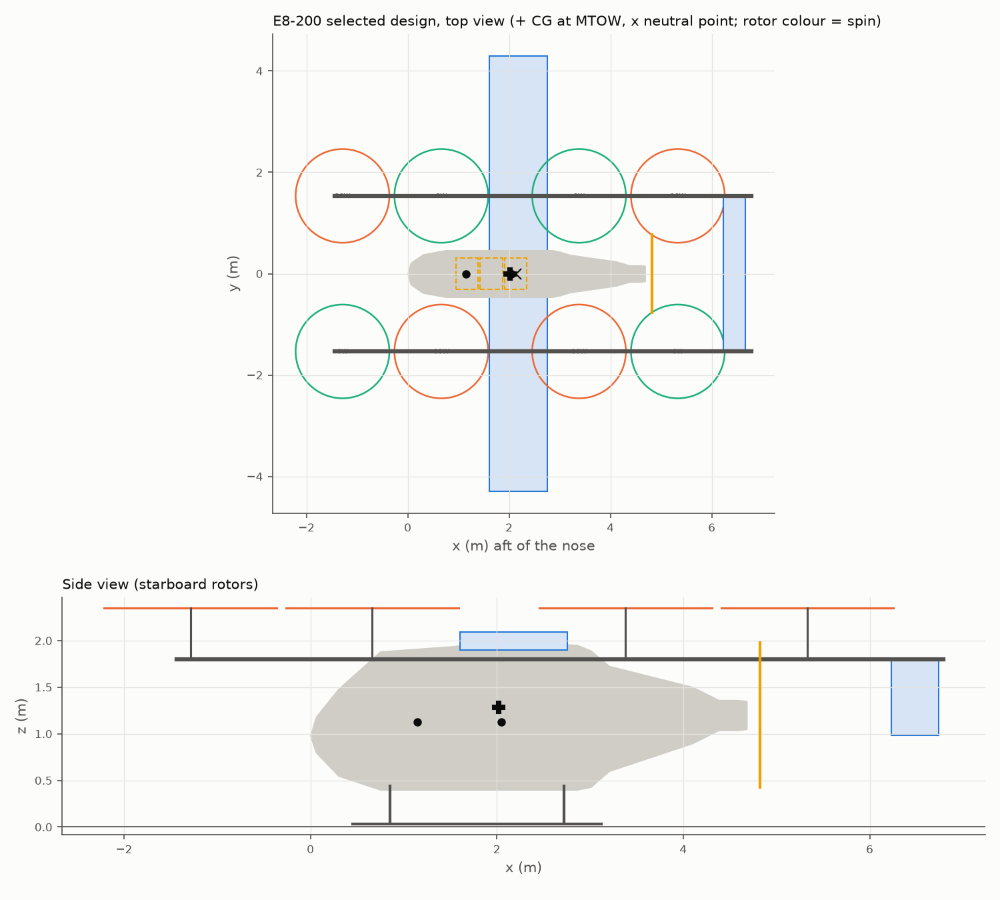
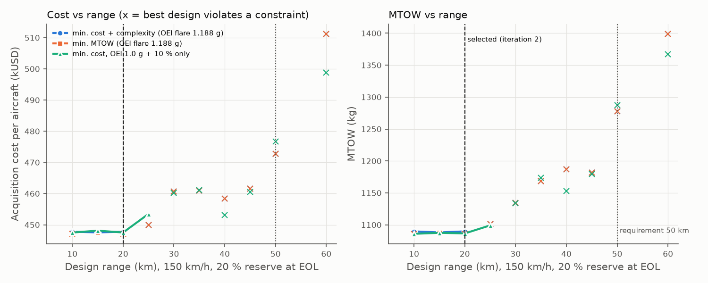

# WP D - E8-200 sizing and optimisation

Sizing, layout and cost/complexity optimisation of the E8-200 lift + cruise eVTOL (200 kg payload,
[requirements/requirements.yaml](../requirements/requirements.yaml)). Outputs: [design/selected_design.json](../design/selected_design.json),
[design/geometry.json](../design/geometry.json) (+ [geometry_cfd.json](../design/geometry_cfd.json)),
[design/mass_calibration.json](../design/mass_calibration.json), trade studies and plots in this folder, verification in
[validation/sizing/](../validation/sizing/README.md). Iteration-1 files are kept in `design/iteration1/` and `sizing/results/iteration1/`.

## Status after design iteration 2 (read this first)

Iteration 2 absorbed the CAD (WP G) and FEA (WP F) findings on the iteration-1 design: CAD empty mass +29 %
(MTOW 1,096 kg instead of 1,002 kg), 11 geometry problems, a damped gear, and no 1.2 g flare reserve with one motor out.

- **The 50 km mission does not close any more.** With the sizing model calibrated to the CAD/FEA masses (after
  42 kg of adopted weight reductions), the empty mass is ~0.61 MTOW. The 1.2 g one-motor-out flare then needs REB 60
  lift motors, and the largest design range that closes with catalog parts is **24.7 km** (29.4 km without the flare
  requirement). At 40, 45 and 50 km no design meets all constraints (table below). As instructed, the design was not forced.
- **The 1.2 g flare is met to 1.188 g.** With REB 60 motors, the 8 x 1.85 m rotors and the loading-case CG travel, the
  most loaded motor needs 59.4 kW of the 60 kW peak at 1.188 g. A full 1.2 g needs ~1 % more power than the
  catalogue peak rating. No source was found to justify a lower flare value, so the frozen design is flagged as **1 %
  short of the 1.2 g requirement** (WP F's own check, thrust as a fraction of the torque-limited maximum, now gives 96 %
  at 1.2 g, against 103 % in iteration 1).
- **Frozen iteration-2 design:** 20 km design range (actual capability 23.3 km at end of life with 20 % reserve).
  Below ~23 km the battery is sized by hover power (C-rate and one-pack-out current), not by energy, so the same
  aircraft results for any design range up to its capability.
- All 11 CAD geometry problems are fixed in `design/geometry.json`, checked with the CAD audit's definitions
  (`sizing/geometry_checks.py`, 30 integration checks: all pass, plus one information warning).

Decision needed from the owner/coordinator: accept ~20-25 km, relax the flare requirement (1.0 g + 10 %: ~29 km), or
fund further mass reduction / a higher-power lift motor (see "What would recover range").



## Iteration history

| Quantity | Iteration 1 (frozen 2026-11-13) | Iteration 2 (this) | Why it changed |
|---|---|---|---|
| Design range / capability | 50 km / 50.1 km | 20 km / 23.3 km | CAD-calibrated masses; 50 km does not close |
| MTOW | 1,002 kg | **1,090 kg** | +CAD masses (empty 499 -> 664 kg), -42 kg reductions, smaller battery |
| Empty excl. battery (incl. growth) | 499 kg | 664 kg | calibration to CAD/FEA (design/mass_calibration.json) |
| Battery | 53.8 kWh, 303 kg, 166s18p, 2 packs | **42.9 kWh, 226 kg, 159s15p, 3 packs (159s5p each)** | power-sized (hover C-rate 9.67 of 9.7 C); pack overhead 0.30 -> 0.25 |
| Lift motors | 8 x REB 50 (50 kW, 200 N m) | **8 x REB 60 (60 kW, 250 N m)** | 1.2 g flare with one motor out |
| Lift rotors | 1.75 m, 180 m/s | **1.85 m, 179 m/s**, 2 blades, chord 0.186 m | flare power; E-PROPS matched pair (<= 1.90 m) |
| Pusher | REB 90, 1.80 m E-PROPS | REB 90, **1.55 m DUC SWIRL 3-blade**, 2,341 rpm | catalog prop with mass and price; tail-strike angle |
| Wing | 8.8 x 1.20 m, LS(1)-0417, no flaps, i = 7.2 deg | **8.6 x 1.15 m**, LS(1)-0417, **plain flaps**, i = 4.0 deg | stall with heavier MTOW; incidence lowered (boom/wing, head clearance) |
| Wing spars | 0.25 / 0.65 c | **0.20 / 0.70 c** | passenger door width >= 0.483 m between the spar posts |
| Hover power (500 / 1000 m) | 247 / 251 kW | 271 / 275 kW | heavier |
| OEI 1.0 g + 10 % (1000 m) | 48.9 kW / 196 N m (REB 50) | 53.7 kW / 229 N m (REB 60: 60 / 250) | |
| OEI flare | not required | **1.188 g: 59.4 kW / 244 N m** (pilot + cargo: 59.7 kW / 245 N m) | new requirement 1.2 g |
| Cruise | 150 km/h, L/D 9.95, 58.0 kW | 150 km/h, **L/D 9.44**, 68.9 kW | heavier, taller fuselage, faired pylons |
| Parachute | GRS 6 800-990 SDS (1,050 kg), 21.7 kg | **GRS 6 990-1190 SDS/FF** (sourced, not in catalog), 28.9 kg + 6.5 kg installation | MTOW > 1,050 kg |
| Static margin (3 loading cases) | 9.5-12.1 % (CAD CG: 5.7 %) | 9.6-10.3 % with CAD-calibrated item positions | item CGs moved to the CAD group CGs |
| Cost per aircraft | USD 387 k | **USD 448 k** (objective 513 k) | REB 60, heavier airframe (Eastlake), parachute |
| Checker (WP M) | 55 PASS / 4 WARN / 0 FAIL | 48 PASS / 10 WARN / **1 FAIL** (empty mass, regression vs CAD) | see validation/sizing |

## Selected design (iteration 2)

| Item | Value |
|---|---|
| Configuration | 8 lift rotors on two carbon-tube booms (2 fore, 2 aft of the wing per boom) on **faired pylons**, shoulder wing faired into the cabin top, H-tail between the booms with twin ventral fins, REB 90 pusher in a cowled tail cone, **damped** aluminium skid gear (oleo dampers, 80 mm stroke), tandem cabin, ballistic parachute inside the OML |
| Masses | MTOW **1,089.7 kg**; empty excl. battery 663.9 kg (incl. 31.6 kg = 5 % growth); battery 225.8 kg; payload 200 kg |
| Battery | Molicel P50B, **3 independent packs of 159s5p** (2,385 cells), **42.9 kWh**, 572 V nominal / 668 V max; each pack 0.62 x 0.44 x 0.19 m (2 tiers, 26 x 16 cells per tier), Orion BMS 2 + 2 EV200 + fuse per pack |
| Lift rotors | 8 x **1.85 m** 2-blade E-PROPS ground-adjustable, chord 0.186 m, tip speed 179 m/s (M 0.52), disk loading 497 N/m2, FM 0.72 |
| Lift motors / inverters | 8 x **MGM REB 60** (60 kW peak, 250 N m, 15.3 kg; continuous taken as 36 kW, estimate) / 9 x MGM HBCi 400800 |
| Pusher | MGM REB 90 + 1.55 m DUC SWIRL 3-blade, 2,341 rpm, efficiency 0.79; hub at x 4.82, z 1.20 m |
| Wing | span **8.6 m**, chord **1.15 m**, 9.89 m2, AR 7.5, LS(1)-0417, plain flaps y 0.51-2.58 m, ailerons y 2.67-4.17 m, CLmax 2.02 (flaps), incidence 4.0 deg (fuselage +5.0 deg nose-up in cruise) |
| Tail | H-tail 1.28 m2 exposed (chord 0.433 m, 3.07 m between boom axes), V_H 0.50; ventral fins 2 x 0.38 m2 exposed (V_V 0.04) |
| Hover power | 271.2 kW (500 m) / 275.2 kW (1000 m, ISA+15), 29.8 kW shaft per motor |
| One motor out | 1.0 g + 10 % at 1000 m: 53.7 kW / 229 N m (margins 10.5 % / 8.3 %); **flare 1.188 g at 500 m: 59.4 kW / 244 N m** (pilot + cargo 59.7 kW, margin 0.4 %) |
| Cruise | 150 km/h, L/D 9.44, drag 1,132 N, D/q 0.533 m2 (stopped rotors with faired pylons and nacelles 0.170 m2), 68.9 kW electrical |
| Mission (20 km) | 25.9 kWh at the cells; usable energy at end of life with 20 % reserve 27.5 kWh; reserve 6.9 kWh; capability **23.3 km** |
| C-rates (EOL) | hover 9.67 C (limit 9.7 C, sizing constraint); one pack out (3 packs) 14.5 C (limit 15 C) |
| Stall / transition | Vs 29.6 m/s (SL, MTOW, flaps); cruise = 1.30 Vs; transition 37.3 m/s |
| CG / static margin | CG x 2.021 m, z 1.287 m; SM 10.0 % (2 occupants), 9.6 % (pilot + cargo), 10.3 % (pilot only) |
| Cost (N = 10) | **USD 448 k** per aircraft (COTS 270 k + recurring airframe 178 k); complexity 9 part types, 40 LRUs (penalty 65 k) |

## Iteration 2 work

### 1. Mass calibration to CAD/FEA (`sizing/calibration.py` -> `design/mass_calibration.json`)

The CAD audit gives the mass of every made part (CAD volume x density) and the COTS placeholders. Each mass group
of the sizing model is scaled by `k = CAD mass after the adopted reductions / iteration-1 model mass`. The factor
multiplies the model's physics or regression estimate, so it still scales with MTOW and geometry. Groups the
iteration-1 model did not contain are added as fixed masses.

| Group | Factor / fixed mass | On |
|---|---|---|
| wing | x 0.956 | Raymer [M1] x 0.85 |
| tail | x 1.339 | Raymer [M3]+[M4] x 0.85 (clamps, hinges, spars) |
| fuselage | x 1.395 | Raymer [M5] x 0.85 (canopy, shells, side panels, clevises, root fairing) |
| boom tubes | x 2.060 | strength-sized raw tube (WP F over-wrap segments, +-45 layers, sleeves, bands, caps) |
| landing gear | x 2.967 | raw cross tubes + skids (oleo dampers, P4 saddles, clamps, fairings, shoes) |
| avionics / cooling | x 1.173 / x 1.102 | Raymer [M12] / build-up |
| rotor-station hardware | **4.94 kg per rotor** (new) | pylon tube, saddle with socket, pylon head, P3 plate, isolators, nacelle |
| boom-wing clamps P2 | **9.55 kg** (new) | 4 saddles |
| parachute installation | **6.53 kg** (new) | cradle, P5 hard points |
| pusher installation | **3.52 kg** (new) | motor plate, struts, spinner |
| seats + furnishings | **22.67 kg** (CAD) | |
| battery non-cell fraction | **0.25** (was 0.30) | CAD packs + estimated nickel/liners/BMS harness give 0.22; 0.25 (= WP M light) kept for the reshaped packs |

Item positions follow the CAD group CGs: rotor-station mass 0.20 m below the hub, fuselage structure at 0.428 L, pusher
unit 0.25 m ahead of the propeller, wing at 0.425 c, avionics at x 0.66 m, and flight controls split into inceptors,
aileron actuators (wing), tail actuators (tail) and wiring. This removes the 0.05 m aft CG error that the CAD found.

### 2. Weight reductions adopted (42.4 kg; for WP G to implement and WP F to re-check)

| Part | Reduction | kg | Justification |
|---|---|---|---|
| W-CORE-1..7 (wing XPS cores) | 40 % of the core mass | 16.5 | hot-wire-cut spanwise lightening voids; keep 30 mm of foam under each skin and solid foam at the ribs, spar box and hinge lines (hollow-core moldless-wing practice). WP F: skin wrinkling, core shear |
| W-SPM-F (main-spar box foam) | Divinycell H80 -> H45 | 2.7 | the webs carry the shear, the foam only stabilises them. WP F: web buckling |
| MP (motor plate P3) | pocket 50 % | 6.4 | FEA MS +2.8 (stress 26 % of allowable) |
| PY-C (pylon saddle + socket) | pocket 30 % | 6.6 | walls and socket outside the clamp and bolt bosses |
| PY-HEAD | pocket 25 % | 1.8 | between the isolator bosses |
| LG-SADDLE (P4) | 20 % thinner pad/wall | 3.3 | the dampers cut the limit gear load to ~2.3 W (WP F); confirm with the damper load case |
| LG-SKCL | pocket 30 % | 2.2 | clamp halves |
| CH-CRADLE | 40 % | 1.7 | open truss cradle instead of a solid block |
| TL-CLAMP | pocket 30 % | 1.1 | outside the spar sockets |

### 3. Geometry changes in `design/geometry.json` (every CAD problem)

| # | CAD problem | Change |
|---|---|---|
| 1 | Booms through the wing lower surface and spar caps | Wing raised (chord line at the LE z 1.78 -> **1.985 m**), incidence 7.2 -> **4.0 deg**, boom axis z 1.623 -> **1.798 m**. The P2 saddle pad tops (84 mm above the boom axis) sit 19 / 8 mm under the lower skin at the main / rear spar; the boom crown clears the lower surface by >= 21 mm over the chord |
| 2 | Passenger head in the wing | Seats with a 150 mm stroke under the pan (SRP 0.847 m, floor 0.647 m), wing raised as above: P95 head clearance pilot 107 mm (canopy), passenger 62 mm (wing) |
| 3 | Passenger exit 0.40 x 0.49 m | Spars at **0.20 / 0.70 c** (posts 0.60 m apart): door 0.494 x 0.699 m >= 0.483 x 0.660 m (14 CFR 23.807). The door width is a constraint of the optimiser |
| 4 | Packs outside the OML; front cross tube through pack A | Fuselage section **super-ellipse exponent 2.5 -> 4.0** (boxier cabin, width 0.92 m) with the belly at z 0.40 m; **3 packs of 0.62 x 0.44 x 0.19 m** (2 tiers) placed where the section is wide enough (corners >= 13 mm inside); front cross tube **ahead of pack A** (x 0.85 m), rear tube behind the last pack (x 2.72 m); saddle pads clear of the packs by 20 mm |
| 5 | Pusher tail-down strike 9.2 deg | Skid aft end set for 11 deg: x_end 3.12 m, pusher hub z 1.20 m, D 1.55 m: **11.5 deg** (fin 16.1 deg); ground clearance 0.35 m |
| 6 | REB 90 does not fit the tail cone | **Cowl in the OML**: stations x 4.38-4.68 m are 0.32 x 0.32 m around the pusher axis (motor radius 135 mm, 24 mm margin) |
| 7 | Parachute canister above the OML | Canister at x 3.00 m, z 1.42 m, fully inside the aft fuselage (top 0.13 m below the OML) under a frangible hatch |
| 8 | Root fittings outside the OML | Root fittings at y **0.38 m** (was 0.43); the fuselage top rises into the wing between the LE and the TE (shoulder-wing fairing, top z 1.97 m), so the fittings 56 mm below the lower skin are inside the OML (8 mm margin) |
| 9 | Exposed tail areas smaller than sized | Tail areas are now **exposed** areas: H-tail chord = S_H / span between the boom surfaces (2 x (b_y - 0.056)); fin height measured from the boom underside |
| 10 | Mass / CG | Calibration and reductions (above); item CGs at the CAD group CGs |
| 11 | Warnings | Rotor-burst fan: pylon raised to **0.55 m** -> minimum depression angle 5.4 deg (>= 5 deg + 0.3 envelope margin); boom underside 1.74 m above ground (was 1.57; still < 1.9 m: pad and mark); seat stroke 160 mm (was 60 mm) |
| - | FEA: damped gear | `landing_gear_oml.dampers`: 4 oleo-pneumatic dampers, 80 mm stroke (>= 75 mm), collar on each leg to a cabin-side hard point; cross tubes 76 x 5.82 mm (WP F); gear mass from the CAD incl. dampers |
| - | FEA: slotted rear boom saddle | kept in the design notes; P2 masses in the calibration |
| - | CFD: pylons | Lift-rotor pylons faired: `mast_thickness` 0.116 m, `mast_chord` 0.40 m (fairing over the WP F 100 x 1.6 mm tube) in `geometry_cfd.json`; pylon (C_D 0.07 on frontal, t/c 0.29, Hoerner AE04) and inverter-nacelle drag in the sizing build-up; gear legs faired (`faired: true`) |

The layout is generated by `sizing/design_out.py` from the bottom up. The cabin belly and the pack width fitted to the
section give the floor; the 150 mm seat stroke gives the SRP; P95 heads with 50 mm (+10 mm) clearance and the 0.66 m
door give the wing height; the saddle pads give the boom height; the 0.15 m blade-over-wing clearance and the 5 deg burst
fan give the pylon height; the 11 deg strike angle gives the skid length; the root fittings and the canister give the
fuselage top. `sizing/geometry_checks.py` then re-checks everything with the CAD audit definitions.

### 4. One motor out at 1.2 g, motor re-selection

New constraint: one lift motor failed, 1.2 g vertical at MTOW, 500 m ISA+15. This is the flare/arrest of the descent
at the landing site; no extra control margin is added, because the 0.2 g is the manoeuvre. It is checked against
motor peak power and maximum torque (LP over every failed rotor and every loading case in the final design; screening
n/(n-2) + 0.5 % CG-travel allowance in the optimiser). The tip-Mach limit for this < 5 s emergency transient is the
[H7] compressibility screen 0.70 (as for the pusher); continued OEI hover keeps 0.65.

| Lift motor | Result (re-optimised, 20 km) |
|---|---|
| REB 30 | infeasible: rotor-out torque, flare power/torque |
| REB 50 | infeasible: flare power/torque (1,007 kg best) |
| **REB 60** | **feasible to 1.188 g** (1,090 kg); 1.2 g short by 1 % power |
| REB 90 | infeasible: 1,185 kg, pusher continuous power, climb, stall |

Flare load-factor trade (`plots/trade_flare_g.png`): 1.0, 1.1 and 1.15 g close at ~1,087-1,090 kg; 1.2 and 1.25 g do
not. Diameter (`plots/trade_diameter.png`): only 1.85-1.90 m are feasible. Below that, the higher disk loading exceeds
the flare power; above 1.90 m there is no matched E-PROPS pair and the length runs into the footprint. Tip speed
(`plots/trade_tip_speed.png`): 175-180 m/s are feasible. Lower is torque-limited; higher exceeds the OEI tip Mach.

### 5. Range: no closure at 40 / 45 / 50 km

| Design range | Best design (min. cost + complexity) | MTOW | Battery | Cost | Violated (normalised excess) |
|---|---|---|---|---|---|
| 10-20 km | the frozen design (power-sized battery) | 1,088-1,090 kg | 42.7-42.9 kWh | USD 448 k | none |
| **24.7 km** | largest closing range (bisection) | 1,100 kg | - | - | - |
| 30 km | REB 60, 1.80 m | 1,135 kg | 49.8 kWh | USD 461 k | flare power +11 %, pusher continuous |
| **40 km** | REB 60, 1.90 m | **1,187 kg** | 59.4 kWh | **USD 458 k** | flare power +12 %, flare torque +5 %, door width, OEI tip Mach |
| **45 km** | REB 50, 1.85 m | **1,182 kg** | 63.7 kWh | **USD 462 k** | rotor-out power/torque +22 %, flare +37 % |
| **50 km** | REB 60, 1.85 m | **1,278 kg** | 73.9 kWh | **USD 473 k** | rotor-out power +15 %, torque +10 %, flare power +29 %, parachute |
| 100 km | REB 90, 2.40 m | ~2,100 kg | 184 kWh | - | everything (mass spiral) |

With the iteration-1 rotor-out rule only (1.0 g + 10 %), the limit is **29.4 km** (25 km: 1,099 kg, USD 453 k).



**What would recover range** (from the sensitivities and trades): every 10 kg of empty mass is worth ~17 kg of MTOW
here.
- The empty-mass fraction (0.61) is the problem, not the cells. The largest CAD groups above the iteration-1
  estimate are the gear (53 kg incl. dampers), rotor-station hardware (40 kg), boom tubes (47 kg, driven by the 4.8 g
  parachute opening case) and the fuselage (66 kg).
- Limiting the parachute deployment speed (lower opening load, FEA item 5) and a composite bow gear are the most
  promising structural levers.
- A higher-power lift motor of REB 60 mass (>= 63 kW peak, ~250 N m) would make the 1.2 g flare at the current MTOW.
- Relaxing the flare to 1.0 g gives ~29 km.

### Discrete and continuous trades at the frozen design (`plots/trade_discrete.png`, `results/trades.json`)

8 rotors (6 rotors, 4 coaxial pairs, 4 rotors all infeasible on rotor-out/flare); REB 60; P50B; LS(1)-0417 (NACA 4415 and
2415 feasible but USD 2-5 k dearer); REB 90 pusher (the only motor with the continuous power); plain flaps
(without flaps the stall margin fails); 2 blades; tandem cabin (side-by-side infeasible on the flare); 150 km/h.
3 packs are needed: 2 packs exceed the one-pack-out current, 4 packs cost USD 5 k more. Some single trade points are
infeasible by < 1 % next to feasible neighbours: the design sits on the flare constraint, so the GA result is
sensitive to the discrete steps.

### Sensitivity (frozen geometry, battery and mass closure respond)

| Assumption (low / high) | dMTOW kg | dBattery kWh | dCost kUSD | Violated at high value |
|---|---|---|---|---|
| pack overhead 0.25 / 0.35 | 0 / +67 | 0 / +4.3 | 0 / +5.0 | rotor-out torque, flare, pusher |
| hover induced factor 1.15 / 1.25 | -14 / +14 | -2.4 / +2.4 | -1.9 / +1.9 | flare, pusher |
| blade cd0 0.012 / 0.018 | -9 / +9 | -1.6 / +1.6 | -1.3 / +1.3 | flare, pusher |
| download base 0.01 / 0.04 | -5 / +14 | -0.8 / +2.4 | -0.7 / +2.0 | flare, pusher |
| growth 0 / 10 % | -63 / +53 | -3.5 / +3.0 | -6.5 / +3.7 | flare, pusher |
| structure factor 0.75 / 1.0 | -43 / +45 | -2.4 / +2.4 | -12.6 / +14.5 | flare, pusher |
| excrescence 1.05 / 1.20, motor-bell C_D, battery efficiency | ~0 | ~0 | ~0 | pusher only (battery power-sized) |

Because the battery is power-sized, drag no longer moves the mass (only the pusher continuous rating); hover power
and empty mass do.

## How to run

```
P=~/tools/cadenv/bin/python
$P -m sizing.airfoils        # NeuralFoil section data -> results/airfoils.json (once)
$P -m sizing.calibration     # CAD/FEA calibration -> design/mass_calibration.json
$P -m sizing.run             # optimise, flare fallback search, write design/*.json, results/selected.json (~40 min)
$P -m sizing.trades          # trades, range fronts, sensitivities -> results/trades.json, plots/ (~25 min, 10 processes)
$P methods/check_design.py --out validation/sizing --tag selected
$P validation/sizing/verify_sizing.py
```

| File | Content |
|---|---|
| `data.py` | catalog interface (motors, inverters, cells, parachutes incl. the sourced GRS 6 990-1190, propellers, systems) |
| `airfoils.py` | NeuralFoil (TL04) section data |
| `calibration.py` | CAD/FEA mass calibration and the adopted weight reductions |
| `physics.py` | vectorised equations ([A], [H], [P], [D], [I], [M], [L], [C] tags of methods/EQUATIONS.md) |
| `model.py` | closure model, constraints (incl. OEI flare, door width), cost and complexity |
| `rotor_out.py` | rotor-out LP and spin-pattern choice |
| `optimise.py` | mixed discrete/continuous GA + polish |
| `design_out.py` | bottom-up layout, CG solution, loading cases, design files |
| `geometry_checks.py` | integration checks with the CAD audit definitions |
| `run.py`, `trades.py` | drivers |

## Method (unchanged from iteration 1 except where noted)

**Optimiser.** The objective is acquisition cost + USD 5,000 per distinct propulsion/actuated part type + USD 500 per
propulsion LRU. It is searched by a vectorised genetic algorithm over rotor configuration, rotor diameter, tip speed and
blades, lift and pusher motor, wing span, chord, airfoil and flaps, pusher diameter, cell, pack count and cruise speed.
The integer series/parallel/pack layout is solved inside the MTOW closure.

**Constraints.**
- 50 km-style mission per the requirements (EOL 80 %, 20 % reserve, I2R battery losses capped at 0.95).
- Hover at 1000 m ISA+15 with download (0.02 + area under the discs, RA03).
- Rotor-out (1.0 g + 10 % at 1000 m) and **flare (1.2 g, 500 m; new)** within peak power and torque.
- C-rate, including one pack out.
- Tip Mach; stall (1.3 Vs); gust; 9 m footprint; static margin (10 % at MTOW, 5-15 % in all cases).
- Pusher continuous power and climb; parachute rating; **door width (new)**.

**Equations and sources.**
- Hover [H1]-[H5] (RA01); drag [D1]-[D9] (AE01, AE04); stopped rotors [D7] with faired motor bells, **faired pylons and
  nacelles (new)**.
- Raymer masses with a composite factor and **CAD calibration (new)**; Eastlake cost (AE02).
- NeuralFoil section data (TL04). LS(1)-0417 clmax 1.82 at Re 3e6 / ncrit 5 is used; CFD reports that handbook clmax may
  be 5-10 % optimistic, and -7.5 % would cut the stall margin from 1.30 to ~1.27 (see risks).
- CFD found its own hover download conservative by ~1.46 x against Felker & Light. The sizing download model is
  calibrated on RA03 test data, not on CFD, and is kept.

## Notes for other work packages

- **WP G**:
  - Implement the weight reductions above and the geometry changes (all driven from geometry.json).
  - Packs are now 3 x 0.62 x 0.44 x 0.19 m in 2 tiers (`battery_packs[].tiers / cells_across / rows_per_tier`).
  - The pusher cowl is part of the OML (no separate PM-COWL needed); the root fairing is the raised fuselage top.
- **WP F**:
  - Re-run with the new MTOW (1,090 kg), REB 60 motors (250 N m, rotors `max_thrust_N` 2,229 N) and the raised wing.
  - Root fittings move to y 0.38 m; spars move to 0.20 / 0.70 c (spar sections are first-order sizes for the new
    stations).
  - Parachute opening load is now 48.8 kN (GRS 6 990-1190 at 1,190 kg, VNE; `n_open_limit` 4.57 on MTOW).
  - Check the damper load case for the 20 % lighter P4 saddles.
- **WP C**: use `geometry_cfd.json`: faired pylons (`mast_thickness` 0.116, `mast_chord` 0.40), faired gear, the cowl
  and the shoulder-wing fairing are in the OML stations.
- **WP P**: please add the Galaxy GRS 6 990-1190 SDS/FF (28.9 kg, 990/1190 kg, VNE 320/280 km/h, opening shock
  45.6/48.8 kN; https://galaxysky.cz/grs-6-990-1190-sds-ff-245m2-p44-en) to the catalog with a quote. Request the REB 60
  continuous rating (36 kW assumed) and whether a 63-65 kW short-time rating exists.

## Open risks (iteration 2)

| # | Risk | Mitigation |
|---|---|---|
| 1 | Range: 50 km does not close; 20-25 km with all requirements | owner decision (requirement, flare value, mass-reduction programme) |
| 2 | 1.2 g OEI flare met only to 1.188 g; REB 60 at 99 % of peak power in the flare | thrust-stand test of REB 60 at 40 C; ask MGM for a short-time (5 s) rating; flare law that uses the remaining rotors' overspeed; or relax to 1.15 g with justification |
| 3 | REB 60 continuous rating not published (36 kW assumed); hover 29.8 kW at 500 m | MGM data |
| 4 | Battery power-sized at 9.67 C of the 9.7 C limit (40 A screening); 14.5 C one pack out | thermal test of a 159s module at the 2-min hover current; consider P50B at 45 A screening |
| 5 | Weight reductions (42 kg) not yet built or re-analysed | WP G/F iteration; growth allowance 5 % (31.6 kg) retained |
| 6 | CLmax of LS(1)-0417 5-10 % lower than handbook (CFD) | stall margin 1.30 -> ~1.27 at -7.5 %: 155 km/h cruise or ~5 % more wing area (+~3 kg) |
| 7 | Fuselage flies 5 deg nose-up in cruise (incidence lowered to 4 deg for the boom/wing and head clearance) | CFD fuselage polar; a 1 deg higher incidence costs 18 mm of boom-pad clearance |
| 8 | Boom underside 1.74 m above ground on the egress path | padding, marking, egress procedure |
| 9 | Boom/rotor modes near 1P/2P (WP F) | isolators, GVT (unchanged) |
| 10 | Checker disagrees on empty mass by 22 % (regressions vs CAD bottom-up) | documented in validation/sizing; CAD masses kept |
