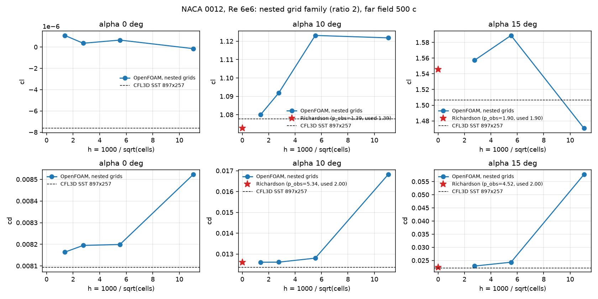
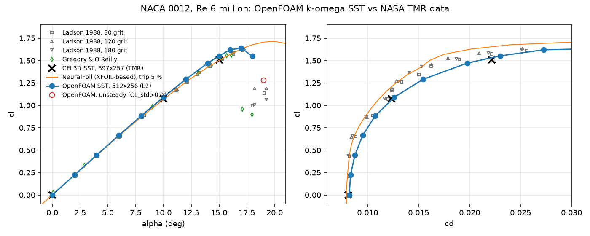
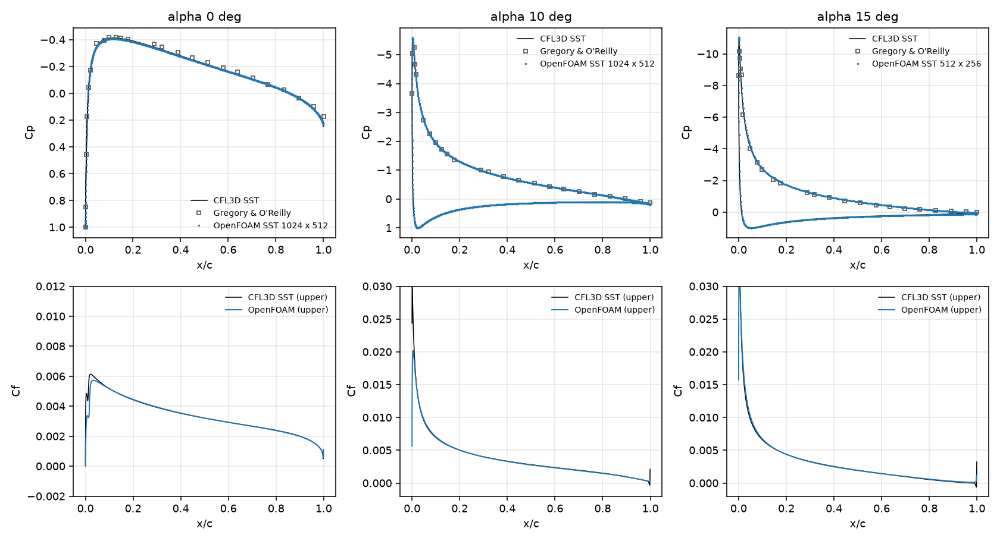
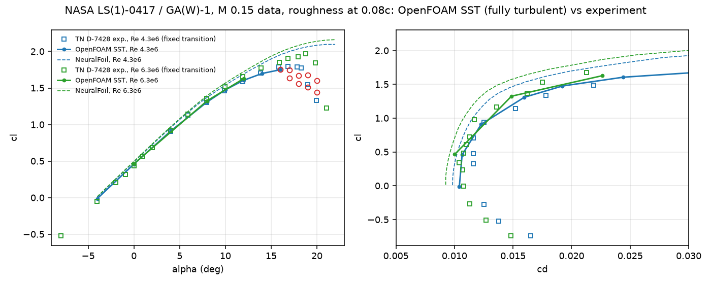
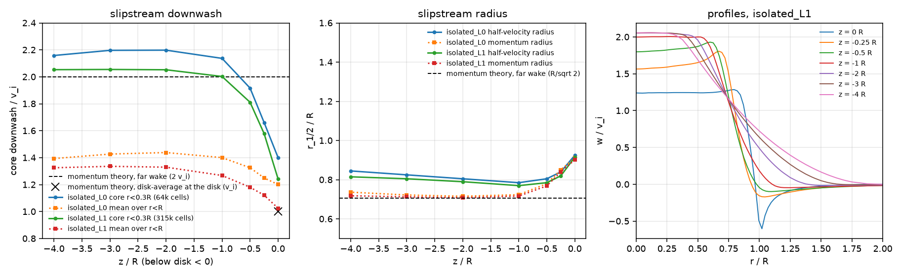
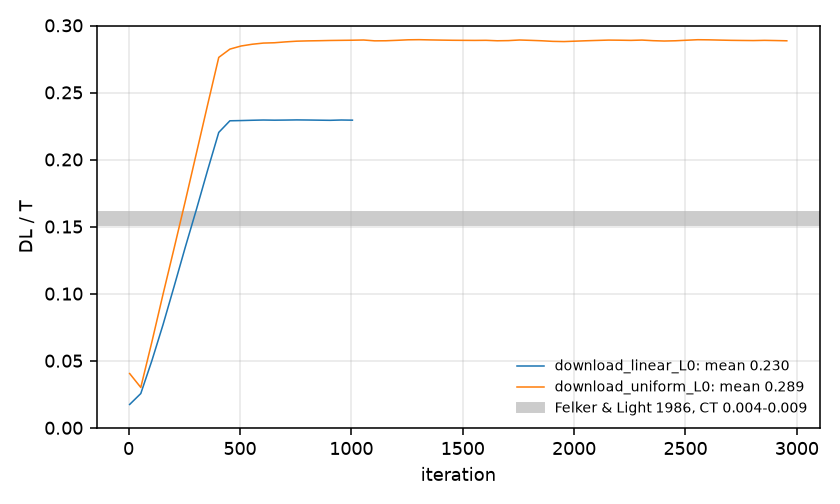
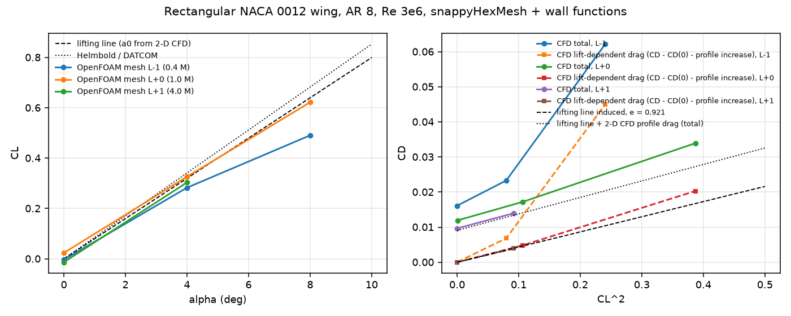
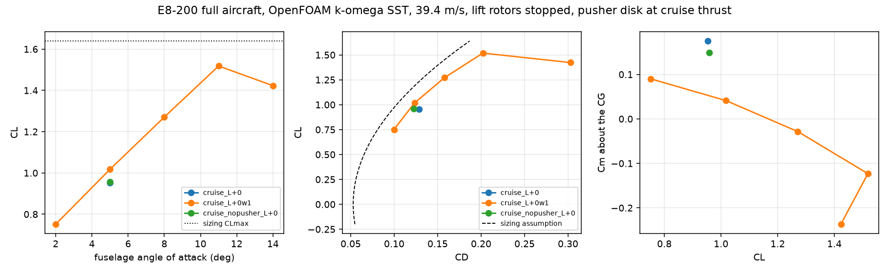

# CFD verification and validation (work package C)

This folder holds the evidence that the OpenFOAM tool chain in [`cfd/`](../../cfd/README.md) gives credible answers at the
full-scale Reynolds numbers of the E8-200 (wing chord 1.2 m at 30-45 m/s: Re 2.4-3.6 million; hover rotor wakes at
about 500 N/m2 disk loading), and it states the uncertainty bands applied to every design result (section 7).

Solver for every case: OpenFOAM v2412 `simpleFoam` (incompressible steady SIMPLEC), k-omega SST (as implemented in
OpenFOAM), linear-upwind convection for momentum, fully turbulent, ISA air.

| Path | Content |
|---|---|
| `data/*.json` | Raw results of every case (coefficients, iteration counts, mesh statistics, y+); `summary.json` collects the tables below |
| `img/*.png` | Plots shown below |
| `reference/` | Reference data (NASA TMR files, digitised experiments, airfoil coordinates); sources in the file headers |

Scripts: `cfd/tools/airfoil2d.py`, `rotor_disk.py`, `wing3d.py`, `report.py` (plots and tables), `gci.py`, `watchdog.py`.
Scratch cases are in `cfd/.cache/` and are regenerated with the commands in section 8.

## Summary

| # | Case | Reference | Result | Verdict |
|---|---|---|---|---|
| 1 | NACA 0012, Re 6e6, grid study (4 nested grids to 1024 x 512) | NASA TMR CFL3D/FUN3D SST, Ladson 1988 | cd(0) +0.9 %, cl(10) -0.5 % (Richardson), cd(10) +2 %, cl(15) +3 % vs CFL3D; GCI_fine cl 0.85 %, cd 0.02-1.1 %; polar clmax 1.64 vs 1.61 (Ladson); Cp/Cf overlay CFL3D | pass |
| 2 | NACA 0012, wall treatment | wall-resolved solution, same code | y+ 30 wall functions: cl -0.5 %, cd -1 %; y+ 60: cd(10) +10 %; y+ 120: early stall | y+ <= 40 required |
| 3 | NASA LS(1)-0417 (GA(W)-1), Re 4.3e6 / 6.3e6 | McGhee & Beasley, NASA TN D-7428 (fixed transition) | lift slope -4 / -9 %, cl(0) +0.02, cd(cl 0.5) -7 / -6 %, clmax 1.75 vs 1.80 (Re 4.3e6), 1.76 vs 1.97 (Re 6.3e6) | pass; clmax conservative |
| 4 | Actuator disk in hover | momentum theory | disk-average induced velocity +2.5 %, ideal power +3 %, far-wake velocity +2.6 %, far-wake radius 0.71 R (theory 0.707 R) | pass |
| 5 | Rotor over a wing in hover | Felker & Light 1986, NASA TM 88255 | DL/T 0.23 (radius-weighted disk) and 0.29 (uniform) vs 0.157 measured | conservative by factor 1.5 |
| 6 | Rectangular wing AR 8, Re 3e6, snappyHexMesh + wall functions | lifting-line theory with 2-D CFD section data, VLM, Helmbold | L+1 mesh: CD0 +6 %, CL_alpha -1 %, lift-dependent drag within 2 %; L0 mesh: CD0 +31 %, e -20 %, CL_alpha -6.5 % | pass at L+1; L0 for trends only |

## 1. NACA 0012 at Re 6 million (NASA TMR case 2DN00)

Set-up as the NASA Turbulence Modeling Resource (TMR) validation case: TMR sharp-trailing-edge NACA 0012, Re 6e6,
fully turbulent SST, free-stream Tu 0.052 % and nu_t/nu 0.009, far field at 500 chords. Structured O-grids from
`cfd/tools/ogrid.py` (normal marching). The four grids form an exactly nested family: the finest grid (1024 x 512
cells, first cell 5e-7 c, y+ < 0.2) is generated once and the coarser ones are obtained by removing every second grid
line (refinement ratio 2), the same procedure TMR uses for its grid families.

References (in `reference/tmr_naca0012/`, from https://tmbwg.github.io/turbmodels/naca0012_val.html, mirror of
https://turbmodels.larc.nasa.gov/naca0012_val.html): CFL3D SST on the 897 x 257 grid (also representative of FUN3D and
NTS, which agree to plotting accuracy on the TMR page), Ladson (1988, NASA TM-4074) tripped experiments, Gregory &
O'Reilly (1970) pressure data. TMR runs are compressible at M 0.15; the incompressible OpenFOAM result is expected to
lie about 1 % below in lift (Prandtl-Glauert factor 1/sqrt(1 - 0.15^2) = 1.011).

### 1.1 Grid convergence (Celik et al. 2008 procedure)

| Grid | Cells | cl (10 deg) | cd (10 deg) | cd (0 deg) | cl (15 deg) | cd (15 deg) |
|---|---|---|---|---|---|---|
| L4 | 8,192 | 1.1219 | 0.01682 | 0.00852 | 1.4706 | 0.0577 |
| L3 | 32,768 | 1.1232 | 0.01280 | 0.00820 | 1.5889 | 0.0243 |
| L2 | 131,072 | 1.0919 | 0.01261 | 0.00820 | 1.5572 * | 0.0229 * |
| L1 | 524,288 | 1.0800 * | 0.01261 * | 0.00816 * | - | - |
| Richardson extrapolation (L1-L3) | | **1.0726** | **0.01260** | (no observed order) | 1.5457 (L2-L4) | 0.0224 |
| CFL3D SST 897 x 257 (TMR) | | 1.0778 | 0.01236 | 0.00809 | 1.5068 | 0.02219 |

\* not fully converged iteratively: the value is the limit of an exponential fit to the last 3000 iterations
(`airfoil2d.py iter_limit`); the iterative error estimate is 0.0026 in cl (L1, 10 deg), 1e-5 in cd (L1, 0 deg) and
0.003 in cl (L2, 15 deg).

| Quantity | Observed order p | GCI_fine (L1) | GCI_medium (L2) | Asymptotic check GCI_32/(r^p GCI_21) |
|---|---|---|---|---|
| cl, 10 deg | 1.39 | 0.85 % | 2.2 % | 0.99 |
| cd, 10 deg | 5.3 (credited 2) | 0.02 % | 0.6 % | 1.00 |
| cd, 0 deg | none (L3 to L1 difference grows) | 1.1 % (factor of safety 3 on the L1-L2 difference) | - | - |
| cl, 15 deg (L2-L4) | 1.9, oscillatory | 0.9 % (on L2) | 3.4 % | 0.98 |



Comparison with the reference (finest-grid / extrapolated values):

* cd at 0 deg: 0.00816 vs 0.00809 (CFL3D, +0.9 %) and 0.0081 (Ladson tripped, 80-180 grit).
* cl at 10 deg: 1.0726 extrapolated vs 1.0778 (-0.5 %; -1.5 % from the expected compressibility offset of +1.1 %
  in CFL3D); cd at 10 deg 0.01260 vs 0.01236 (+2 %).
* cl at 15 deg (L2 grid): 1.557 vs 1.507 (+3.3 %), cd 0.0229 vs 0.0222 (+3 %); close to stall the SST
  solution is sensitive to the grid (L4 stalls).
* The production 2-D grid L2 (512 x 256) is within 1.8 % (cl) and 0.4 % (cd) of the extrapolated values.

**Finding (numerics).** With `cellLimited` gradient limiting (the setting inherited from the subscale project) the
symmetric airfoil converged to an asymmetric state at alpha 0 on the 512 x 256 grid (cl = 0.012, residuals 1e-8; the
256 x 128 grid was symmetric) and cl(10 deg) was 1.109 instead of 1.092 (`data/n0012_limited_gradient_runs.json`).
Unlimited gradients removed the asymmetry; all 2-D results above use unlimited gradients. The 3-D set-up keeps the
limiter (needed for robustness on snappyHexMesh grids), which is one reason for the 3-D calibration in section 6.

**Checkmesh.** All O-grids pass except the skewness check at the sharp trailing edge (max skewness 17.6, 22-103 faces in
the first cells behind the TE, depending on the grid); this is inherent to a sharp-TE O-grid. There are no inverted cells
(checked by `inverted_cells` before writing). The blunt-TE GA(W)-1 grid has max skewness 0.82 (no failed checks).

### 1.2 Polar and surface distributions

Production grid L2 (512 x 256); the 0, 10 and 15 deg points are the grid-study L2 cases.

| alpha (deg) | cl OpenFOAM | cd OpenFOAM | cl CFL3D | cd CFL3D | cl Ladson (80 grit, interpolated) | cd Ladson |
|---|---|---|---|---|---|---|
| 0 | -0.0000 | 0.00820 | 0.0000 | 0.00809 | -0.007 | 0.00809 |
| 2 | 0.2235 | 0.00833 | - | - | 0.207 | 0.00816 |
| 4 | 0.4463 | 0.00875 | - | - | 0.427 | 0.00823 |
| 6 | 0.6669 | 0.00952 | - | - | 0.645 | 0.00882 |
| 8 | 0.8829 | 0.01074 | - | - | 0.856 | 0.01028 |
| 10 | 1.0919 | 0.01261 | 1.0778 | 0.01236 | 1.059 | 0.01191 |
| 12 | 1.2905 | 0.01543 | - | - | 1.249 | 0.01321 |
| 14 | 1.4735 | 0.01980 | - | - | 1.419 | 0.01601 |
| 15 | 1.5533 | 0.02301 | 1.5068 | 0.02219 | 1.494 | 0.01831 |
| 16 | 1.6208 | 0.02725 | - | - | 1.556 | 0.02126 |
| 17 | 1.6404 | 0.03472 | - | - | 1.606 | 0.02506 |
| 18 | 1.5490 (unsteady) | 0.05481 | - | - | - | - |
| 19 | 1.2841 (unsteady) | 0.10400 | - | - | - | - |

Up to 17 deg the solutions are steady (CL oscillation below 0.004); 18 and 19 deg oscillate (CL_std 0.008-0.010) and
are marked unsteady. The 12-19 deg points needed 6000-10000 iterations to recover from the impulsive start. Lift is 3-4 %
above Ladson's tripped data between 8 and 16 deg (the experiment is not corrected to free air and the L2 grid is 1.8 %
high in lift at 10 deg, section 1.1); clmax is 1.64 at 17 deg vs 1.61 at 17.1 deg in the experiment. In the linear
range cd is 0.0001-0.0007 above Ladson, consistent with fully turbulent flow compared with tripped data. Pressure and
skin-friction distributions (1024 x 512 grid at 0 and 10 deg, 512 x 256 at 15 deg) overlay the CFL3D results; the
suction peaks and the Gregory & O'Reilly pressures agree to plotting accuracy.




## 2. Wall treatment (what y+ the 3-D meshes must have)

The 3-D aircraft meshes (snappyHexMesh) cannot reach y+ ~ 1 at full-scale Reynolds numbers with a practical cell
count (first cell about 5 micrometres on a 1.2 m chord at 42 m/s), so they use wall functions (Spalding nu_t, blended
omega). The error of that choice was measured on the same NACA 0012 / Re 6e6 case with 512-point O-grids whose first
cell height gives the listed y+, all other settings equal:

| Wall treatment | mean y+ | cl (0) | cd (0) | cl (10) | cd (10) |
|---|---|---|---|---|---|
| wall-resolved, fine grid L1 (reference) | 0.1 | 0 | 0.00816 | 1.080 | 0.01261 |
| wall-resolved, 512 x 256 grid with y+ 1 | 1.1 | 0 | 0.00771 | 1.090 | 0.01194 |
| Spalding wall function | 33 | 0 | 0.00810 | 1.085 | 0.01246 |
| Spalding wall function | 65 | 0 | 0.00791 | 1.074 | 0.01393 |
| Spalding wall function | 119 | 0 | 0.00679 | 0.864 (stalled) | 0.106 |
| low-Re boundary condition at y+ 24 (wrong use) | 24 | 0 | 0.00412 | 1.138 | 0.00618 |

At Re 3e6 (the 3-D wing case) the same comparison at y+ 70 gives cl(8 deg) 0.829 vs 0.873 and cd(8 deg) 0.0182 vs
0.0120 (wall-resolved), i.e. premature trailing-edge separation (`data/n0012_re3e6.json`).

Conclusion: wall functions are acceptable on the lifting surfaces only with a first-cell y+ of about 30
(cl within 0.5 %, cd within 1 %); at y+ 60 the lift-dependent drag is 10 % high and at y+ 100+ separation is
predicted much too early. The 3-D meshes therefore use a first prism layer of 0.5 mm (cell-centre y+ 25-40 at
42 m/s on a 1.2 m chord), 9 layers with expansion 1.25, and the low-Re wall condition is never combined with
y+ > 5 (that combination underpredicts drag by a factor of two).

## 3. Cambered wing section: NASA LS(1)-0417 (GA(W)-1) at Re 4.3 and 6.3 million

The E8-200 wing section. Coordinates: McGhee & Beasley, *Low-speed aerodynamic characteristics of a 17-percent-thick
airfoil section designed for general aviation applications*, NASA TN D-7428, 1973, table I
(https://ntrs.nasa.gov/citations/19740003708; identical to the UIUC `ls417.dat`). The measured 0.71 %-chord blunt
trailing edge is kept and closed with a semicircular base (round TE); a sharp-TE closure was tried first and changes
cl(0) by -0.08 according to NeuralFoil, which is why it was not used. Experimental data: figure 12(b) of the TN,
M 0.15, transition fixed by No. 80 grit at 0.08c, digitised by this work package
(`reference/gaw1_TND7428_fig12b_digitized.csv`, reading accuracy cl +-0.015, cd +-0.0004, alpha +-0.15 deg; tunnel
corrections of about 2 % are not applied in the TN). NeuralFoil (an XFOIL-trained network, `xxxlarge`, transition
forced at 5 % chord) is the panel-method comparison; XFOIL itself could not be built in this environment.
CFD: 512 x 256 O-grid, far field 500 c, y+ < 1, Tu 0.1 %, fully turbulent, mean of the last 1000 iterations.

| Quantity | CFD Re 4.3e6 | Exp. Re 4.3e6 | CFD Re 6.3e6 | Exp. Re 6.3e6 | NeuralFoil 4.3e6 / 6.3e6 |
|---|---|---|---|---|---|
| lift slope -4..8 deg (/deg) | 0.110 | 0.114 | 0.108 (0, 8 deg) | 0.118 | - |
| zero-lift angle (deg) | -4.0 | -3.8 | -4.3 | -3.7 | - |
| cl at 0 deg | 0.459 | 0.435 | 0.465 | 0.435 | 0.49 / 0.50 |
| cl at 8 deg | 1.309 | 1.302 | 1.325 | 1.360 | - |
| cd at cl 0.5 | 0.0108 | 0.0116 | 0.0102 | 0.0108 | 0.0103 / 0.0096 |
| clmax (steady points / incl. oscillating) | 1.75 at 16 deg / 1.75 | 1.80 at 16.8 deg | 1.63 at 12 deg / 1.76 at 16 deg | 1.97 at 18.8 deg | 2.10 / 2.16 |



Steady RANS points with a lift oscillation above 0.01 (red circles) are unsteady and are not used for fits. The CFD
reproduces the linear range within 0.03 in cl and the drag within 7 % (below the fixed-transition data, which include
the trip-strip drag), and it predicts clmax within 3 % at Re 4.3e6. At Re 6.3e6 it misses the measured Reynolds-number
gain in clmax (1.76 vs 1.97, -11 %) and stalls 2-3 deg early, a known trait of SST for trailing-edge stall. NeuralFoil
over-predicts clmax by 0.2-0.3. For the design, the CFD clmax is therefore a conservative (low) estimate at
Re 3-4 million.

## 4. Actuator disk in hover vs momentum theory

`rotor_disk.py isolated`: rotor R = 1.067 m, thrust 1000 N (280 N/m2), uniform momentum source (`actuator.py`) in a
disk of 0.08 R thickness, quarter domain (two symmetry planes) 24 R x 12 R x 12 R, snappyHexMesh refinement only,
same SST/wall settings as the aircraft hover case. The source is ramped over the first 400 iterations (an impulsive
start diverged) and turbulence convection is first-order upwind in hover (with limitedLinear the hover jet diverged
through a negative-omega excursion).

| Quantity | Theory | L0 (64 k cells, R/16 at disk) | L1 (315 k cells, R/32 at disk) |
|---|---|---|---|
| disk-average induced velocity / v_i (flux through r < R at the disk) | 1 | 1.201 | 1.025 |
| induced power / ideal (T x zone-average velocity) | 1 | 1.20 | 1.031 |
| far-wake core velocity / v_i (z = -2..-4 R) | 2 | 2.20 | 2.05 |
| far-wake momentum radius / R (z = -2 R) | 0.707 | 0.716 | 0.709 |
| half-velocity radius / R (z = -1 R) | - | 0.785 | 0.77 |



The L1 resolution (R/32 in the disk, R/16 in the slipstream) reproduces momentum theory within 3 %; the L0 resolution
over-predicts the induced velocity by 20 %. The aircraft hover meshes use R/24 to R/32 at the disks (section 7 band).

## 5. Rotor over a wing in hover (download): Felker & Light (1986)

Reference: Felker & Light, *Rotor/wing aerodynamic interactions in hover*, NASA TM 88255 (1986),
https://ntrs.nasa.gov/citations/19860018588, small-scale test: 4-blade rotor R = 1.067 m, NACA 23015 wing, chord
0.447 m, span 1.60 m, flap 0, incidence 0, rotor axis over the wing centre, rotor-to-wing distance 0.4 R, no image
plane. Measured DL/T = 0.157 +- 0.004 for CT 0.004-0.008 (figure 11, digitised in `reference/`). CFD: half model,
200 k cells (wing c/54, 3 prism layers, 94 % coverage), same disk thrust 1000 N.

| Disk loading model | DL/T CFD | Measured | CFD / measured |
|---|---|---|---|
| uniform (ideal rotor) | 0.289 | 0.157 | 1.84 |
| radius-weighted (dT/dA ~ r, root cut-out 0.12 R), the aircraft default | 0.230 | 0.157 | 1.46 |



The download per unit wing area is 1.44 times the disk loading for the uniform disk (Felker & Light measure
about 1.4 times the local wake dynamic pressure for chordwise flow, i.e. about 1.0 times the disk loading). Reasons for the
over-prediction: no swirl and no blade-passage unsteadiness (both spread the real wake), a disk loading still too
concentrated at the inner radii where the wing sits, and steady RANS of the bluff, separated wing wake. The
statement carried forward: **the actuator-disk download is conservative by a factor of about 1.5 (radius-weighted
loading)**; phase-2 downloads are reported raw and divided by 1.46, with the band given in section 7. The hover
download is the least accurate CFD output of this work package.

## 6. Finite wing with the 3-D mesher at full-scale Reynolds number

`wing3d.py`: rectangular NACA 0012 wing, chord 1 m, span 8 m (AR 8, square tips), 45 m/s, Re 3.0e6, half model
(symmetry plane at the root), snappyHexMesh with 9 prism layers (first layer 0.5 mm, y+ 25-40, expansion 1.25,
coverage 96-98 %), Spalding wall functions, the same numerical settings as the aircraft cases. Three surface
refinements: L-1 (cell c/32 on the surface, c/64 at the leading and trailing edges), L0 (c/64 and c/128, the
aircraft baseline) and L+1 (c/128 and c/256). The background mesh is offset so that no cell face lies on the chord
plane (with an aligned background mesh the castellation was asymmetric and gave cl = -0.011 at alpha 0).

References, all built from the validated 2-D data (wall-resolved NACA 0012 at Re 3e6: a0 = 6.25 /rad, cd = 0.0091 +
0.0038 cl^2): Prandtl lifting line (Glauert series, 400 terms; CL_alpha 4.58 /rad, e = 0.921, the series converges
slowly for a rectangular planform, e +-0.01), Helmbold/DATCOM (4.89 /rad), aerosandbox vortex lattice (thin wing,
4.63 /rad). The lift-dependent drag is evaluated relative to the CFD's own zero-lift drag (CD - CD(0) minus the
strip-integrated profile-drag increase) to separate it from the zero-lift error.

| Mesh | Cells (half) | Prism layers (of 9) | CL(0) | CD(0) | CL(4) | CD(4) | CL(8) | CD(8) | CL_alpha (/rad) | lift-dependent drag at CL(4) |
|---|---|---|---|---|---|---|---|---|---|---|
| L-1 (c/32) | 351 k | 7.9 | -0.004 | 0.0161 | 0.283 | 0.0233 | 0.490 (separated) | 0.0622 | 3.54 | 0.0069 |
| L0 (c/64) | 957 k | 8.3 | +0.024 | 0.0119 | 0.326 | 0.0172 | 0.622 | 0.0339 | 4.28 | 0.0048 |
| L+1 (c/128) | 3.99 M | 8.5 | -0.013 | 0.0097 | 0.304 | 0.0140 | - | - | 4.54 | 0.0040 |
| Reference (lifting line + 2-D CFD) | | | 0 | 0.0091 | 0.320 | 0.0135 | 0.639 | 0.0272 | 4.58 (VLM 4.63, Helmbold 4.89) | 0.0040 |



Findings:

* The baseline surface resolution L0 (c/64, the resolution of the first aircraft pipeline mesh) is **not adequate for
  drag**: zero-lift drag +31 %, lift-dependent drag +22 % at CL 0.62 (Oswald factor 0.70-0.76 instead of 0.92) and
  lift slope -6.5 %. The coarse L-1 mesh separates at 8 deg.
* L+1 (c/128 on the surface, c/256 at the leading and trailing edges) reproduces the reference: zero-lift drag +6 %,
  lift slope -1 % (from 0 and 4 deg), lift-dependent drag at CL 0.30 within 2 %.
* The three levels are not in the asymptotic range for a formal GCI (drag differences 0.0042 and 0.0023, observed order
  0.9; lift not monotone), so the band is taken from the L+1-to-reference difference plus the L0-to-L+1 change.
* A residual lift offset at zero incidence (+0.024 on L0, -0.013 on L+1) comes from the snapped mesh around a
  symmetric section; it is carried as a +-0.025 lift (+-0.3 deg zero-lift angle) band.
* Prism-layer coverage 96-98 % of the target thickness at all levels; checkMesh passes on all three wing meshes.

Consequence for the design runs: the lifting surfaces of the aircraft meshes must be resolved at the L+1 level
(c/128); `aircraft3d.py mesh --lev 1` does this (`--lev 0` is suitable for pipeline tests and trends only).

### 6.1 Check on the full aircraft (design iteration 3.1)

At fuselage alpha 5 deg the aircraft mesh with all surfaces at c/64 gives CL 0.953 / CD 0.1288 against 1.018 / 0.1234 on
the production mesh (lifting surfaces at c/128): -6.4 % lift, +4.4 % drag, the same direction and size as the wing
validation above (`cfd/results/README.md`, section 3). The pitching-moment level moved by 0.13 between the two meshes,
which is why Cm levels carry a +-0.1 band and only the slope is used.



### 6.2 Grid convergence on the full aircraft (design iteration 3.3, cruise point)

Fuselage alpha 5 deg (near the cruise CL), three meshes that differ only in the wing and tail surface cells (c/64,
c/128 = production, c/256; 1.21 / 1.88 / 3.87 M cells), Celik et al. (2008) procedure (`data/aircraft33_gci.json`):

| Quantity | c/64 | c/128 | c/256 | observed order | extrapolated | GCI fine | GCI production (c/128) |
|---|---|---|---|---|---|---|---|
| CD | 0.1476 | 0.1381 | 0.1400 | 2.3 (credited 2), oscillatory | 0.1406 | 0.6 % | 2.8 % |
| CL | 1.019 | 0.975 | 0.996 | 1.1, oscillatory | 1.014 | 2.3 % | 5.0 % |
| Cm | 0.060 | 0.076 | 0.030 | none (not converging) | - | - | - |

The production mesh is within 2 % of the extrapolated drag (slightly low) and within 4 % of the extrapolated lift,
inside the bands of section 7; the pitching-moment level does not converge with this refinement, which confirms the
+-0.1 band on Cm levels (static margin from the slope only).

## 7. Uncertainty bands applied to the design results

The bands below are the differences found in sections 1-6, rounded up. They apply to results from meshes with
the validated settings (lifting surfaces at the L+1 resolution of section 6, first prism layer at y+ about 30, actuator
disks resolved with at least R/24 in the disk). "CFD high" means the CFD value is expected to be above the true value.

| Design quantity | Evidence | Band applied to phase-2 results |
|---|---|---|
| Lift-curve slope CL_alpha (wing, tail, aircraft) | 2-D within 4 % of experiment (sec. 1, 3); 3-D L+1 -1 % vs lifting line (sec. 6) | +-5 % |
| Lift at a given angle (zero-lift angle) | GA(W)-1 cl(0) +0.02 (sec. 3); 3-D offset +-0.025 (sec. 6) | +-0.03 in CL (+-0.4 deg) |
| CD0 of wing, tail, booms, fuselage (attached flow) | 2-D cd within 1-2 % (sec. 1), wall functions at y+ 30 -1 % (sec. 2), 3-D L+1 +6 % (sec. 6) | -10 % / +5 % (CFD slightly high) |
| CD0 of bluff items (gear, motor hubs, stopped blades, spinner) | no specific validation; steady RANS of separated bluff bodies | +-30 % on their drag area |
| Aircraft CD0 (sum) | weighted by the shares above | about +-12 % (stated per result) |
| Lift-dependent drag / Oswald factor e | 3-D L+1 within 2 % at CL 0.3 (sec. 6); larger CL not verified at L+1 | e +-8 % |
| CLmax and stall angle | 2-D clmax -3 % (GA(W)-1, Re 4.3e6), -11 % (Re 6.3e6), +2 % (NACA 0012); steady RANS unsteady past clmax | CLmax -5 % / +12 % (CFD conservative); stall angle +-2 deg; post-stall values qualitative only |
| Pitching-moment slope, neutral point; Cm level | derived from wing and tail lift slopes (+-5 % each); aircraft mesh check sec. 6.1 | static margin / neutral point +-5 % MAC; Cm level +-0.1 |
| Rotor induced velocity / ideal induced power (actuator disk) | momentum theory within 3 % at R/32 (sec. 4) | +-3 % (R/32), +20 % at R/16 |
| Hover download | CFD 1.46 x measured with the radius-weighted disk (sec. 5) | report raw and raw/1.46; band +-30 % on the corrected value |
| Results at mesh L0 (pipeline tests, trends) | sec. 6 | CD0 about 30 % high, e about 20 % low, CL_alpha about 6 % low |

Not covered by this validation (stated as such with any phase-2 result): rotor-wing interaction in transition with
spinning rotors (actuator disks with edgewise flow), swirl, blade-passage unsteadiness, ground effect, and
compressibility (all cases are incompressible; M < 0.2 in the design envelope).

## 8. Reproducing the validation

```bash
P=~/tools/cadenv/bin/python
$P cfd/tools/airfoil2d.py grid-study && $P cfd/tools/airfoil2d.py grid-study-fine && $P cfd/tools/airfoil2d.py grid-collect
$P cfd/tools/airfoil2d.py n0012-polar
$P cfd/tools/airfoil2d.py wallfn
$P cfd/tools/airfoil2d.py n0012-re3
$P cfd/tools/airfoil2d.py gaw1-polar
$P cfd/tools/rotor_disk.py isolated --lev 0 && $P cfd/tools/rotor_disk.py isolated --lev 1
$P cfd/tools/rotor_disk.py download --lev 0 --loading uniform && $P cfd/tools/rotor_disk.py download --lev 0 --loading linear
$P cfd/tools/rotor_disk.py post
for L in -1 0 1; do $P cfd/tools/wing3d.py mesh --lev $L; $P cfd/tools/wing3d.py run --lev $L --alphas 0 4 8; done
$P cfd/tools/wing3d.py theory && $P cfd/tools/wing3d.py post
$P cfd/tools/report.py neuralfoil && $P cfd/tools/report.py
```
Run `cfd/tools/watchdog.py` alongside (stops steady cases at force-coefficient convergence). Typical cost on the
12 allowed cores: 2-D polar point 15-40 min, 3-D wing point (1 M cells) 30-40 min.

## References

1. NASA Turbulence Modeling Resource, 2-D NACA 0012 validation case and numerical-analysis case,
   https://turbmodels.larc.nasa.gov/naca0012_val.html (mirror https://tmbwg.github.io/turbmodels/naca0012_val.html).
2. Ladson, C. L., *Effects of independent variation of Mach and Reynolds numbers on the low-speed aerodynamic
   characteristics of the NACA 0012 airfoil section*, NASA TM-4074, 1988 (data files via ref. 1).
3. Gregory, N., O'Reilly, C. L., *Low-speed aerodynamic characteristics of NACA 0012 aerofoil section*, ARC R&M 3726, 1970
   (data via ref. 1).
4. McGhee, R. J., Beasley, W. D., *Low-speed aerodynamic characteristics of a 17-percent-thick airfoil section designed
   for general aviation applications*, NASA TN D-7428, 1973, https://ntrs.nasa.gov/citations/19740003708.
5. Felker, F. F., Light, J. S., *Rotor/wing aerodynamic interactions in hover*, NASA TM 88255, 1986,
   https://ntrs.nasa.gov/citations/19860018588.
6. McCroskey, W. J., Spalart, Ph., Laub, G. H., Maisel, M. D., Maskew, B., *Airloads on bluff bodies, with application to
   the rotor-induced downloads on tilt-rotor aircraft*, NASA TM 84401, 1983, https://ntrs.nasa.gov/citations/19840003074
   (background for section 5).
7. Celik, I. B. et al., *Procedure for estimation and reporting of uncertainty due to discretization in CFD
   applications*, ASME J. Fluids Eng. 130 (2008) 078001; Roache, P. J., *Perspective: a method for uniform reporting of
   grid refinement studies*, ASME J. Fluids Eng. 116 (1994) 405-413.
8. Menter, F. R., Kuntz, M., Langtry, R., *Ten years of industrial experience with the SST turbulence model*, 2003.
9. Sharpe, P., *NeuralFoil* (XFOIL-trained airfoil model, used through aerosandbox), https://github.com/peterdsharpe/NeuralFoil.
10. Phillips, W. F., *Mechanics of Flight*, Wiley, 2010 (lifting-line theory); USAF DATCOM (Helmbold lift slope).

