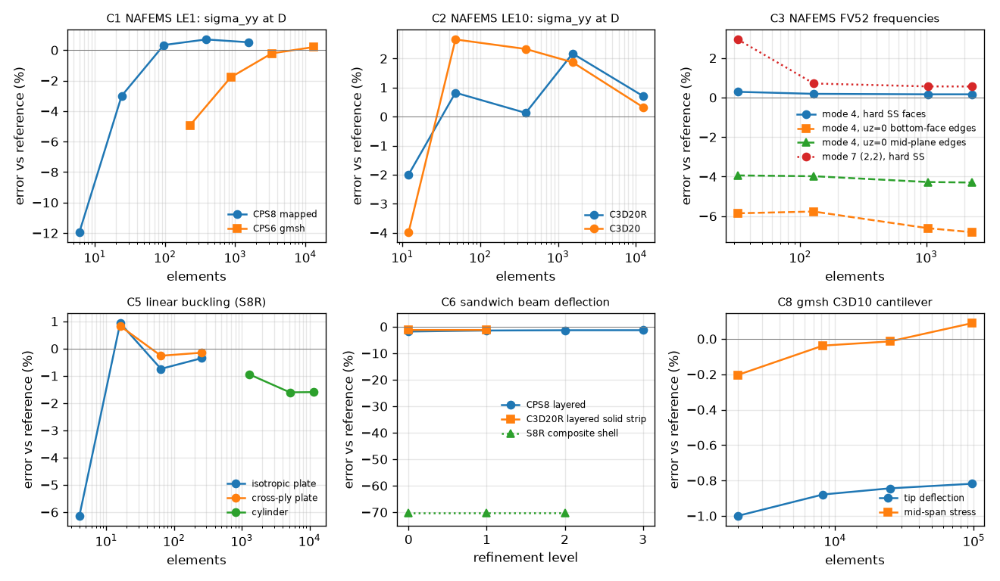
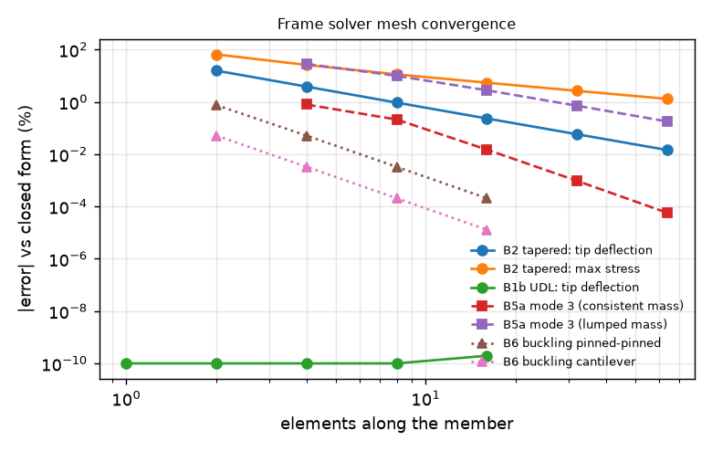
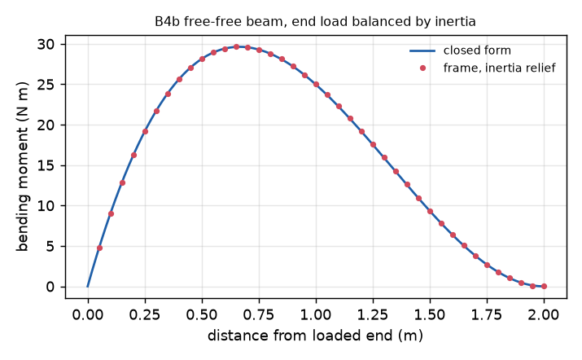
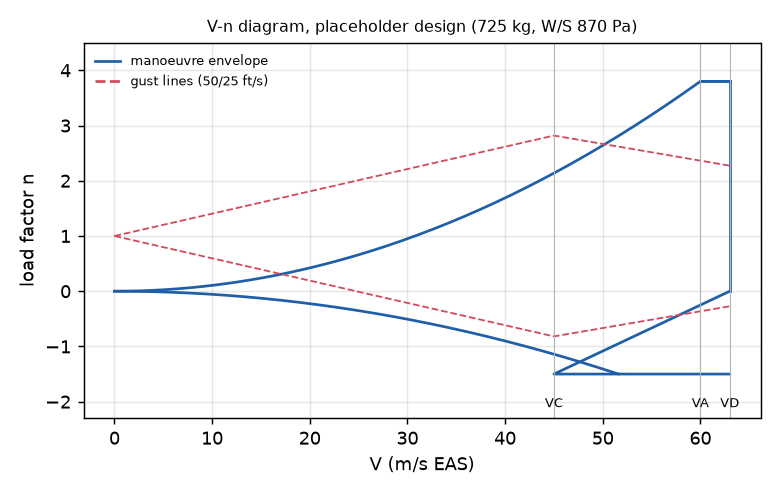

# WP F verification – structural tool chain

Verification of the structural solvers and of the loads / airframe tools before they are used on the E8-200 design.
Code under test: [`fea/frame.py`](../../fea/frame.py) (beam FEM), [`fea/ccx.py`](../../fea/ccx.py) (CalculiX 2.23 + gmsh
pipeline), [`fea/clt.py`](../../fea/clt.py), [`fea/loads.py`](../../fea/loads.py), [`fea/airframe.py`](../../fea/airframe.py).

| Script | Cases | Run time |
|---|---|---|
| `verify_beam.py` | B1–B7 beam / frame solver vs closed form | ~5 s |
| `verify_ccx.py [C1 ... C8]` | CalculiX benchmarks (NAFEMS LE1, LE10, FV52), CLT, buckling, sandwich, Bredt, C3D10 | ~5 min, 6 threads |
| `verify_loads.py` | L1–L7 loads module and parametric airframe model (placeholder design) | ~10 s |
| `verify_dynamics.py` | D1–D6 phase-2 tools: flutter, divergence, whirl, gear frame, fitting mesh convergence | ~4 min |
| `make_report.py` | convergence plots, summary table | – |

Results: `results/*.json` (every mesh of every study), plots: `img/`. Scratch runs: `fea/.cache/verify/` (not kept).
Python `~/tools/cadenv/bin/python`; ccx/gmsh from `~/tools/envs/cfd`.

## Summary (finest mesh vs reference)

| Case | Quantity | Error |
|---|---|---|
| B1 cantilever tip load / UDL / Timoshenko | tip deflection, root stress | 0.000 % (exact, any mesh) |
| B2 tapered tube cantilever (64 el.) | tip deflection / max stress | +0.014 % / +1.3 % (O(h²) / O(h)) |
| B3 tube & box torsion | twist, shear stress (Bredt) | 0.000 % |
| B4 free-free beam, inertia relief | moment distribution, accelerations | max 0.14 % of peak; reactions < 1e-10 N |
| B5 free-free beam modes 1–3 (consistent mass, 32 el.) | frequencies | < 0.001 % |
| B6 Euler buckling (16 el.) | P_cr | 0.0002 % |
| B7 3-D L-frame | tip deflection, root torque | 0.000 % |
| C1 NAFEMS LE1 | σ_yy at D (92.7 MPa) | +0.52 % (CPS8), +0.20 % (gmsh CPS6) |
| C2 NAFEMS LE10 | σ_yy at D (-5.38 MPa) | +0.71 % (C3D20R), +0.33 % (C3D20) |
| C3 NAFEMS FV52 (hard simple support) | 6 flexural frequencies | max 0.56 % |
| C4 laminate vs CLT | ply stresses / strains / B-coupling curvature | 0.27 % / 0.34 % / 0.04 % |
| C5 buckling: isotropic plate / cross-ply plate / cylinder | N_cr | -0.35 % / -0.15 % / -1.6 % |
| C6 sandwich beam: layered CPS8 / C3D20R | mid-span deflection | -1.3 % / -1.2 % |
| C6 sandwich as S8R composite shell | mid-span deflection | **-70 % (not usable for sandwich)** |
| C7 box beam torsion (S8R) vs Bredt | twist rate, web / flange shear | +0.08 %, +0.03 %, -0.15 % |
| C8 gmsh C3D10 cantilever | tip deflection / stress | -0.82 % / +0.09 % |
| L1 gust load factor | SI vs CS-23 imperial formula | -0.07 % (rounding of 498) |
| L6 airframe wing-root bending | beam model vs strip integration | -0.52 % |

## Beam / frame solver (`verify_beam.py`)

Carbon tube properties E = 70 GPa, G = 5 GPa, ρ = 1550 kg/m³ unless stated.

**B1 Cantilever.** 80 x 3 mm tube, L = 2 m. Tip load 1 kN: δ = PL³/3EI, σ = PLc/I – exact with one element
(cubic shape functions). Uniform load 2 kN/m with consistent nodal loads: tip deflection exact at the nodes; the root
moment from element end forces (no fixed-end correction) converges as 1/n² (-16.7, -4.2, -1.04, -0.26, -0.07 % for
1–16 elements). In the airframe model distributed loads are applied as nodal forces on fine stations.
Timoshenko: 80 x 6 tube, L = 0.4 m, shear area A/2: δ = PL³/3EI + PL/(G A_s), shear share 27 % – exact.

**B2 Tapered cantilever.** OD 100 -> 40 mm, t 2.5 mm, L 3 m, 500 N tip; reference by numerical integration of the
Mohr integral (scipy `quad`). Piecewise-constant sections (mid-element properties):

| elements | 2 | 4 | 8 | 16 | 32 | 64 |
|---|---|---|---|---|---|---|
| tip deflection error % | 15.6 | 3.84 | 0.94 | 0.23 | 0.058 | 0.014 |
| max stress error % | 65 | 26 | 11.3 | 5.4 | 2.6 | 1.3 |

Consequence: tapered spars/booms need ≥ 20 elements per half-span (default) and the stress is read at the element
end with the local section in phase 2.

**B3 Torsion.** 60 x 1.5 tube, 400 N m: twist TL/GJ and τ = Tr/J exact; thin-wall J = 2π r_m³ t differs from the exact
J by -0.066 %. Box 200 x 120 mm (webs 2 mm, flanges 3 mm): `Section.rect_tube` reproduces the Bredt J = 4A_m²/∮ds/t
and τ = T/(2A_m t). The Bredt assumption itself is checked against a CalculiX shell model in C7.

**B4 Inertia relief.** Free-free uniform beam (2 m, 10 kg). Central 100 N: M_centre = PL/8 (-0.04 % consistent mass,
0.000 % lumped), a = P/m. End load: a = P/m, α = 6P/(mL), M(x) = Px - (P/L)(2x² - x³/L), peak 4PL/27 at L/3 from the
loaded end: max deviation over the span 0.14 % of the peak (consistent) / 0.04 % (lumped); support reaction 1e-11 N.
3-D space frame with random forces, moments and lumped masses/inertias: resultant of the balanced loads 3e-12 N,
support reaction 6e-9 N on 5.5 kN applied; gravity alone gives zero deformation.

**B5 Modes.** Free-free 100 x 3 tube, 3 m, Euler-Bernoulli βL = 4.730, 7.853, 10.996 (91.2, 251.5, 493.0 Hz);
six rigid-body modes recovered. Consistent mass: 0.11 / 0.62 / 0.79 % with 4 elements, < 0.001 % with 32.
Lumped mass: -15 / -22 / -28 % with 4 elements, -0.08 / -0.13 / -0.18 % with 64 – consistent mass is the default.
Cantilever 30 x 27 tube with 0.3 kg tip mass vs the characteristic equation: 1e-7 %.

**B6 Euler buckling (geometric stiffness).** 50 x 2 tube, 2 m: pinned-pinned 0.75 / 0.05 / 0.003 / 0.0002 % for 2–16
elements; cantilever (P_e/4) 0.05 % with 2 elements.

**B7 L-frame.** Two perpendicular tubes 1.2 + 0.8 m, load normal to the plane: δ = Pa³/3EI + Pb³/3EI + Pab²/GJ, root
torque Pb and moment Pa – exact (checks transformation and assembly in 3-D).

## CalculiX pipeline (`verify_ccx.py`)

**C1 NAFEMS LE1, elliptic membrane** (plane stress, t = 0.1 m, E = 210 GPa, ν = 0.3, 10 MPa outward on the outer
ellipse; target σ_yy(D) = 92.7 MPa). Consistent edge loads by Gauss integration on curved quadratic edges.

| CPS8 mapped | 2x3 | 4x6 | 8x12 | 16x24 | 32x48 |
|---|---|---|---|---|---|
| σ_yy(D) MPa | 81.63 | 89.92 | 93.01 | 93.35 | 93.18 |
| error % | -11.9 | -3.0 | +0.33 | +0.70 | +0.52 |

| gmsh CPS6, h (mm) | 250 | 125 | 62.5 | 31.25 |
|---|---|---|---|---|
| σ_yy(D) MPa | 88.13 | 91.04 | 92.50 | 92.89 |
| error % | -4.9 | -1.8 | -0.22 | +0.20 |

The mapped mesh settles 0.5 % above the target (nodal extrapolation at the stress-concentration point); the free
mesh converges monotonically – both within the 1 % accepted for stress benchmarks.

**C2 NAFEMS LE10, thick plate** (t = 0.6 m, 1 MPa on the top face, BCs as specified; target σ_yy(D, top) = -5.38 MPa).

| mesh (θ x r x t) | 2x3x2 | 4x6x2 | 8x12x4 | 16x24x4 | 32x48x8 |
|---|---|---|---|---|---|
| C3D20R error % | -2.0 | +0.82 | +0.13 | +2.17 | +0.71 |
| C3D20 error % | -4.0 | +2.66 | +2.33 | +1.87 | +0.33 |

The point value depends on the through-thickness division (4 -> 8 layers); a 48x72x8 trial run gave +1.0 % (C3D20R)
and +0.13 % (C3D20). Full integration is preferred for stress at free surfaces of thick parts.

**C3 NAFEMS FV52, simply supported thick plate** (10 x 10 x 1 m, E 200 GPa, ν 0.3, ρ 8000 kg/m³; reference flexural
frequencies 45.897, 109.44 (x2), 167.89, 206.19 (x2) Hz, as tabulated in the Altair OptiStruct verification manual;
Mindlin closed form computed in the script: 45.895, 109.44, 167.89, 204.5 Hz).

| boundary condition, 24x24x4 C3D20R | mode (1,1) | (1,2) | (2,2) | (1,3) |
|---|---|---|---|---|
| hard SS (u_z and tangential u = 0 on the edge faces) | 45.97 (+0.16 %) | 109.86 (+0.38 %) | 168.83 (+0.56 %) | 205.88 (-0.15 %) |
| u_z = 0 on mid-plane edges only | 43.92 (-4.3 %) | 106.33 (-2.8 %) | 160.75 (-4.3 %) | – |
| u_z = 0 on bottom-face edges only | 42.77 (-6.8 %) | 101.88 (-6.9 %) | 150.36 (-10.4 %) | – |

The published reference values are the hard-simple-support (Mindlin / 3-D exact) frequencies; with that support
CalculiX converges to within 0.6 % (0.2–0.4 % for the low modes). Line supports, as the benchmark wording is
sometimes quoted, are softer, give 3–10 % lower values that do not converge to the reference and also produce the
in-plane mode at 193.59 Hz (reproduced to 0.00 % in those runs). This sensitivity is recorded as a modelling lesson
for our own support conditions (pins vs faces).

**C4 Composite S8R shell vs CLT** (ply E1 120, E2 8, G12 4 GPa, ν12 0.3, t 0.25 mm; Nx = 100 N/mm on a 100 x 100 mm plate).

| mesh | 2x2 | 4x4 | 8x8 | 16x16 |
|---|---|---|---|---|
| [0/45/-45/90]s ε_x error % | -0.14 | -0.14 | -0.06 | -0.20 |
| ε_y error % | +0.30 | -0.09 | -0.11 | -0.34 |
| max ply stress (σ1, σ2, τ12) error, % of ply max | 0.16 | 0.19 | 0.13 | 0.27 |

Unsymmetric [0/90]T (2 x 0.5 mm), free plate: curvature κ_x from a fit of w(x, y) over the centre region vs CLT
(B-matrix coupling): -0.61 / -0.17 / -0.04 % (4x4 / 8x8 / 16x16); mid-plane strain -0.28 / -0.05 / -0.01 %.
Note: `*EL PRINT` stresses of composite shells are output in the ply (orientation) axes and those of homogeneous
shells in element axes, not in global axes.

**C5 Linear buckling, S8R.**
* Simply supported aluminium square plate 500 x 500 x 2 mm, uniaxial compression, N_cr = 4π²D/b² = 8.098 N/mm:
  -6.1 / +0.93 / -0.74 / -0.35 % (2x2 … 16x16).
* Cross-ply [0/90]s plate (4 x 0.5 mm), N_cr from the specially orthotropic formula (min over m) = 3.937 N/mm:
  +0.83 / -0.26 / -0.15 % (4x4 … 16x16) – verifies composite stiffness in the buckling step.
* Thin cylinder R = 100, t = 1, L = 200 mm (aluminium), classical N_cr = E t²/(R√(3(1-ν²))) = 423.7 N/mm:
  -0.94 / -1.60 / -1.60 % (elements 9.8 / 4.9 / 3.3 mm, half-wave 24 mm). The converged value is 1.6 % below the
  classical value because of the end conditions (rotations free, one end axially free). Design use applies the
  NASA SP-8007 knock-down on top of the bifurcation load.

**C6 Sandwich beam, 3-point bending** (span 300 mm, b 50 mm, faces 1 mm E 50 GPa, core 20 mm E 70 MPa / G 26.9 MPa,
500 N over 20 mm). Sandwich theory (Allen, Zenkert): δ = P(8L³-4Lc²+c³)/(384D) + P(L-c/2)/(4S) = 1.728 mm, 71 % of it
core shear.

| model | meshes | deflection (mm) | error % |
|---|---|---|---|
| CPS8 plane stress, layered | 32x(1+4+1) … 256x(2+16+2) | 1.697 … 1.705 | -1.81 … -1.31 |
| C3D20R layered solid strip | 32x2x(1+2+1), 64x2x(1+4+1) | 1.7065, 1.7064 | -1.24 |
| S8R composite shell (face/core/face), line load (ref 1.771 mm) | 16x4 … 64x4 | 0.525 | -70.4 |

Layered continuum models agree with sandwich theory to 1.2–1.3 % (the remaining difference is the support overhang
and load spreading through the faces, within the accuracy of the beam theory). The composite S8R shell, which
CalculiX expands into a single 20-node brick through the thickness, cannot represent the face/core zig-zag shear and
essentially returns the bending part only. **Rule adopted: sandwich panels and sandwich spar webs are modelled with
layered solid elements (or checked with sandwich theory), never as CalculiX composite shells.**

**C7 Box beam torsion, S8R** (aluminium 200 x 120 mm, webs 2 / flanges 3 mm, L = 1.5 m, 2 kN m end torque applied as
the Bredt shear flow, root clamped). Twist rate between 0.4 L and 0.8 L vs T/GJ_Bredt: +0.16 / +0.09 / +0.08 %;
web shear +0.02 / +0.03 / +0.03 %; flange shear -0.12 / -0.14 / -0.15 %. Confirms the Bredt torsion constant used
for the wing torsion box and rectangular sections in the beam model.

**C8 gmsh C3D10 cantilever (part-analysis pipeline)** (6061 bar 200 x 20 x 10 mm, clamped face, 100 N tip shear;
Timoshenko δ = 2.327 mm, mid-span σ = 30 MPa).

| h_max (mm) | 5 | 3 | 2 | 1.25 |
|---|---|---|---|---|
| elements | 1993 | 8201 | 24 817 | 97 127 |
| tip error % | -1.00 | -0.88 | -0.84 | -0.82 |
| stress error % | -0.20 | -0.04 | -0.01 | +0.09 |

The -0.8 % is the extra stiffness of the fully clamped face (Poisson and warping restraint), not discretisation.
Reaction sums equal the applied load in all runs.

## Loads module and parametric airframe model (`verify_loads.py`, placeholder design)

* **L1** gust load factor at VC, SI implementation vs the CS-23 imperial formula n = 1 + k_g U_de V a /(498 W/S):
  2.818 vs 2.820 (-0.07 %, from the rounded constant 498); mass ratio μ_g identical (31.54).
* **L2** span loads: Schrenk distribution integrates to the wing lift (0.0 %); wing + tail lift = nW (0.0 %); pitching
  moment about the cg closes to 1e-12 N m in all 10 flight cases.
* **L3** thrust allocation: hover and all 8 one-motor-out cases satisfy vertical force, roll, pitch and yaw balance to
  1e-12; highest remaining thrust fraction 0.99 (1.0 g) – reported for the requirement check.
* **L4** landing reactions sum to 3.0 W (level/one-side), side case 1.33 W vertical / 0.83 W lateral; parachute 6.0 W;
  crash factors (e.g. 18 g forward for a battery pack above/aft of the occupants).
* **L5** airframe model mass 725.0 kg = budget; inertia-relief support residual < 1.2e-6 N over all 31 cases.
* **L6** wing-root bending in manoeuvre case A (limit) from the beam model (internal forces of the members cut at the
  root fitting) vs a hand strip integration of lift, tail load and the inertia of the outboard masses with the model's
  rigid-body accelerations: 14 246 vs 14 321 N m (-0.52 %, from the interpolation of the lift onto the model stations).
* **L7** discretisation study of the airframe model (5 / 10 / 20 / 40 elements per half-span): wing-tip deflection
  -4.4 / -1.7 / -0.5 / 0 %, front-spar stress +3.3 / +2.9 / +0.7 / 0 %, boom stress 0.01 %; default 20.

## Phase-2 tools (`verify_dynamics.py`)

| Case | Quantity | Result |
|---|---|---|
| D1 typical section (Hodges & Pierce: mu 20, a -0.2, x_a 0.1, r^2 0.24, sigma 0.4) | flutter speed U/(b w_a), modal k-method vs 2-DOF determinant | 2.1839 vs 2.1839 (-0.00004 %); textbook ~2.17 |
| D2 Goland wing (strip theory, rho 1.02) | flutter speed / frequency vs 137.2 m/s, 70.7 rad/s | 40 el.: 137.3 m/s (+0.06 %), 68.3 rad/s (-3.4 %) |
| D3 uniform cantilever divergence | q_D vs pi^2 GJ/(4 e c a0 L^2) | 40 el.: -0.013 % |
| D4 pivoted rotor, no aerodynamics | forward/backward whirl frequencies vs I w^2 -+ Ip Omega w - K = 0 | < 1e-6 % |
| D5 skid-gear frame | vertical stiffness vs inclined-cantilever formula | +0.007 % |
| D6 fitting P1 mesh study (iteration-3 loads) | peak von Mises away from supports | not converged at the production mesh: x 1.19 applied to all fittings |

**D2 Goland wing** (semi-span 6.096 m, chord 1.829 m, elastic axis 33 % c, cg 43 % c, 35.71 kg/m, I_cg 8.64 kg m, EI 9.77e6,
GJ 0.987e6 N m^2; reference: Goland 1945 / Goland & Luke 1948, 137 m/s, 70.7 rad/s). The frame model gives 7.65 / 14.17 Hz for
the first bending / torsion modes (published 7.66-7.89 / 13.9 Hz depending on the source).

| elements | f1 / f2 (Hz) | V_F (m/s) | omega_F (rad/s) |
|---|---|---|---|
| 10 | 7.62 / 14.15 | 137.5 (+0.23 %) | 68.2 (-3.6 %) |
| 20 | 7.64 / 14.17 | 137.3 (+0.09 %) | 68.3 (-3.5 %) |
| 40 | 7.65 / 14.17 | 137.3 (+0.06 %) | 68.3 (-3.4 %) |

The flutter frequency is 3.4 % low because the beam model has no warping/rotary refinements; the speed is within 0.1 %.

**D3 divergence** (L 4 m, c 1.2 m, GJ 2e5 N m^2, e 0.15 m, a0 = 2 pi):

| elements | error |
|---|---|
| 5 | -0.820 |
| 10 | -0.205 |
| 20 | -0.051 |
| 40 | -0.013 |

**D6 P1 wing-root lug mesh study** (C3D10, peak away from the fixed bolt holes and the pin bearing surface by >= 3.75 mm):

| h_max / h_hole (mm) | elements | peak (MPa) | max displacement (mm) |
|---|---|---|---|
| 10 / 4.0 | 5218 | 288 (-20.8 %) | 0.242 (-0.8 %) |
| 7 / 2.5 | 15360 | 305 (-16.0 %) | 0.243 (-0.2 %) |
| 5 / 1.6 | 45683 | 338 (-7.0 %) | 0.244 (+0.1 %) |
| 4 / 1.2 | 102072 | 363 (+0.0 %) | 0.244 (+0.0 %) |

Displacements converge (1 %), the peak stress does not converge within 20 % at the production mesh (h 7 / 2.5 mm) because the
peak sits at a re-entrant region near the fully fixed bolt holes. All fitting margins in `fea/results/margins.json` are therefore
computed with peak x 1.19 (finest / production ratio, re-run with the iteration-3 loads). Sensitivity of the FV52 lesson (support idealisation) applies here as
well: the fixed bolt holes are a conservative idealisation of bolted joints.

The loads module and the beam model of the frozen design are checked as in L1-L7 (same code); the sizing loop converged in
7-9 iterations (`fea/results/sizing_update.json -> _history`).

**Iteration 3 additions.** The damped-gear energy model (`fea/gear.py analyse_damped`) uses the leg as a lever on its pivot;
its lever ratio (damper force / skid reaction 2.14) agrees with the pivoted-leg beam model of `airframe.py` (damper link force
20.7 kN design / 1.725 / (2.33 W / 4) = 2.0; the beam model puts the damper eye on the straight leg line, 6 % difference). Element end releases (pins, slotted saddle, leg pivots, axial-only
dampers) are implemented by static condensation; the B-series beam checks and L1-L7 were re-run after the change with unchanged
results (L5 residual 3e-6 N, L6 -0.52 %). The CAD-part runs (`fea/parts_cad.py`) use the same element type and mesh sizes as
D6, so the same 1.19 peak factor is applied; their load resultants were checked against the intended design loads (the couple
traction on uneven CAD face sizes is balanced per half so that it carries no net force). Multi-body STEP parts (e.g. LG-SKCL,
CH-CRADLE) are fused with gmsh BooleanFragments so that touching bodies share nodes; a run whose maximum displacement is
unbounded (> 1 m) flags a body that is not connected to the supports (CH-CRADLE ring and posts in the rebuild of 2026-11-15),
and such a result is not used as a margin. The skin-wrinkling check now uses the skin/cap height ratio from the LS(1)-0417
ordinates (validation/cfd/reference/ls417_coordinates_TND7428.dat).

**Iteration 3.2 additions.**
* Mass reader: `fea/geometry.py mass_items` now includes every unit of `geometry["pushers"]` (the legacy `pusher` key held only
  the left unit and dropped 27.2 kg); `validation/sizing/verify_sizing.py` A3a (reader total = MTOW 1,169.5 kg) and A3b (cg x
  2.491 vs 2.474 m) pass, 102 PASS / 0 FAIL.
* Wing-root links: the fuselage-to-lug connector is now a stiff frame arm out to the fitting station plus a vertical pinned lug
  link, so the lug sees the true fitting force (the former inclined link from the fuselage axis added a lateral component of
  about half the vertical force, which overloaded the fuselage clevis model). L1-L7 re-run after the change.
* CAD parts that are missing from the current CAD build (gear, seat, cradle and rear parachute fittings while WP G rebuilds) keep
  their last CalculiX result, scaled linearly to the new loads (MTOW, parachute and canister ratios) and labelled as such in
  `fea/results/margins.json`.
* Numerical libraries are limited to 6 threads (`fea/__init__.py`, run scripts export OMP/OPENBLAS/MKL_NUM_THREADS=6).

**Phase 3.2b (rebuilt CAD).** `fea/parts_cad.py` saves after every part; bolted parts use their bolt-hole cylinders as supports
where the CAD models the holes (F-CLV-MS/RS); the wing-root lugs are evaluated at >= 6 mm from the pin bore and the supports
(the cosine pin-bearing pressure without contact gives a local peak at the bore that is covered by the Fbru check). C3 boom
moment cross-check against a hand integration: see fea/README.md phase 3.2b (uniform 4.25 g: 20.9 kN m ultimate, as the
independent check; with the model's pitch acceleration: 27.2 vs 28.6 kN m).

**Phase 3.3B.** `parts_cad.py` reads each part's material from cad/parts.json and supports a bolt-circle support set ("pcd"
spec, used for the MP-EMX adapter ring held at the motor-plate bolts and loaded at the EMRAX bolts). Section checks of CAD stock
sizes against the global model are in `fea/results/cad_member_checks.json`.

**Phase 3.3C.** `ccx.NCPU` follows `FEA_NCPU` (default 6) so the parts can run on fewer cores beside other jobs.
`parts_cad.py` can run a case on a modified STEP (`FEA_CAD_PARTS=<dir>`, `FEA_RESULTS=<file>`) without touching
`parts_cad.json`; the proposed fitting changes were checked this way (`fea/results/parts_cad_fix_checks.json`). Same mesh
sizes and the same 1.27 mesh factor as the production runs.

**Phase 3.3 final.** `margins.py` takes the member margins from the final-configuration beam run (`airframe_final33.json`,
scaled to MTOW 1,350.4 kg) when present, and no longer applies the iteration-3.1 load-ratio scaling to CAD parts (every
part was run on the iteration-3.3 STEP); only MP and MP-EMX are scaled by 4,267/4,240 for the final rotor thrust. Pass criterion MS > 0 at ultimate with knocked-down
allowables; `ms_target` is a sizing-loop setting only. Redrawn CH-CRADLE re-run: +0.32.

## References

* NAFEMS, *The Standard NAFEMS Benchmarks*, TNSB Rev. 3, 1990 (LE1, LE10); NAFEMS R0015, *Selected Benchmarks for
  Natural Frequency Analysis*, 1987 (FV52). Reference values as reproduced in:
  Altair OptiStruct verification 0455 FV52 – <https://help.altair.com/hwsolvers/os/topics/solvers/os/simply_supported_soid_square_plate_fv52_r.htm>;
  Abaqus Benchmarks FV52 – <https://docs.software.vt.edu/abaqusv2025/English/SIMACAEBMKRefMap/simabmk-c-fv52.htm>.
* G. Dhondt, *CalculiX CrunchiX User's Manual* v2.23 – <http://www.dhondt.de/ccx_2.23.pdf>.
* C. Geuzaine, J.-F. Remacle, *Gmsh reference manual* – <https://gmsh.info/doc/texinfo/gmsh.html>.
* W.C. Young, R.G. Budynas, *Roark's Formulas for Stress and Strain*, 7th ed. (cantilever, torsion, plate buckling).
* S.P. Timoshenko, J.M. Gere, *Theory of Elastic Stability* (Euler columns, plate and cylinder buckling).
* R.M. Jones, *Mechanics of Composite Materials*, 2nd ed. (CLT, specially orthotropic plate buckling).
* R.D. Mindlin, *Influence of rotatory inertia and shear on flexural motions of isotropic, elastic plates*,
  J. Appl. Mech. 18 (1951) 31–38.
* H.G. Allen, *Analysis and Design of Structural Sandwich Panels*, Pergamon 1969; D. Zenkert, *An Introduction to
  Sandwich Construction*, EMAS 1995.
* T.H.G. Megson, *Aircraft Structures for Engineering Students* (Bredt-Batho torsion, inertia relief).
* M. Goland, *The flutter of a uniform cantilever wing*, J. Appl. Mech. 12 (1945); M. Goland, Y.L. Luke, J. Aeronaut. Sci. 15 (1948).
* D.H. Hodges, G.A. Pierce, *Introduction to Structural Dynamics and Aeroelasticity*, 2nd ed., Cambridge 2011 (Theodorsen
  aerodynamics, k-method, typical section).
* W.H. Reed, *Review of propeller-rotor whirl flutter*, NASA TR R-264 (1967) – <https://ntrs.nasa.gov/citations/19670022204>.
* NASA SP-8007, *Buckling of Thin-Walled Circular Cylinders* (2020 rev.) – <https://ntrs.nasa.gov/citations/20205011530>.
* EASA CS-23 Amendment 4 (load formulas 23.333–23.561, special factors 23.619–23.625) –
  <https://www.easa.europa.eu/en/document-library/certification-specifications/cs-23-amendment-4>.
* FAA AC 23.562-1 (dynamic seat tests); FAA AC 20-107B (composite structure) –
  <https://www.faa.gov/documentLibrary/media/Advisory_Circular/AC_20-107B.pdf>.
