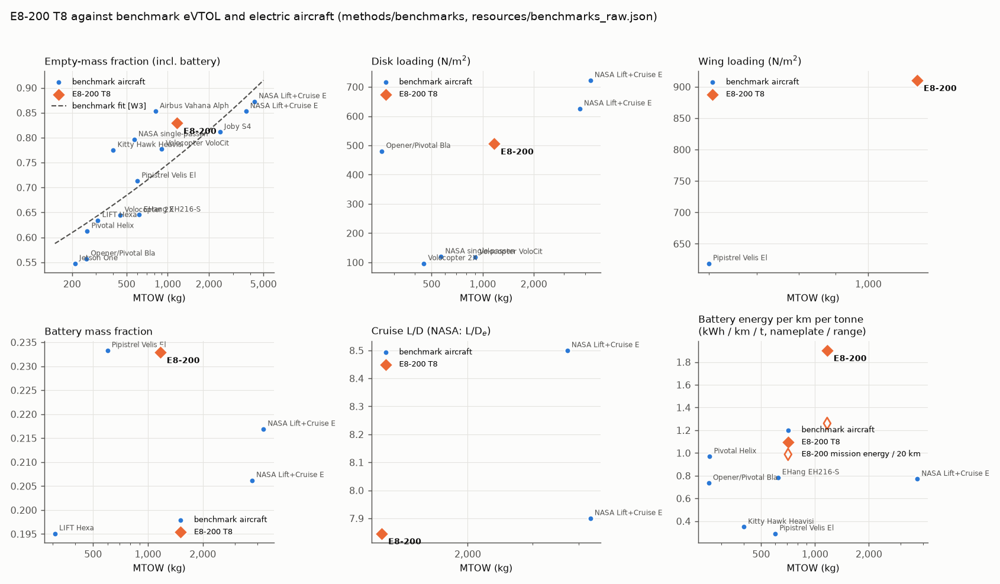

# Independent checks of the E8-200 T8 design (WP V)

Written by `check_t8.py`. Do not edit by hand.

Run: 2026-11-18 20:49. Inputs: `design/selected_design.json`, `design/geometry.json`, `bom/BOM.csv`, `cad/mass_properties.json`, `fea/results/*.json`, `cfd/results/`, `methods/benchmarks/`.

**Summary: 43 PASS, 13 FLAG, 8 FAIL, 17 pending 3.2 re-run, 6 information.**

Verdict rules:
- Comparison rows (independent value against the design or WP value): PASS within 5 %, FLAG 5-20 %, FAIL above 20 %.
  Above 20 % the row stays FLAG when the design value is on the conservative side.
- Limit rows (requirement or rating checked with the independent value): PASS when the margin is at least 2 %.
  FLAG when the margin is within +-2 % (inside the accuracy of a hand calculation). FAIL below -2 %.
- PENDING: the row needs a CAD or CFD file of the 3.2 re-run that is not there yet. Provisional values are shown.

Assumptions of the hand checks (independent of WP D's model unless stated):

- `fm_benchmark` = 0.74
- `download_cfd` = 0.055
- `k_ctrl` = 0.1
- `prop_profile` = 0.9
- `thrust_deduction` = 0.045
- `eta_motor` = 0.93
- `eta_inv` = 0.97
- `eta_wire` = 0.98
- `aux_kw` = 1.5
- `v_oc_mid` = 3.6
- `v_oc_low` = 3.45
- `dcir_eol_factor` = 1.5
- `i_cont_cell` = 40.0
- `i_peak_cell` = 60.0
- `f_eol` = 0.8
- `f_res` = 0.2
- `dC` = 0.3
- `pod_cd_frontal` = 0.15
- `labour_learning` = 0.85
- The thrust deduction (4.5 %) and the EOL resistance factor (1.5) are the same values as WP D's; no independent data exist.
- CFD 3.1 drag-area inputs are from `cfd/results/README.md` section 2.

## hover

| id | quantity | independent | design / limit | unit | diff / margin | verdict | method / note |
|---|---|---|---|---|---|---|---|
| H1 | disk loading W/(N A) | 505.6 | 505.6 | N/m2 | -0.0 % | PASS | W / (8 pi R^2) |
| H2 | hover shaft power per motor, 500 m ISA+15 | 31.70 | 31.88 | kW | -0.6 % | PASS | momentum theory, FM 0.74 (NASA L+C benchmark), CFD download 5.5 %; design uses FM 0.717 and download 3.7% |
| H3 | hover electrical power, 500 m | 288.4 | 290.0 | kW | -0.6 % | PASS | 8 x shaft / (0.93 x 0.97 x 0.98) + 1.5 kW aux |
| H4 | hover electrical power, 1000 m ceiling | 295.5 | 294.3 | kW | +0.4 % | PASS | P ~ rho^-1/2 at constant thrust |
| H5 | hover tip Mach, 500 m ISA+15 | 0.524 | 0.524 | - | +0.0 % | PASS | V_tip / a |
| H6 | hover tip Mach <= 0.55 (noise screen) | 0.524 | <= 0.550 | - | +4.9 % | PASS |  |

## one motor out

| id | quantity | independent | design / limit | unit | diff / margin | verdict | method / note |
|---|---|---|---|---|---|---|---|
| O1 | worst remaining rotor thrust / mean hover thrust (LP) | 1.333 | 1.333 | - | +0.0 % | PASS | WP M linear programme on geometry.json hubs and spins (Fz, roll, pitch, yaw trimmed) |
| O2 | OEI shaft power, worst rotor, 1000 m, +10 % control | 57.72 | 57.47 | kW | +0.4 % | PASS | fixed pitch: T ~ rho n^2, Q ~ T, P = Q x Omega |
| O3 | OEI torque, worst rotor, 1000 m, +10 % control | 242.7 | 247.7 | N m | -2.0 % | PASS | Q = Q_hover x T/T_hover |
| O4 | flare 1.10 g one motor out, shaft power, 500 m | 56.31 | 56.63 | kW | -0.6 % | PASS | as O2 at 500 m |
| O5 | flare 1.10 g one motor out, torque, 500 m | 242.7 | 244.1 | N m | -0.6 % | PASS | as O3 |

## motor rating

| id | quantity | independent | design / limit | unit | diff / margin | verdict | method / note |
|---|---|---|---|---|---|---|---|
| MS1 | hover shaft power, 1000 m <= continuous (summary ratings) | 32.49 | <= 36.00 | kW | +10.8 % | PASS | MGM REB 60 page, summary block (continuous 0.6 x peak assumed by WP D; page says 35-45 kW) |
| MS3 | OEI power <= peak (summary) | 57.72 | <= 60.00 (design 57.47) | kW | +3.9 % | PASS |  |
| MS4 | OEI torque <= peak (summary) | 242.7 | <= 250.0 (design 247.7) | N m | +3.0 % | PASS |  |
| MS5 | flare power <= peak (summary) | 56.31 | <= 60.00 (design 56.63) | kW | +6.5 % | PASS |  |
| MS6 | flare torque <= peak (summary) | 242.7 | <= 250.0 (design 244.1) | N m | +3.0 % | PASS |  |
| MT1 | hover shaft power, 1000 m <= continuous (table ratings) | 32.49 | <= 25.00 | kW | -23.1 % | FAIL | MGM REB 60 page, detailed table 'valid for 25 C' (bom/catalog.json table_25C_*) |
| MT2 | hover torque <= continuous torque (table) | 165.5 | <= 95.00 | N m | -42.6 % | FAIL |  |
| MT3 | OEI power <= peak (table) | 57.72 | <= 33.50 (design 57.47) | kW | -42.0 % | FAIL |  |
| MT4 | OEI torque <= peak (table) | 242.7 | <= 133.0 (design 247.7) | N m | -45.2 % | FAIL |  |
| MT5 | flare power <= peak (table) | 56.31 | <= 33.50 (design 56.63) | kW | -40.5 % | FAIL |  |
| MT6 | flare torque <= peak (table) | 242.7 | <= 133.0 (design 244.1) | N m | -45.2 % | FAIL |  |

## cruise

| id | quantity | independent | design / limit | unit | diff / margin | verdict | method / note |
|---|---|---|---|---|---|---|---|
| A1 | zero-lift drag area CD0 x S | 0.755 | 0.729 | m2 | +3.6 % | PASS | CFD 3.1 drag area (0.729 m2) scaled to the 3.2 geometry by component |
| A2 | CD0 | 0.060 | 0.058 | - | +3.5 % | PASS | A1 / S |
| A3 | Oswald factor e | 0.771 | 0.770 | - | +0.1 % | PASS | CFD 3.1 e (0.734) x Raymer AR correction |
| A4 | cruise drag, 129 km/h, 500 m ISA+15 | 1,480 | 1,462 | N | +1.2 % | PASS | parabolic polar |
| A5 | cruise L/D | 7.751 | 7.846 | - | -1.2 % | PASS | W / D |
| A6 | cruise CL (fraction of flaps-down CLmax) | 1.279 | - | - | - | INFO | 75% of CLmax; the CFD polar fit (2-8 deg) and the e validation (CL 0.3) do not cover CL 1.28 |

## pusher

| id | quantity | independent | design / limit | unit | diff / margin | verdict | method / note |
|---|---|---|---|---|---|---|---|
| P1 | pusher propulsive efficiency | 0.836 | 0.839 | - | -0.4 % | PASS | actuator disc x 0.90 (McCormick) |
| P2 | cruise electrical power | 76.62 | 75.44 | kW | +1.6 % | PASS | D/(1-t) V / eta_p / eta_drive + aux |
| P3 | pusher shaft power x 1.10 <= continuous (summary 36 kW per REB 60) | 36.53 | <= 36.00 | kW | -1.4 % | FLAG | kept rule: 10 % continuous margin |
| P4 | pusher cruise torque <= table continuous 95 N m | 204.6 | <= 95.00 | N m | -53.6 % | FAIL | at 1550 rpm; summary block gives no continuous torque |
| P5 | pusher cruise torque <= peak 250 N m | 204.6 | <= 250.0 | N m | +22.2 % | PASS |  |
| P6 | climb rate at cruise speed, pusher peak torque | 1.026 | 1.104 | m/s | -7.0 % | FLAG | (P_peak eta_p (1-t) - D V) / W, peak torque-limited at 1,550 rpm |
| P7 | climb rate >= 1.0 m/s | 1.026 | >= 1.000 | m/s | +2.6 % | PASS |  |

## battery

| id | quantity | independent | design / limit | unit | diff / margin | verdict | method / note |
|---|---|---|---|---|---|---|---|
| B1 | nominal energy (cells x Wh) | 47.25 | 47.25 | kWh | +0.0 % | PASS | 175 x 15 x 18 Wh |
| B2 | pack specific energy | 173.5 | - | Wh/kg | - | PASS | Pipistrel Velis pack about 177 Wh/kg on 253 Wh/kg cells (EQUATIONS.md); NASA L+C assumes 400 |
| B3 | battery efficiency in hover (exact I-R, mid SOC, EOL resistance) | 0.795 | 0.836 | - | -4.9 % | PASS | V_terminal / V_oc with I from P = I (V_oc - I R); design linearises with I = P / V_nom, which under-states the current when the voltage sags |
| B4 | hover C-rate at the ceiling (EOL capacity) | 9.916 | 9.335 | 1/h | +6.2 % | FLAG | P_cells / E_EOL |
| B5 | hover C-rate <= 40 A continuous / EOL Ah - 0.3 C | 9.916 | <= 9.700 | 1/h | -2.2 % | FAIL | requirement '0.3 C margin' |
| B6 | hover cell current, all packs, ceiling, low SOC, EOL | 42.85 | <= 60.00 | A | +40.0 % | PASS |  |
| B7 | one pack out: cell current <= 60 A (hover 500 m, aux shed, low SOC, EOL) | 58.90 | <= 60.00 (design 59.60) | A | +1.9 % | FLAG |  |
| B8 | one pack out: bus voltage >= 400 V | 405.8 | >= 400.0 (design 403.6) | V | +1.5 % | FLAG |  |
| B9 | one pack out at the 1000 m ceiling: cell current / bus (sensitivity) | 61.92 | - | A | - | INFO | bus 396 V |
| B10 | one pack out with EOL resistance x 1.2 instead of x 1.5 (sensitivity) | 51.32 | - | A | - | INFO | bus 466 V |

## range

| id | quantity | independent | design / limit | unit | diff / margin | verdict | method / note |
|---|---|---|---|---|---|---|---|
| R1 | mission energy at the cells, 20 km | 30.23 | 29.48 | kWh | +2.5 % | PASS | hover 120 s + vertical climb + 2 x 30 s transitions (mean power) + climb to 500 m + cruise |
| R2 | range capability (EOL 80 %, 20 % reserve) | 20.02 | 21.23 | km | -5.7 % | FLAG | (E_usable - E_fixed) / P_cruise x V |
| R3 | range >= 20 km | 20.02 | >= 20.00 | km | +0.1 % | FLAG |  |
| R4 | range with the linearised battery efficiency (sensitivity) | 20.96 | - | km | - | INFO | isolates the effect of the battery-loss model on R2 |

## stall

| id | quantity | independent | design / limit | unit | diff / margin | verdict | method / note |
|---|---|---|---|---|---|---|---|
| S1 | CLmax flaps down (35 deg) vs CFD 3.1 | 1.704 | 1.699 | - | +0.3 % | PASS | 2-D CFD flap increment x Swf/S on the 3-D clean CFD CLmax (cfd/results/summary.json) |
| S2 | stall speed EAS, MTOW, flaps down | 29.57 | 29.57 | m/s | +0.0 % | PASS | sqrt(2W / (rho0 S CLmax)) |
| S3 | cruise >= 1.15 Vs (EAS) | 1.153 | >= 1.150 | - | +0.2 % | FLAG |  |
| S4 | cruise speed >= 120 km/h | 129.0 | >= 120.0 | km/h | +7.5 % | PASS |  |

## footprint

| id | quantity | independent | design / limit | unit | diff / margin | verdict | method / note |
|---|---|---|---|---|---|---|---|
| F1 | overall length (rotor discs to pusher spinners) | 10.46 | <= 10.50 (design 10.46) | m | +0.4 % | FLAG | original requirement 9.0 m: exceeded by 1.46 m |
| F2 | overall width | 9.000 | <= 10.50 | m | +16.7 % | PASS |  |

## mass

| id | quantity | independent | design / limit | unit | diff / margin | verdict | method / note |
|---|---|---|---|---|---|---|---|
| W1 | empty mass = sum of the breakdown | 697.2 | 697.2 | kg | +0.0 % | PASS | sum |
| W2 | MTOW = empty + battery + payload | 1,170 | 1,170 | kg | +0.0 % | PASS | sum |

## mass vs CAD

| id | quantity | independent | design / limit | unit | diff / margin | verdict | method / note |
|---|---|---|---|---|---|---|---|
| W3 | MTOW, CAD (incl. the design growth allowance) | 1,209 | 1,170 | kg | +3.4 % | PENDING (provisional PASS) | cad/mass_properties.json + growth; [provisional: CAD files of 2026-11-18 20:49; the 3.2 rebuild with the FEA fixes has not finished] |
| W4 | empty mass excl. battery, CAD (incl. growth) | 755.0 | 697.2 | kg | +8.3 % | PENDING (provisional FLAG) | CAD; [provisional: CAD files of 2026-11-18 20:49; the 3.2 rebuild with the FEA fixes has not finished] |
| W5 | battery, CAD | 253.7 | 272.4 | kg | -6.8 % | PENDING (provisional FLAG) | CAD; [provisional: CAD files of 2026-11-18 20:49; the 3.2 rebuild with the FEA fixes has not finished] |
| W6-wing | group wing, CAD | 86.40 | 74.61 | kg | +15.8 % | PENDING (provisional FLAG) | CAD; [provisional: CAD files of 2026-11-18 20:49; the 3.2 rebuild with the FEA fixes has not finished] |
| W6-booms | group booms, CAD | 76.46 | 60.06 | kg | +27.3 % | PENDING (provisional FAIL) | CAD; [provisional: CAD files of 2026-11-18 20:49; the 3.2 rebuild with the FEA fixes has not finished] |
| W6-fuselage | group fuselage, CAD | 75.60 | 63.88 | kg | +18.3 % | PENDING (provisional FLAG) | CAD; [provisional: CAD files of 2026-11-18 20:49; the 3.2 rebuild with the FEA fixes has not finished] |
| W6-tail | group tail, CAD | 16.15 | 13.66 | kg | +18.2 % | PENDING (provisional FLAG) | CAD; [provisional: CAD files of 2026-11-18 20:49; the 3.2 rebuild with the FEA fixes has not finished] |
| W6-landing_gear | group landing_gear, CAD | 44.12 | 37.96 | kg | +16.2 % | PENDING (provisional FLAG) | CAD; [provisional: CAD files of 2026-11-18 20:49; the 3.2 rebuild with the FEA fixes has not finished] |
| W6-rotor_pylons_mounts | group rotor_pylons_mounts, CAD | 48.84 | 46.26 | kg | +5.6 % | PENDING (provisional FLAG) | CAD; [provisional: CAD files of 2026-11-18 20:49; the 3.2 rebuild with the FEA fixes has not finished] |
| W6-pusher_motor | group pusher_motor, CAD | 39.88 | 37.64 | kg | +6.0 % | PENDING (provisional FLAG) | CAD; [provisional: CAD files of 2026-11-18 20:49; the 3.2 rebuild with the FEA fixes has not finished] |
| W7 | CAD MTOW excl. growth <= parachute rating 1,190 kg | 1,176 | <= 1,190 | kg | +1.2 % | PENDING (provisional FLAG) | growth allowance consumed by the as-built CAD [provisional: CAD files of 2026-11-18 20:49; the 3.2 rebuild with the FEA fixes has not finished] |
| W8 | CAD MTOW incl. growth <= parachute rating 1,190 kg | 1,209 | <= 1,190 | kg | -1.6 % | PENDING (provisional FLAG) | [provisional: CAD files of 2026-11-18 20:49; the 3.2 rebuild with the FEA fixes has not finished] |

## structure

| id | quantity | independent | design / limit | unit | diff / margin | verdict | method / note |
|---|---|---|---|---|---|---|---|
| ST1 | wing ultimate bending at the root fitting, +3.8 g x 1.5 | 34.08 | 39.99 | kN m | -14.8 % | FLAG | elliptic lift on the full span minus the inertia of the boom groups and outer wing (no tail load); FEA value = main + rear spar moments, case F A |
| ST1b | wing ultimate bending with the Schrenk distribution (sensitivity) | 39.56 | - | kN m | - | INFO | -1.1 % vs FEA (the FEA loads module uses Schrenk, verify_loads L2) |
| ST2 | main-spar cap stress, ultimate, case F A | 343.4 | 421.8 | MPa | -18.6 % | FLAG | M c / I of the four spar caps at the root fitting (sizing_update.json sections); with the FEA moment the same section gives 403 MPa |
| ST3 | main-spar cap compression <= UD design allowable | 343.4 | <= 460.0 | MPa | +34.0 % | PASS |  |
| ST4 | boom ultimate bending, all rotors at max thrust (R2) | 12.91 | 12.84 | kN m | +0.5 % | PASS | overhang moment at the wing saddle, inertia relief, x 1.5 |
| ST5 | boom ultimate bending, parachute opening vertical (C3) | 20.83 | 28.65 | kN m | -27.3 % | FLAG | overhang moment at the rear saddle, n_open 4.25 x 1.5 on the boom masses; FEA higher: its peak boom moment in C3 is not the saddle overhang; load path to be confirmed by WP F |
| ST6 | boom UD over-wrap stress, R2, front saddle | 186.4 | 195.3 | MPa | -4.6 % | PASS | E-weighted composite tube, M r E / sum(E I) |

## parachute

| id | quantity | independent | design / limit | unit | diff / margin | verdict | method / note |
|---|---|---|---|---|---|---|---|
| CH1 | MTOW <= GRS 6 990-1190 rating | 1,170 | <= 1,190 | kg | +1.8 % | FLAG |  |
| CH2 | opening load factor at MTOW (48.8 kN vendor) | 4.255 | 4.250 | g | +0.1 % | PASS | F / W |

## cost

| id | quantity | independent | design / limit | unit | diff / margin | verdict | method / note |
|---|---|---|---|---|---|---|---|
| K1 | prototype cash, BOM.csv roll-up | 346,536 | 335,187 | USD | +3.4 % | PASS | sum of BOM.csv total_usd |
| K2 | cumulative-average learning factor, N = 10, 85 % | 0.712 | 0.712 | - | -0.1 % | PASS | (1/N) sum n^log2(0.85) |
| K3 | cost per aircraft at N = 10 from the BOM | 450,620 | 442,286 | USD | +1.9 % | PASS | BOM - tooling + tooling/N + hours x rate x learning |
| K4 | share of the BOM on estimates / quote-required prices | 63.86 | - | % | - | INFO | manufacturing/QUOTES_TO_REQUEST.md |

## CFD 3.2

| id | quantity | independent | design / limit | unit | diff / margin | verdict | method / note |
|---|---|---|---|---|---|---|---|
| CF1 | CD0 on the 3.2 geometry | - | - |  | - | PENDING | cfd/results/iteration32/summary.json not present yet |
| CF2 | Oswald e on the 3.2 geometry | - | - |  | - | PENDING | cfd/results/iteration32/summary.json not present yet |
| CF3 | CLmax flaps down on the 3.2 geometry (1.15 Vs margin 0.2 %) | - | - |  | - | PENDING | cfd/results/iteration32/summary.json not present yet |
| CF4 | hover download on the 3.2 geometry | - | - |  | - | PENDING | cfd/results/iteration32/summary.json not present yet |
| CF5 | boom-tail pusher thrust deduction (assumed 4.5 %) | - | - |  | - | PENDING | cfd/results/iteration32/summary.json not present yet |

## WP M checker on the 3.2 design (run in memory, no files written)

`methods/check_design.py` Checker: {'PASS': 42, 'WARN': 13, 'FAIL': 4, 'INFO': 0, 'MISSING': 0}.

| status | quantity | M | D | diff |
|---|---|---|---|---|
| WARN | zero-lift drag area D/q | 0.578 | 0.729 | -20.7 % |
| WARN | cruise L/D | 9.106 | 7.846 | +16.1 % |
| WARN | cruise electrical power | 65.01 | 75.44 | -13.8 % |
| FAIL | cruise speed >= 1.3 x stall (TAS at cruise altitude) | 1.153 | - | - |
| WARN | mission energy (design range, at battery terminals / eta_batt) | 26.20 | 29.48 | -11.1 % |
| FAIL | range to 20 % reserve at EOL capacity | 27.62 | 21.23 | +30.1 % |
| WARN | hover C-rate at EOL capacity (ceiling) | 8.195 | 9.335 | -12.2 % |
| WARN | fuselage mass | 46.85 | 63.88 | -26.7 % |
| WARN | parachute mass | 23.01 | 36.30 | -36.6 % |
| WARN | tail (H + V) mass | 9.222 | 13.66 | -32.5 % |
| WARN | pusher motor mass | 25.16 | 37.64 | -33.2 % |
| FAIL | pusher propeller mass | 2.169 | 8.690 | -75.0 % |
| FAIL | seats mass | 38.58 | 25.17 | +53.3 % |
| WARN | avionics mass | 10.68 | 15.57 | -31.4 % |
| WARN | wing mass, NDARC AFDD93 cross-check | 106.1 | 74.61 | +42.2 % |
| WARN | empty mass excluding battery | 569.1 | 697.2 | -18.4 % |
| WARN | MTOW recomputed (M empty + D battery + payload) | 1,041 | 1,170 | -10.9 % |

## Benchmark comparison

| aircraft | MTOW kg | empty fraction | disk loading N/m2 | wing loading N/m2 | battery fraction | L/D | kWh/km | kWh/km/t |
|---|---|---|---|---|---|---|---|---|
| **E8-200 T8** | 1,170 | 0.829 | 505.6 | 910.2 | 0.233 | 7.846 | 2.225 | 1.903 |
| Wisk Cora (Gen 5) | - | - | - | - | - | - | - | - |
| CityAirbus NextGen | - | - | - | - | - | - | - | - |
| Vertical VX4 | - | - | - | - | - | - | - | - |
| Jetson One | 210.0 | 0.548 | - | - | - | - | - | - |
| Opener/Pivotal BlackFly | 255.0 | 0.557 | 480.6 | - | - | - | 0.188 | 0.735 |
| Pivotal Helix | 258.0 | 0.612 | - | - | - | - | 0.250 | 0.969 |
| LIFT Hexa | 309.0 | 0.634 | - | - | 0.195 | - | - | - |
| Kitty Hawk Heaviside 2 Block 2 | 400.0 | 0.775 | - | - | - | - | 0.140 | 0.349 |
| Volocopter 2X | 450.0 | 0.644 | 96.34 | - | - | - | - | - |
| NASA single-passenger electric quadrotor | 567.9 | 0.796 | 119.8 | - | - | - | - | - |
| Pipistrel Velis Electro | 600.0 | 0.713 | - | 618.7 | 0.233 | - | 0.175 | 0.291 |
| EHang EH216-S | 620.0 | 0.645 | - | - | - | - | 0.486 | 0.783 |
| Airbus Vahana Alpha | 815.0 | 0.853 | - | - | - | - | - | - |
| Volocopter VoloCity | 900.0 | 0.778 | 118.0 | - | - | - | - | - |
| Joby S4 | 2,404 | 0.811 | - | - | - | - | - | - |
| Beta Alia A250 | 2,720 | - | - | - | - | - | - | - |
| Archer Midnight | 2,948 | - | - | - | - | - | - | - |
| Lilium Jet (7-seater) | 3,175 | - | - | - | - | - | - | - |
| NASA Lift+Cruise E (2018) | 3,724 | 0.853 | 625.6 | - | 0.206 | 8.500 | 2.871 | 0.771 |
| NASA Lift+Cruise E (2022) | 4,301 | 0.873 | 722.6 | - | 0.217 | 7.900 | - | - |

E8-200 empty fraction 0.829 against the benchmark fit 0.762 at its MTOW (+9 %). Energy per km uses the nameplate energy over the range capability; on the mission energy over 20 km it is 1.47 kWh/km (1.26 per tonne).

