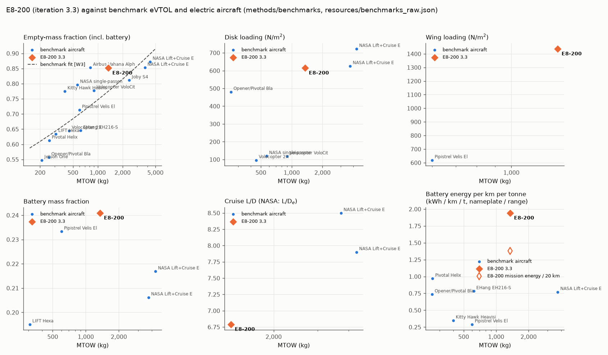

# Final independent checks of the E8-200 iteration 3.3 design (WP V)

Written by `check_final.py`. Do not edit by hand.

Run: 2026-11-19 04:01. Inputs: `design/selected_design.json`, `design/geometry.json`, `bom/BOM.csv`, `cad/mass_properties.json`, `validation/cad/`, `fea/results/*.json`, `cfd/results/iteration33/`, `methods/benchmarks/`.

**Summary: 71 PASS, 19 FLAG, 0 FAIL, 0 pending CAD re-run, 4 information.**

Verdict rules:
- Comparison rows (independent value against the design or WP value): PASS within 5 %, FLAG 5-20 %, FAIL above 20 %.
  Above 20 % the row stays FLAG when the design value is on the conservative side.
- Limit rows (requirement or rating checked with the independent value): PASS when the margin is at least 2 %.
  FLAG when the margin is within +-2 % (inside the accuracy of a hand calculation). FAIL below -2 %.
- PENDING: the row needs a CAD file newer than the cut-off. Provisional values are shown.

Assumptions of the hand checks (independent of WP D's model unless stated):

- `fm_benchmark` = 0.74
- `k_ctrl` = 0.1
- `prop_profile` = 0.9
- `eta_motor` = 0.93
- `eta_inv` = 0.97
- `eta_wire` = 0.98
- `aux_kw` = 1.5
- `v_oc_mid` = 3.6
- `v_oc_low` = 3.45
- `dcir_eol_factor` = 1.5
- `i_cont_cell` = 40.0
- `i_peak_cell` = 60.0
- `f_eol` = 0.8
- `f_res` = 0.2
- `dC` = 0.3
- `clmax_2d` = 1.74
- `k_3d` = 0.9
- `fus_kf_per_deg` = 0.012
- `eta_tail` = 0.9
- `parachute_rating_kg` = 1390.0
- `parachute_shock_kN` = 57.4
- `labour_learning` = 0.85
- Thrust deduction, wake fraction and hover download are the CFD 3.3 values; the EOL resistance factor (1.5) is the same as WP D's.
- Motor ratings: EMRAX 268 MV LC datasheet v1.7 (bom/catalog.json MOT-EMRAX268); MGM REB 90 page: 80 kW peak, 60-70 kW continuous, 300 N m (bom/catalog.json MOT-REB90); continuous torque not published.

## hover

| id | quantity | independent | design / limit | unit | diff / margin | verdict | method / note |
|---|---|---|---|---|---|---|---|
| H1 | disk loading W/(N A) | 614.7 | 614.7 | N/m2 | +0.0 % | PASS | W / (8 pi R^2) |
| H1b | hover download fraction (CFD 3.3 corrected) | 0.020 | 0.020 | - | -0.1 % | PASS | cfd/results/iteration33/summary.json hover.corrected_download_fraction |
| H2 | hover shaft power per motor, 500 m ISA+15 | 38.29 | 39.07 | kW | -2.0 % | PASS | momentum theory, FM 0.74 (NASA L+C benchmark), CFD 3.3 download; design uses FM 0.725 |
| H3 | hover electrical power, 500 m | 348.0 | 355.0 | kW | -2.0 % | PASS | 8 x shaft / (0.93 x 0.97 x 0.98) + 1.5 kW aux |
| H4 | hover electrical power, 1000 m ceiling | 356.7 | 360.5 | kW | -1.1 % | PASS | P ~ rho^-1/2 at constant thrust |
| H5 | hover tip Mach, 500 m ISA+15 | 0.527 | 0.527 | - | +0.0 % | PASS | V_tip / a |
| H6 | hover tip Mach <= 0.55 (noise screen) | 0.527 | <= 0.550 | - | +4.3 % | PASS |  |

## motor rating

| id | quantity | independent | design / limit | unit | diff / margin | verdict | method / note |
|---|---|---|---|---|---|---|---|
| M1 | hover shaft power at 1000 m <= EMRAX 268 LC continuous 91 kW | 39.25 | <= 91.00 | kW | +131.9 % | PASS | EMRAX 268 MV LC datasheet v1.7 (bom/catalog.json MOT-EMRAX268) |
| M2 | hover torque <= EMRAX 268 LC continuous 205 N m | 193.5 | <= 205.0 | N m | +5.9 % | PASS | fixed pitch: Q at the ceiling equals Q at 500 m (1936 rpm at 1000 m); WP P quotes 202 N m (+1.6 %), sizing 0.1 % |
| M3 | OEI power <= EMRAX peak 210 kW | 69.80 | <= 210.0 (design 70.56) | kW | +200.9 % | PASS |  |
| M4 | OEI torque <= EMRAX peak 500 N m | 284.1 | <= 500.0 (design 294.4) | N m | +76.0 % | PASS |  |
| M5 | flare torque <= EMRAX peak 500 N m | 284.1 | <= 500.0 (design 289.9) | N m | +76.0 % | PASS |  |
| M6 | OEI torque above the 205 N m continuous rating (time-limited operation) | 1.386 | - | x cont. | - | FLAG | the datasheet peak rating is for 30 s; a one-motor-out descent and landing from 30 m lasts longer: EMRAX quote item 2 must give the 300 N m time limit |
| M7 | OEI rpm <= flight-controller cap 2,460 rpm | 2,346 | <= 2,460 | rpm | +4.9 % | PASS |  |
| M8 | flare thrust on the worst rotor <= flight-controller thrust cap | 2,474 | <= 2,860 | N | +15.6 % | PASS |  |

## one motor out

| id | quantity | independent | design / limit | unit | diff / margin | verdict | method / note |
|---|---|---|---|---|---|---|---|
| O1 | worst remaining rotor thrust / mean hover thrust (LP) | 1.334 | 1.335 | - | -0.0 % | PASS | WP M linear programme on geometry.json hubs and spins (Fz, roll, pitch, yaw trimmed); worst failed rotor LR_L4 |
| O2 | OEI shaft power, worst rotor, 1000 m, +10 % control | 69.80 | 70.56 | kW | -1.1 % | PASS | fixed pitch: T ~ rho n^2, Q ~ T, P = Q x Omega |
| O3 | OEI torque, worst rotor, 1000 m, +10 % control | 284.1 | 294.4 | N m | -3.5 % | PASS | Q = Q_hover x T/T_hover |
| O4 | flare 1.10 g one motor out, shaft power, 500 m | 68.10 | 69.48 | kW | -2.0 % | PASS | as O2 at 500 m |
| O5 | flare 1.10 g one motor out, torque, 500 m | 284.1 | 289.9 | N m | -2.0 % | PASS | as O3 |

## cruise

| id | quantity | independent | design / limit | unit | diff / margin | verdict | method / note |
|---|---|---|---|---|---|---|---|
| A1 | cruise drag at 167 km/h (CFD 3.3 polar interpolated at the cruise CL, + pods) | 1,918 | 1,946 | N | -1.5 % | PASS | cfd/results/iteration33/cruise.json points, linear in CL; the design uses the parabolic fit CD0 0.0764 / e 0.658 |
| A2 | cruise L/D | 6.891 | 6.791 | - | +1.5 % | PASS | W / D |
| A3 | CD0 incl. pods: CFD fit vs design | 0.076 | 0.076 | - | -0.1 % | PASS | cfd/results/iteration33/summary.json |
| A4 | Oswald e: CFD fit vs design | 0.658 | 0.658 | - | +0.0 % | PASS | cfd/results/iteration33/summary.json |
| A5 | cruise CL | 1.204 | - | - | - | PASS | 74% of the design CLmax; inside the CFD polar (2-16 deg) |
| A6 | CFD run speed vs frozen cruise speed | 172.0 | - | km/h | - | INFO | the 3.3 CFD was run at 172 km/h (CL 1.137); the frozen cruise is 167 km/h (CL 1.20), inside the computed polar |

## pusher

| id | quantity | independent | design / limit | unit | diff / margin | verdict | method / note |
|---|---|---|---|---|---|---|---|
| P1 | propeller efficiency at the wake inflow | 0.829 | 0.828 | - | +0.1 % | PASS | actuator disc x 0.90, V_a = V (1 - w) |
| P2 | cruise electrical power | 119.7 | 121.6 | kW | -1.5 % | PASS | T = D/(1-t)/2, P = T V_a / eta / eta_drive + aux; t 0.019, w 0.045 from CFD 3.3 |
| P3 | pusher shaft power x 1.10 <= REB 90 continuous 60 kW (t and w credited once) | 57.48 | <= 60.00 | kW | +4.4 % | PASS | sizing +2.7 %; the CFD table's -1.8 % applied the drag ratio to a figure that already carried the old 4.5 % deduction |
| P3b | pusher continuous margin without the wake credit (free-stream inflow, sensitivity) | 0.293 | - | % | - | INFO | shaft 54.4 kW per pusher |
| P4 | pusher cruise torque <= REB 90 peak 300 N m | 240.7 | <= 300.0 | N m | +24.7 % | PASS | at 2074 rpm; continuous torque at this speed not published (MGM quote item 1) |
| P5 | climb rate at cruise speed, pusher peak (torque-limited) | 1.660 | 1.552 | m/s | +7.0 % | FLAG | (P_peak eta (1-t)/(1-w) - D V) / W, cruise efficiency |
| P6 | climb rate >= 1.0 m/s | 1.660 | >= 1.000 | m/s | +66.0 % | PASS |  |
| P7 | pusher helical tip Mach <= 0.70 | 0.563 | <= 0.700 | - | +24.3 % | PASS |  |

## battery

| id | quantity | independent | design / limit | unit | diff / margin | verdict | method / note |
|---|---|---|---|---|---|---|---|
| B1 | nominal energy (cells x Wh) | 63.00 | 63.00 | kWh | +0.0 % | PASS | 175 x 20 x 18 Wh |
| B2 | pack specific energy | 194.0 | - | Wh/kg | - | PASS | Pipistrel Velis pack about 177 Wh/kg on 253 Wh/kg cells (EQUATIONS.md) |
| B3 | battery efficiency in hover (exact I-R, mid SOC, EOL resistance) | 0.820 | 0.816 | - | +0.6 % | PASS | V_terminal / V_oc with I from P = I (V_oc - I R); design: exact sag, landing hover at the low-SOC 3.45 V |
| B4 | hover C-rate at the ceiling (EOL capacity) | 8.686 | 8.808 | 1/h | -1.4 % | PASS | P_cells / E_EOL |
| B5 | hover C-rate <= 40 A continuous / EOL Ah - 0.3 C | 8.686 | <= 9.700 | 1/h | +11.7 % | PASS | requirement '0.3 C margin' |
| B6 | hover cell current, all packs, ceiling, low SOC, EOL | 37.26 | <= 60.00 | A | +61.0 % | PASS |  |
| B7 | one pack out: cell current <= 60 A (hover 500 m, aux shed, low SOC, EOL) | 55.24 | <= 60.00 (design 59.70) | A | +8.6 % | PASS | design 59.7 A is the more conservative figure (its hover power is 2 % higher: FM 0.725 vs 0.74) |
| B8 | one pack out: bus voltage >= 400 V | 418.1 | >= 400.0 (design 403.0) | V | +4.5 % | PASS |  |
| B9 | one pack out at the 1000 m ceiling (sensitivity) | 57.82 | - | A | - | INFO | bus 409 V |
| B10 | battery mass fraction (B4 benchmark band of verify_sizing widened by +-0.02) | 0.241 | - | - | - | FLAG | set by hover power and one-pack-out current, not by cruise energy |

## range

| id | quantity | independent | design / limit | unit | diff / margin | verdict | method / note |
|---|---|---|---|---|---|---|---|
| R1 | mission energy at the cells, 20 km | 36.31 | 37.19 | kWh | -2.4 % | PASS | hover 120 s + vertical climb + 2 x 30 s transitions (mean power) + climb to 500 m + cruise |
| R2 | range capability (EOL 80 %, 20 % reserve), CFD drag, t and w | 25.29 | 24.07 | km | +5.1 % | FLAG | (E_usable - E_fixed) / P_cruise x V |
| R3 | range >= 20 km | 25.29 | >= 20.00 | km | +26.5 % | PASS |  |
| R4 | range at the unfavourable end of the CFD bands | 20.86 | 18.96 | km | +10.1 % | FLAG | hand method with CD0 +23 %, e -8 %, download +30 % (CFD 19.0 km was at 172 km/h without t and w) |
| R5 | range at the unfavourable band end against 20 km | 20.86 | - | km | - | PASS | documented risk (not a requirement case) |

## stall

| id | quantity | independent | design / limit | unit | diff / margin | verdict | method / note |
|---|---|---|---|---|---|---|---|
| S1 | clean CLmax: 0.9 x section clmax vs design | 1.566 | 1.628 | - | -3.8 % | PASS | Raymer 12.4.4 with the validated LS(1)-0417 clmax 1.74; CFD aircraft 1.714 (not bracketed); design = CFD - 5 % |
| S2 | stall speed EAS, MTOW, design CLmax | 37.96 | 37.96 | m/s | -0.0 % | PASS | sqrt(2W / (rho0 S CLmax)) |
| S3 | cruise >= 1.15 Vs with the design CLmax 1.628 | 1.163 | >= 1.150 | - | +1.1 % | FLAG |  |
| S3b | cruise >= 1.15 Vs with the handbook CLmax | 1.140 | >= 1.150 | - | -0.8 % | FLAG | the aircraft CFD (1.714) gives 1.19; the handbook value omits fuselage and tail lift |
| S4 | cruise speed >= 120 km/h | 167.0 | >= 120.0 | km/h | +39.2 % | PASS |  |

## stability

| id | quantity | independent | design / limit | unit | diff / margin | verdict | method / note |
|---|---|---|---|---|---|---|---|
| SM1 | neutral point x (wing + tail + fuselage build-up) | 2.678 | 2.674 | m | +0.1 % | PASS | Helmbold lift slopes, downwash 2a/(pi AR), Raymer fuselage K_f; CFD 2.786 m |
| SM2 | static margin at MTOW (hand) vs sizing | 0.101 | 0.098 | MAC | +3.0 % | PASS | (x_np - x_cg) / c |
| SM3 | static margin: CFD vs sizing | 0.195 | 0.098 | MAC | +98.7 % | FLAG | cfd/results/iteration33/summary.json (slope dCm/dCL; the Cm level is mesh-sensitive, GCI 475 %) |
| SM4 | static margin with the CAD CG >= 0.05 | 0.086 | >= 0.050 | MAC | +71.8 % | PASS | validation/cad/mass_cg_audit.json |
| SM5-1 | static margin, pilot + passenger (MTOW) | 0.098 | >= 0.050 | MAC | +96.2 % | PASS |  |
| SM5-2 | static margin, pilot + cargo (MTOW) | 0.095 | >= 0.050 | MAC | +89.0 % | PASS |  |
| SM5-3 | static margin, pilot only | 0.062 | >= 0.050 | MAC | +25.0 % | PASS |  |

## footprint

| id | quantity | independent | design / limit | unit | diff / margin | verdict | method / note |
|---|---|---|---|---|---|---|---|
| F1 | overall length (rotor discs to pusher spinners) | 9.875 | <= 10.50 | m | +6.3 % | PASS | original requirement 9.0 m |
| F2 | overall width | 8.000 | <= 10.50 | m | +31.2 % | PASS |  |

## mass

| id | quantity | independent | design / limit | unit | diff / margin | verdict | method / note |
|---|---|---|---|---|---|---|---|
| W1 | empty mass = sum of the breakdown | 823.1 | 823.1 | kg | +0.0 % | PASS | sum |
| W2 | MTOW = empty + battery + payload | 1,348 | 1,348 | kg | +0.0 % | PASS | sum |
| W2b | geometry.json mass items = MTOW | 1,348 | 1,348 | kg | -0.0 % | PASS | sum of mass_items |

## mass vs CAD

| id | quantity | independent | design / limit | unit | diff / margin | verdict | method / note |
|---|---|---|---|---|---|---|---|
| W3 | MTOW, CAD (incl. the design growth allowance) | 1,330 | 1,348 | kg | -1.3 % | PASS | cad/mass_properties.json + growth |
| W4 | empty mass excl. battery, CAD (incl. growth) | 813.3 | 823.1 | kg | -1.2 % | PASS | CAD |
| W5 | battery, CAD | 316.7 | 324.7 | kg | -2.5 % | PASS | CAD |
| W6-wing | group wing, CAD | 63.95 | 74.68 | kg | -14.4 % | FLAG | CAD |
| W6-booms | group booms, CAD | 84.23 | 72.17 | kg | +16.7 % | FLAG | CAD |
| W6-fuselage | group fuselage, CAD | 75.88 | 87.33 | kg | -13.1 % | FLAG | CAD |
| W6-tail | group tail, CAD | 13.22 | 12.85 | kg | +2.9 % | PASS | CAD |
| W6-landing_gear | group landing_gear, CAD | 37.05 | 48.45 | kg | -23.5 % | FLAG | CAD |
| W6-rotor_pylons_mounts | group rotor_pylons_mounts, CAD | 55.09 | 48.84 | kg | +12.8 % | FLAG | CAD |
| W6-lift_motors | group lift_motors, CAD | 175.2 | 175.2 | kg | +0.0 % | PASS | CAD |
| W6-pusher_motor | group pusher_motor, CAD | 56.92 | 57.92 | kg | -1.7 % | PASS | CAD |
| W6-parachute | group parachute, CAD | 38.80 | 36.77 | kg | +5.5 % | FLAG | CAD |
| W7 | CG x at MTOW, CAD (growth at the design point) | 2.576 | 2.561 | m | +0.6 % | PASS | CAD |
| W8 | CAD MTOW incl. growth <= parachute rating 1,390 kg | 1,330 | <= 1,390 | kg | +4.5 % | PASS |  |

## structure

| id | quantity | independent | design / limit | unit | diff / margin | verdict | method / note |
|---|---|---|---|---|---|---|---|
| ST1 | wing ultimate bending at the root fitting, +3.8 g x 1.5 (Schrenk) | 37.48 | 39.63 | kN m | -5.4 % | FLAG | Schrenk lift minus the inertia of the boom groups and the outer wing; FEA fea/results/airframe_final33.json, case F A, main + rear spar |
| ST2 | main-spar cap stress, ultimate, case F A | 381.6 | 415.0 | MPa | -8.0 % | FLAG | M c / I of the four spar caps at the root fitting (sizing_update.json) |
| ST3 | main-spar cap compression <= UD design allowable | 381.6 | <= 460.0 | MPa | +20.6 % | PASS |  |
| ST4 | boom ultimate bending, all rotors at 4267 N (R2) | 22.68 | 22.60 | kN m | +0.4 % | PASS | overhang moment at the wing saddle, inertia relief, x 1.5 |
| ST5 | boom UD over-wrap stress, R2, at the saddle | 268.4 | 224.7 | MPa | +19.5 % | FLAG | E-weighted composite tube, M r E / sum(E I); FEA uses a homogeneous section checked against the twill allowable (248 MPa); layer by layer the UD is at 268 of 460 MPa and the twill at 125 of 248 MPa, so the FEA margin is conservative |
| ST6 | lowest FEA strength margin >= 0 | 1.094 | >= 1.000 | 1+MS | +9.4 % | PASS | member: boom_L MS +0.094 (fea/results/margins.json; margins are at ultimate, so MS > 0 passes) |
| ST7 | frequency placement (boom/rotor and pusher 1P/2P) | -1.000 | - | MS flag | - | FLAG | pusher 1P 34.6 Hz is 3-9 % below boom/tail modes 35.5-37.6 Hz: GVT and notch filtering |

## parachute

| id | quantity | independent | design / limit | unit | diff / margin | verdict | method / note |
|---|---|---|---|---|---|---|---|
| CH1 | MTOW <= GRS 6 1200-1390 rating | 1,348 | <= 1,390 | kg | +3.1 % | PASS |  |
| CH2 | opening load factor at MTOW (57.4 kN vendor) vs geometry.json n_open_limit | 4.343 | 3.690 | g | +17.7 % | FLAG | F / W; geometry.json keeps the GRS 990-1190 value (48.8 kN); FEA used 57.4 kN directly (fea/README.md phase 3.3B) |
| CH3 | cruise speed <= parachute VNE 260 km/h (1,390 kg variant) | 167.0 | <= 260.0 | km/h | +55.7 % | PASS |  |

## cost

| id | quantity | independent | design / limit | unit | diff / margin | verdict | method / note |
|---|---|---|---|---|---|---|---|
| K1 | prototype cash, BOM.csv roll-up | 388,912 | 381,046 | USD | +2.1 % | PASS | sum of BOM.csv total_usd |
| K2 | cumulative-average learning factor, N = 10, 85 % | 0.712 | 0.712 | - | -0.1 % | PASS | (1/N) sum n^log2(0.85) |
| K3 | cost per aircraft at N = 10 from the BOM | 502,698 | 497,538 | USD | +1.0 % | PASS | BOM - tooling + tooling/N + hours x rate x learning |
| K4 | share of the BOM on estimates / quote-required prices | 67.52 | - | % | - | INFO | manufacturing/QUOTES_TO_REQUEST.md |

## WP M checker on the 3.3 design (run in memory, no files written)

`methods/check_design.py` Checker: {'PASS': 39, 'WARN': 13, 'FAIL': 7, 'INFO': 0, 'MISSING': 0}.

| status | quantity | M | D | diff |
|---|---|---|---|---|
| WARN | Oswald efficiency | 0.840 | 0.658 | +27.7 % |
| WARN | zero-lift drag area D/q | 0.536 | 0.703 | -23.8 % |
| WARN | cruise drag | 1,506 | 1,946 | -22.6 % |
| WARN | cruise L/D | 8.776 | 6.791 | +29.2 % |
| WARN | cruise electrical power | 99.62 | 121.6 | -18.1 % |
| FAIL | cruise speed >= 1.3 x stall (TAS at cruise altitude) | 1.163 | - | - |
| WARN | mission energy (design range, at battery terminals / eta_batt) | 31.64 | 37.19 | -14.9 % |
| FAIL | range to 20 % reserve at EOL capacity | 33.82 | 24.07 | +40.5 % |
| WARN | hover C-rate at EOL capacity (ceiling) | 7.529 | 8.808 | -14.5 % |
| WARN | inverters + HV harness (vs NASA 0.63 x motor accessory factor) | 49.35 | 70.02 | -29.5 % |
| WARN | fuselage mass | 53.92 | 87.33 | -38.3 % |
| WARN | parachute mass | 26.72 | 36.77 | -27.3 % |
| WARN | tail (H + V) mass | 7.333 | 12.85 | -42.9 % |
| FAIL | pusher motor mass | 28.47 | 57.92 | -50.8 % |
| FAIL | pusher propeller mass | 1.847 | 6.831 | -73.0 % |
| FAIL | seats mass | 48.96 | 25.17 | +94.5 % |
| WARN | avionics mass | 10.68 | 17.09 | -37.5 % |
| FAIL | wing mass, NDARC AFDD93 cross-check | 116.2 | 74.68 | +55.6 % |
| FAIL | empty mass excluding battery | 602.0 | 823.1 | -26.9 % |
| WARN | MTOW recomputed (M empty + D battery + payload) | 1,127 | 1,348 | -16.4 % |

## Benchmark comparison

| aircraft | MTOW kg | empty fraction | disk loading N/m2 | wing loading N/m2 | battery fraction | L/D | kWh/km | kWh/km/t |
|---|---|---|---|---|---|---|---|---|
| **E8-200 3.3** | 1,348 | 0.852 | 614.7 | 1,437 | 0.241 | 6.791 | 2.618 | 1.942 |
| Wisk Cora (Gen 5) | - | - | - | - | - | - | - | - |
| CityAirbus NextGen | - | - | - | - | - | - | - | - |
| Vertical VX4 | - | - | - | - | - | - | - | - |
| Jetson One | 210.0 | 0.548 | - | - | - | - | - | - |
| Opener/Pivotal BlackFly | 255.0 | 0.557 | 480.6 | - | - | - | 0.188 | 0.735 |
| Pivotal Helix | 258.0 | 0.612 | - | - | - | - | 0.250 | 0.969 |
| LIFT Hexa | 309.0 | 0.634 | - | - | 0.195 | - | - | - |
| Kitty Hawk Heaviside 2 Block 2 | 400.0 | 0.775 | - | - | - | - | 0.140 | 0.349 |
| Volocopter 2X | 450.0 | 0.644 | 96.34 | - | - | - | - | - |
| NASA single-passenger electric quadrotor | 567.9 | 0.796 | 119.8 | - | - | - | - | - |
| Pipistrel Velis Electro | 600.0 | 0.713 | - | 618.7 | 0.233 | - | 0.175 | 0.291 |
| EHang EH216-S | 620.0 | 0.645 | - | - | - | - | 0.486 | 0.783 |
| Airbus Vahana Alpha | 815.0 | 0.853 | - | - | - | - | - | - |
| Volocopter VoloCity | 900.0 | 0.778 | 118.0 | - | - | - | - | - |
| Joby S4 | 2,404 | 0.811 | - | - | - | - | - | - |
| Beta Alia A250 | 2,720 | - | - | - | - | - | - | - |
| Archer Midnight | 2,948 | - | - | - | - | - | - | - |
| Lilium Jet (7-seater) | 3,175 | - | - | - | - | - | - | - |
| NASA Lift+Cruise E (2018) | 3,724 | 0.853 | 625.6 | - | 0.206 | 8.500 | 2.871 | 0.771 |
| NASA Lift+Cruise E (2022) | 4,301 | 0.873 | 722.6 | - | 0.217 | 7.900 | - | - |

E8-200 empty fraction 0.852 against the benchmark fit 0.775 at its MTOW (+10 %). Energy per km uses the nameplate energy over the range capability; on the mission energy over 20 km it is 1.86 kWh/km (1.38 per tonne).

